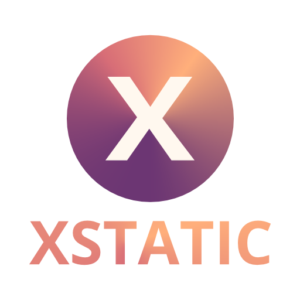

<p align="center">
  
</p>

<h1 align="center">xStatic for Umbraco</h1>

<p align="center">
  Publish your Umbraco site as a fast, secure static website. Editors keep the backoffice they know.
</p>

<p align="center">
  <a href="https://mulliman.github.io/xStatic-for-Umbraco/"><strong>Read the documentation</strong></a>
  ·
  <a href="https://mulliman.github.io/xStatic-for-Umbraco/Installation.html">Installation</a>
  ·
  <a href="https://mulliman.github.io/xStatic-for-Umbraco/Your-First-Static-Site.html">Your first static site</a>
  ·
  <a href="https://www.nuget.org/packages/xstatic/">NuGet</a>
</p>

<p align="center">
  <a href="https://www.nuget.org/packages/xstatic/"></a>
  <a href="https://umbraco.com"></a>
  <a href="https://scorecard.dev/viewer/?uri=github.com/Mulliman/xStatic-for-Umbraco"></a>
  <a href="https://github.com/Mulliman/xStatic-for-Umbraco/actions/workflows/codeql.yml"></a>
</p>

---

xStatic is a static site generator that runs inside Umbraco. Your content stays in Umbraco and your editors keep
working in the backoffice. When they're ready, xStatic renders every published page, copies the media and assets the
pages use, and deploys the result to the host of your choice. The live site is plain files: no database, no server
code and no login page for anyone to attack, and it can be served from a CDN for little or nothing.

## How it works

xStatic runs each site through the same pipeline. Generating and deploying are separate steps, so you can check the
output before it goes live.

| Step | What happens | Read more |
|------|--------------|-----------|
| **Generate** | Fetches every published page under the site's root node from your running Umbraco site, with the media and asset files it needs | [Generating and deploying](https://mulliman.github.io/xStatic-for-Umbraco/Generating-and-Deploying.html) |
| **Transform** | Runs each page through a list of transformers, for example to rewrite hostnames or point images at pre-made crops | [Export types](https://mulliman.github.io/xStatic-for-Umbraco/Export-Types.html) |
| **Store** | Writes the output to a staging folder, one per site | [Architecture](https://mulliman.github.io/xStatic-for-Umbraco/Architecture.html) |
| **Deploy** | Sends the staging folder to a deployment target | [Deployment targets](https://mulliman.github.io/xStatic-for-Umbraco/Deployment-Targets.html) |
| **Post-generation actions** | Optional extra steps, such as creating a `404.html` page | [Post-generation actions](https://mulliman.github.io/xStatic-for-Umbraco/Post-Generation-Actions.html) |

## Capabilities

- **Deploy anywhere static files are served.** Built-in deployers for
  [Netlify](https://mulliman.github.io/xStatic-for-Umbraco/Deploying-to-Netlify.html),
  [Git](https://mulliman.github.io/xStatic-for-Umbraco/Deploying-with-Git.html) (GitHub Pages and similar),
  [FTP](https://mulliman.github.io/xStatic-for-Umbraco/Deploying-to-FTP.html),
  [Cloudflare Pages and R2](https://mulliman.github.io/xStatic-for-Umbraco/Deploying-to-Cloudflare.html) and
  [a folder](https://mulliman.github.io/xStatic-for-Umbraco/Deploying-to-a-Folder.html).
- **Image crops without an image server.** Resized images are generated ahead of time and the page markup is
  updated to match. See [Image crops](https://mulliman.github.io/xStatic-for-Umbraco/Image-Crops.html).
- **Multi-language sites.** Every configured culture is generated. See
  [Multi-language sites](https://mulliman.github.io/xStatic-for-Umbraco/Multi-Language-Sites.html).
- **JSON export.** Publish content as static JSON for a headless front end. See
  [JSON export](https://mulliman.github.io/xStatic-for-Umbraco/JSON-Export.html).
- **Automation.** Rebuild when content is published with
  [Auto publish](https://mulliman.github.io/xStatic-for-Umbraco/Auto-Publish.html), or trigger runs from a scheduler
  or CI pipeline with [Remote operations](https://mulliman.github.io/xStatic-for-Umbraco/Remote-Operations.html).
- **Static failover.** Keep a read-only copy of your site online while Umbraco is down. See
  [Static failover site](https://mulliman.github.io/xStatic-for-Umbraco/Static-Failover-Site.html).
- **Extensible.** Write your own generators, transformers, deployers and actions against the public API. See
  [Extending xStatic](https://mulliman.github.io/xStatic-for-Umbraco/Extending-xStatic.html).
- **Role-based access.** xStatic sets up Umbraco user groups for administrators and editors. See
  [User groups and security](https://mulliman.github.io/xStatic-for-Umbraco/User-Groups-and-Security.html).

## Getting started

Install the package into your Umbraco site and restart it:

```bash
dotnet add package xStatic
```

An **xStatic** section appears in the backoffice. Add a deployer package (for example `xStatic.Netlify`) if you need
one, then follow [Your first static site](https://mulliman.github.io/xStatic-for-Umbraco/Your-First-Static-Site.html)
to create, generate and deploy a site.

Use the xStatic major version that matches your Umbraco major version:

| xStatic | Umbraco | Status |
|---------|---------|--------|
| 18.x | 18 | Latest |
| 17.x | 17 (LTS) | Long-term support |
| 13.x | 13 (LTS) | Long-term support |

[Upgrading](https://mulliman.github.io/xStatic-for-Umbraco/Upgrading.html) covers moving between versions.

## Documentation

The full documentation is at **[mulliman.github.io/xStatic-for-Umbraco](https://mulliman.github.io/xStatic-for-Umbraco/)**.
It covers installation, every backoffice screen, each deployer, configuration, troubleshooting and the extension API.
It is also available as the [GitHub wiki](https://github.com/Mulliman/xStatic-for-Umbraco/wiki).

Both are built from the [`Wiki/`](Wiki) folder of this repository, so corrections are welcome as pull requests.

### Working with AI tools

- [xStatic MCP server](Source/xstatic-mcp/README.md) lets AI assistants generate and deploy sites through xStatic.
- [xStatic agent skill](.agents/skills/xstatic-umbraco/SKILL.md) gives coding agents the context to build xStatic
  extensions.

## Contributing

Contributions are welcome. [CONTRIBUTING.md](CONTRIBUTING.md) explains how to set up test instances and run the
tests, and [Developing xStatic](https://mulliman.github.io/xStatic-for-Umbraco/Developing-xStatic.html) describes the
codebase. Coding agents should start with [AGENTS.md](AGENTS.md).

## Security

Please don't report security problems in a public issue. Use
[Report a vulnerability](https://github.com/Mulliman/xStatic-for-Umbraco/security/advisories/new) instead.
[SECURITY.md](SECURITY.md) lists the supported versions and what happens after you report.

## License

xStatic is open source under the [MIT licence](LICENSE).
