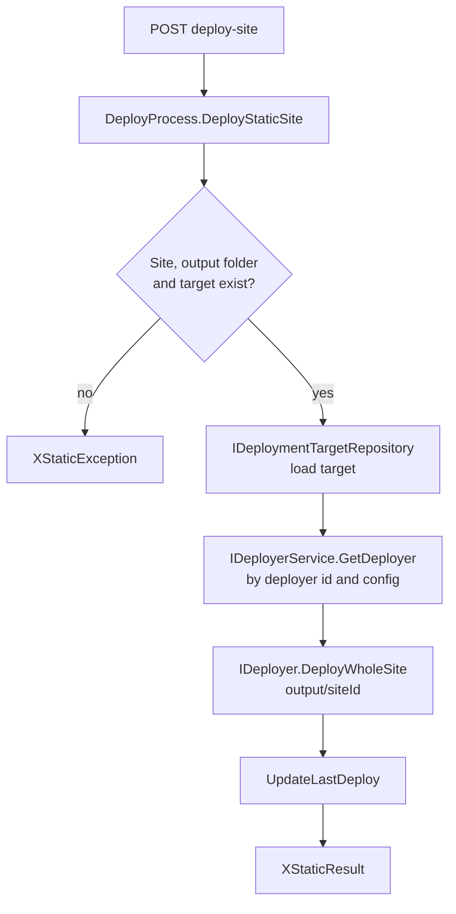
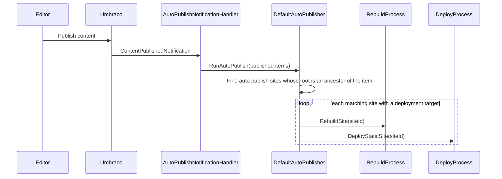
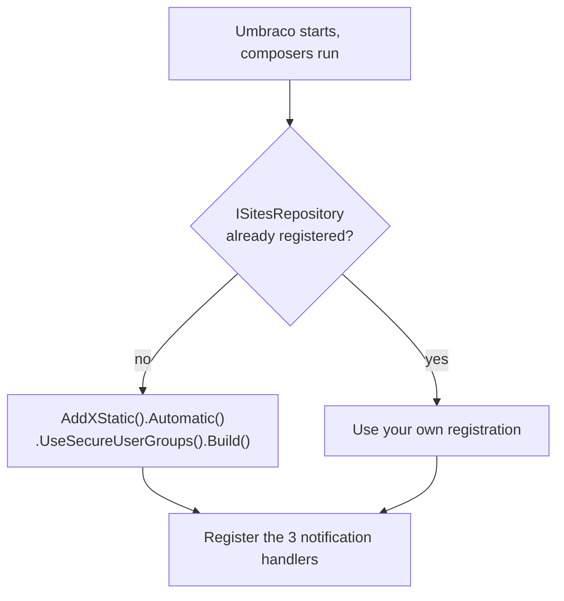

How xStatic works inside: the generate pipeline, the deploy step, how plugins are found, how everything is registered, and where data lives. Read this first if you want to extend xStatic or work out why a run behaved the way it did. If you only want to use xStatic, start at [What is xStatic?](What-is-xStatic.md). Unfamiliar terms are in the [Glossary](Glossary.md).

## At a glance

| Question | Answer |
|----------|--------|
| What runs a generate? | `RebuildProcess`, in [RebuildProcess.cs](../Source/XStaticCore/XStatic.Core/Generator/Processes/RebuildProcess.cs) |
| What runs a deploy? | `DeployProcess`, in [DeployProcess.cs](../Source/XStaticCore/XStatic.Core/Deploy/Processes/DeployProcess.cs) |
| Are generate and deploy one step? | No. They are separate. Only [auto publish](Auto-Publish.md) chains them |
| Is the generate parallel? | No. Pages, media and assets are processed one at a time, in order |
| Where is the output? | `umbraco/Data/xStatic/output/<siteId>` under the site's content root |
| Where are settings stored? | Four tables in Umbraco's database, plus a legacy one from xStatic 13 (see [Where data lives](#where-data-lives)) |
| How are plugins found? | By scanning loaded assemblies for implementations of the extension interfaces |
| How do I turn off the default setup? | Register xStatic yourself before the composer runs (see [Extending-xStatic.md](Extending-xStatic.md#opting-out-of-the-default-setup)) |

## The big picture

An editor clicks **Generate** on a site. xStatic turns that site's settings into a list of work (a "job"), runs the job through a generator, stores the files in a staging folder, then runs any post-generation actions. **Deploy** is a separate click that sends that staging folder to a deployment target.

```mermaid
flowchart LR
    A[Site settings<br/>XStaticSiteConfigs14Plus] --> B[RebuildProcess]
    B --> C[JobBuilder builds a Job]
    C --> D[JobRunner runs the Job]
    D --> E[IGenerator<br/>pages, media, assets]
    E --> F[ITransformer list<br/>per page]
    F --> G[IFileNameGenerator<br/>picks the file path]
    G --> H[IStaticSiteStorer<br/>writes to staging folder]
    H --> I[Post-generation actions]
    I --> J[(output/siteId)]
    J --> K[DeployProcess]
    K --> L[IDeployer<br/>Netlify, Git, FTP, folder]
```



## Projects and packages

All .NET code is under `Source/XStaticCore/`. The solution is `XStaticCore.sln`.

| Project | NuGet package | What it is |
|---------|---------------|------------|
| [XStatic.Core](../Source/XStaticCore/XStatic.Core) | `xStatic.Core` | The engine and the public extension API: generators, transformers, storers, deployers, actions, repositories and the DI builders in `App/` |
| [XStatic](../Source/XStaticCore/XStatic) | `xStatic` | The Umbraco integration: `XStaticComposer`, the Management API controllers, database migrations and user-group setup |
| [XStatic14.Client](../Source/XStaticCore/XStatic14/XStatic14.Client) | `xStatic.Client` | The backoffice UI (Lit web components, built with Vite) |
| [XStatic.Netlify](../Source/XStaticCore/XStatic.Netlify) | `xStatic.Netlify` | Netlify deployer, site creator and the 404 action |
| [XStatic.Git](../Source/XStaticCore/XStatic.Git) | `xStatic.Git` | Git deployer |
| [XStatic.Ftp](../Source/XStaticCore/XStatic.Ftp) | `xStatic.Ftp` | FTP deployer |
| [XStatic.RemoteOperations](../Source/XStaticCore/XStatic.RemoteOperations) | `xStatic.RemoteOperations` | Client library for triggering xStatic from another application |

If you write a plugin, reference only `xStatic.Core`. Everything public in it is the extension API (see [Extending-xStatic.md](Extending-xStatic.md#api-stability)).

## The generate pipeline

Two things start a generate:

- The backoffice **Generate** button, which calls `POST api/v1/xstatic/generate/generate-site?staticSiteId=N` ([GenerateController.cs](../Source/XStaticCore/XStatic/Controllers/GenerateController.cs)). See [Management-API.md](Management-API.md).
- [Auto publish](Auto-Publish.md), which calls `RebuildSite` itself.

`RebuildProcess` is not registered in the DI container. Both callers create it with `new`, passing in services they already have. If you need to start a generate from your own code, do the same:

```csharp
using Microsoft.AspNetCore.Hosting;
using Microsoft.Extensions.Logging;
using Microsoft.Extensions.Options;
using System.Threading.Tasks;
using Umbraco.Cms.Core.Services;
using Umbraco.Cms.Core.Web;
using XStatic.Core.Actions;
using XStatic.Core.App;
using XStatic.Core.Generator.ExportTypes;
using XStatic.Core.Generator.Processes;
using XStatic.Core.Repositories;

public class SiteBuilder(
    IUmbracoContextFactory umbracoContextFactory,
    IExportTypeService exportTypeService,
    ISitesRepository sitesRepository,
    IWebHostEnvironment webHostEnvironment,
    IActionFactory actionFactory,
    IOptions<XStaticGlobalSettings> globalSettings,
    ILogger<SiteBuilder> logger,
    IEntityService entityService)
{
    public Task<RebuildProcessResult> BuildAsync(int siteId)
    {
        var process = new RebuildProcess(umbracoContextFactory, exportTypeService, sitesRepository,
            webHostEnvironment, actionFactory, globalSettings, logger, entityService);

        return process.RebuildSite(siteId);
    }
}
```

### Step by step

`RebuildProcess.RebuildSite(int staticSiteId)` does this, in order:

1. **Loads the site** from `ISitesRepository`. An unknown id throws an `XStaticException` ("Site not found with id ..."). This is the one failure that is thrown rather than returned.
2. **Opens an Umbraco context** and resolves the components of the site's [export type](Export-Types.md) as it needs them: the file name generator first, then the transformer list factory (step 4), then the generator (step 5).
3. **Finds the root content node** by the site's root node key.
4. **Builds a job** with `JobBuilder` (see [Jobs](#jobs-jobbuilder-job-and-jobrunner)):
    - the root node and all its published descendants, minus any document types in `XStatic:ExcludeGeneratingDocTypes`
    - each configured culture
    - the media root nodes you picked, with all their descendants
    - the image crops
    - the [asset paths](Asset-Paths.md), via `AssetPathResolver`
    - the transformers built by the export type's transformer list factory
5. **Runs the job** with `JobRunner`, which asks the generator to produce each item.
6. **Adds asset path errors** to the results (paths that could not be found).
7. **Runs the post-generation actions** the site has selected, one after the other.
8. **Records the run**: stores the time and duration (`UpdateLastRun`) and returns a `RebuildProcessResult`.

If anything throws after step 1, `RebuildSite` catches it, logs it, and returns a failed `RebuildProcessResult` with the exception message and stack trace. `LastRun` is not updated in that case.

A run where individual pages fail is not an exception. It completes, updates `LastRun`, runs the post-generation actions, and returns `WasSuccessful = false` with the failed items listed under `Warnings`.

An empty run counts as a success. If the root node can't be found, no pages are generated (media, assets and actions still run) and `WasSuccessful` is still `true`.

### Jobs: JobBuilder, Job and JobRunner

A [`Job`](../Source/XStaticCore/XStatic.Core/Generator/Jobs/Job.cs) is a plain description of the work:

| Property | Type | Meaning |
|----------|------|---------|
| `StaticSiteId` | `int` | Which site the output belongs to |
| `NameGenerator` | `IFileNameGenerator` | Names the page files |
| `Transformers` | `List<ITransformer>` | Run on each page, in list order |
| `PageIds` | `List<int>` | Content ids to generate |
| `Cultures` | `List<string>` | Cultures to generate each page in |
| `MediaIds` | `List<int>` | Media ids to copy |
| `MediaCropSizes` | `List<Crop>` | Crops to download for each croppable image |
| `Folders` | `Dictionary<string, string>` | Asset folders: absolute path to output-relative path |
| `Files` | `Dictionary<string, string>` | Asset files: absolute path to output-relative path |

[`JobBuilder`](../Source/XStaticCore/XStatic.Core/Generator/Jobs/JobBuilder.cs) fills one in. It is created with `new JobBuilder(staticSiteId, nameGenerator)` and every method returns the builder, so calls chain:

| Method | Does |
|--------|------|
| `AddTransformer(ITransformer)`, `AddTransformers(IEnumerable<ITransformer>)` | Adds transformers |
| `AddCulture(string)` | Adds a culture. Null or empty values are ignored |
| `AddPage(IPublishedContent)` | Adds one page |
| `AddPageWithDescendants(IPublishedContent)` | Adds a page and all its descendants |
| `AddPageWithDescendantsWithoutTypes(IPublishedContent, IEnumerable<string>)` | Same, but leaves out descendants whose document type alias is listed |
| `AddMedia(IPublishedContent)`, `AddMediaWithDescendants(IPublishedContent)` | Adds media |
| `AddMediaCrops(IEnumerable<Crop>)` | Adds crops |
| `AddAssetFolder(string absolutePath, string relativePath)` | Adds an asset folder |
| `AddAssetFile(string absolutePath, string relativePath)`, `AddAssetFiles(Dictionary<string, string>)` | Adds asset files |
| `Build()` | Returns the `Job` |

Two details to know about:

- `AddPageWithDescendantsWithoutTypes` filters individual descendants. It does not prune subtrees, so the children of an excluded page are still generated. The root node is never excluded.
- `AddAssetFolder` and `AddAssetFile` use `Dictionary.Add`, so adding the same absolute path twice throws. `AssetPathResolver` catches this and reports it against that path.

[`JobRunner`](../Source/XStaticCore/XStatic.Core/Generator/Jobs/JobRunner.cs) walks the job and calls the `IGenerator`. It runs everything **sequentially**, with no parallelism, in this order:

1. Each page id. If the job has cultures, the page is generated once per culture, so the same id appears several times. Without cultures it is generated once.
2. Each media id.
3. Each asset folder.
4. Each asset file.

The generator returns `null` for items it skips on purpose (a missing node, a page with no template, media with no file). `JobRunner` removes those, so they never appear in the results.

The final order of `RebuildProcessResult.Results` is: pages (per culture), media, asset folder files, asset files, asset path errors, post-generation actions.

### Generators and what they do per item

The generator does the real work for each item. See [Writing-a-Generator.md](Writing-a-Generator.md) for the full detail.

| Item | What happens |
|------|--------------|
| Page (HTML) | `StaticHtmlSiteGenerator` downloads the page over HTTP from the running site, runs the transformers, names the file, stores it |
| Page (JSON) | `BasicJsonApiGenerator` builds JSON from the published content (no HTTP), runs the transformers, names the file, stores it |
| Media | Reads the original from Umbraco's media file system (not over HTTP), stores it at the same `/media/...` path, then downloads each crop over HTTP |
| Asset folder | Copies the top-level files of the folder (not subfolders) |
| Asset file | Copies the file |

Pages and crops are fetched over HTTP, so the generating server must be able to reach the site's own URLs. A failed page download is reported as an error against that page and nothing is stored for it.

### Asset paths

`AssetPathResolver` ([source](../Source/XStaticCore/XStatic.Core/Generator/Processes/AssetPathResolver.cs)) turns the comma-separated **Asset Paths** field into folders and files for the job. For each path it looks, in order, for a folder in the web root, a folder in the content root, a file in the web root, then a file in the content root. The first match wins. Paths containing `*` or `?` are treated as wildcards. A path that can't be found becomes an error result (`Asset path '...' not found`) and never stops the run. See [Asset-Paths.md](Asset-Paths.md).

### The output folder is not cleared

A generate never empties the site's output folder. It overwrites the files it writes and leaves everything else. Files from earlier runs (pages you have since deleted, old crops) stay and are deployed. Clearing is a separate action (the **Clean** button on a site, which calls `DELETE api/v1/xstatic/sites/clear-stored-site`). It keeps the paths listed in `XStatic:DoNotDeletePaths` (default `.git` and `CNAME`). See [Site-Storers.md](Site-Storers.md#clearing-the-output-folder).

### Post-generation actions

Actions run after the whole job, never before or during it. For each action id on the site, `IActionFactory` builds the action and `RebuildProcess` calls `RunAction(siteId, config)`.

- They run one after the other, in the order the site lists them.
- They run even if some pages failed.
- A failing action, or one that throws, is recorded as an error result with type `PostAction`. The remaining actions still run.
- Results appear last in `Results`.

See [Post-Generation-Actions.md](Post-Generation-Actions.md) for the built-in actions and [Writing-a-Post-Generation-Action.md](Writing-a-Post-Generation-Action.md) to write your own.

### What a run reports

Each item produces a `GenerateItemResult` with `WasSuccessful`, `Type`, `Item` and `Message`. The types are `Page`, `Media`, `Folder`, `File`, `Asset` and `PostAction`. `RebuildProcessResult` carries them as `Results`, and exposes the failed ones as `Warnings`. `BuildTime` is in milliseconds. The last result only exists in the response to the request. It isn't saved anywhere, apart from the `LastRun` time and duration on the site.

## The deploy pipeline

Deploy is deliberately separate, so you can generate, look at the output, and deploy when you are happy.



`DeployProcess.DeployStaticSite` checks that the site exists, that its output folder exists (otherwise "Generate the site before deploying"), and that it has a deployment target. It then loads the target, asks `IDeployerService` for the matching `IDeployer`, and calls `DeployWholeSite` with the path of the output folder. When the deployer returns, it stores the deploy time and duration.

Deployers are registered by id. Each deployer has an `IDeployerDefinition` (id, name, help and the fields the backoffice shows) and a factory function that builds the deployer from the field values saved on a deployment target. See [Writing-a-Deployer.md](Writing-a-Deployer.md), and [Deployment-Targets.md](Deployment-Targets.md) for how editors set them up.

The deploy sends the whole folder every time. There is no incremental deploy in the engine; what a deployer sends and skips is up to that deployer.

## Auto publish

When an editor publishes content, xStatic can regenerate and deploy affected sites without anyone clicking a button.



- `XStaticComposer` registers `AutoPublishNotificationHandler` for `ContentPublishedNotification`. It does nothing until Umbraco's runtime level is `Run`.
- `DefaultAutoPublisher` loads the sites with **Auto Publish** switched on. A site qualifies when a published item is the site's root node or sits below it.
- Only sites that have a deployment target are processed. Each one gets a full generate (including post-generation actions) followed by a deploy.
- The result of the generate is ignored. The deploy runs even if pages failed.
- It reacts to publishing only. Unpublishing, deleting, media changes and domain changes do not trigger it.
- There is no debounce. Each publish operation triggers its own run, and the publish request waits while it runs.

`IAutoPublisher` is a single-method interface registered as a singleton, so you can replace `DefaultAutoPublisher` with your own. See [Auto-Publish.md](Auto-Publish.md) for the editor's view.

## How plugins are discovered

xStatic finds most extensions by scanning, so installing a package is enough. There are two mechanisms.

**List classes scan once, when first resolved.** These are singletons that look through `AppDomain.CurrentDomain.GetAssemblies()` for concrete (non-abstract, non-interface) implementations of an interface. The backoffice reads them to fill its dropdowns (through `GET get-config`).

| List class | Finds | Used for |
|------------|-------|----------|
| `GeneratorList` | `IGenerator` | The **Generator** dropdown on an export type |
| `TransformerList` | `ITransformerListFactory` | The **Transformer Factory** dropdown |
| `FileNameGeneratorList` | `IFileNameGenerator` | The **File Name Generator** dropdown |
| `PostGenerationActionsList` | `IPostGenerationAction` | The list of action types an admin can create |

**Auto installers are found when the builders run.** `DeployServiceBuilder` scans for concrete `IDeployerAutoInstaller` and `IDeploymentTargetCreatorAutoInstaller` types, creates each with `Activator.CreateInstance` (so they need a public parameterless constructor), and records the definition and factory by id. This happens inside `Automatic()`. The built-in file system deployer has one, and so do the Netlify, Git and FTP packages.

Some things to remember:

- Only assemblies that are already loaded are scanned. A plugin must be referenced by the host project so that it is loaded.
- Two deployers with the same id make startup throw, because the id is a dictionary key. Don't combine `Automatic()` with a manual `AddXDeployer()` for the same plugin.
- A broken assembly can break a scan. The scans call `GetTypes()` without handling `ReflectionTypeLoadException`.

Other extension points are not scanned. `IStaticSiteStorer`, `IImageCropNameGenerator`, `IAutoPublisher`, `ISitesRepository`, `IExportTypeService` and the repositories are ordinary DI services, so you swap them by registering your own. The full list is in [Extending-xStatic.md](Extending-xStatic.md#the-extension-points).

### Resolving the chosen types

An export type stores three .NET type names. At generate time `DatabaseExportTypeService` loads each with `Type.GetType`, then asks the DI container for it. If the container has no registration, it falls back to `Activator.CreateInstance`, which needs a public parameterless constructor.

So a custom **generator** nearly always has to be registered in DI, because it needs constructor arguments. A custom file name generator or transformer list factory with a parameterless constructor needs no registration. `ActionFactory` resolves post-generation actions the same way. If a stored generator, file name generator or transformer factory type can no longer be loaded (a renamed class, a removed package), the generate returns a failed result with the error message. A post-generation action whose type can't be loaded is skipped silently instead. An action that loads but has constructor parameters and isn't registered in DI makes `Activator.CreateInstance` throw, and that fails the whole generate (see [Writing-a-Post-Generation-Action.md](Writing-a-Post-Generation-Action.md#discovery-registration-and-construction)).

## Registration and the composer opt-out

You don't write any startup code to use xStatic. [`XStaticComposer`](../Source/XStaticCore/XStatic/XStaticComposer.cs) runs when Umbraco starts and does this:

1. Checks whether `ISitesRepository` is already registered. That check is how you opt out.
2. If it isn't, runs `services.AddXStatic().Automatic().UseSecureUserGroups().Build()`. That registers the default services, discovers the deployers, and turns on the two xStatic user groups with the root user as the role creator.
3. Always registers three Umbraco notification handlers: one runs the database migrations on start, one creates the user groups, and one handles auto publish.



Because the handlers are always registered, a manual setup still needs the services they depend on, such as `IAutoPublisher` and `IDeployerService`. The `Add...` builder methods in [Extending-xStatic.md](Extending-xStatic.md) cover them.

Settings that are not services (the `XStatic` section of `appsettings.json`) are bound into `XStaticGlobalSettings` by `AddXStatic()`. See [Configuration.md](Configuration.md).

## Where data lives

### In the database

xStatic creates its tables through a migration plan ([XStaticDatabaseMigrationPlan.cs](../Source/XStaticCore/XStatic/Db/XStaticDatabaseMigrationPlan.cs)) when Umbraco starts. Both SQLite and SQL Server are supported.

| Table | Holds |
|-------|-------|
| `XStaticSiteConfigs14Plus` | Sites: name, root node, media roots, export type, asset paths, hostname, crops, cultures, post-generation action ids, deployment target, auto publish flag, last run and deploy times |
| `XStaticExportTypes` | Export types: name and the three type names |
| `XStaticDeploymentTargets` | Deployment targets: name, deployer id and the saved field values |
| `XStaticActions` | Post-generation actions: name, type and saved settings |
| `XStaticSiteConfigs` | Legacy table from xStatic 13, only present on databases upgraded from it. It's only read by the upgrade; see [Upgrading.md](Upgrading.md) |

The migration plan is append-only: steps that have shipped are never edited. Folder sizes and the last run's results are not stored. The size is worked out from the disk when the sites list loads.

### On disk

The default storer, `AppDataSiteStorer`, writes to:

```text
<content root>/umbraco/Data/xStatic/output/<siteId>/
```

`<siteId>` is the numeric id of the site. The `xStatic` and `output` folders are created when the storer is first constructed, and a site's own folder is created on its first write. With the single-site storer the output goes to `output/<name you chose>` instead. See [Site-Storers.md](Site-Storers.md).

## See also

- [Extending-xStatic.md](Extending-xStatic.md) for every extension point and the manual registration builders
- [Writing-a-Generator.md](Writing-a-Generator.md), [File-Name-Generators.md](File-Name-Generators.md), [Site-Storers.md](Site-Storers.md)
- [Writing-a-Transformer.md](Writing-a-Transformer.md), [Writing-a-Deployer.md](Writing-a-Deployer.md), [Writing-a-Post-Generation-Action.md](Writing-a-Post-Generation-Action.md)
- [Management-API.md](Management-API.md) for the endpoints the backoffice uses
- [Developing-xStatic.md](Developing-xStatic.md) for building and testing the repository
