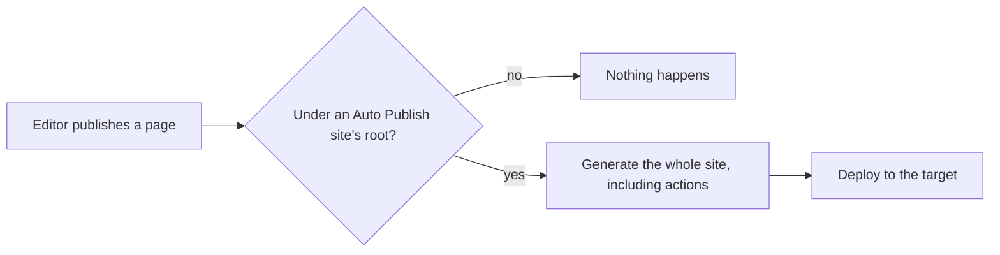

Auto publish makes xStatic rebuild and deploy a site by itself whenever someone publishes content under that site's root page. This page explains exactly when it runs, what it does and the trade-offs, so you can decide whether to switch it on.

## Turn it on

Auto publish is a setting on each site.

1. In the **xStatic Sites** tab, edit the site.
2. Choose a **Deployment Target**. Auto publish does nothing for a site without one.
3. Switch on **Auto Publish** ("Select this is you want to generate the site automatically when a node is published.").
4. Select **Submit**.

The site card then shows **Auto Publish On** instead of **Manual Deploy**. Switch the toggle off to go back to manual builds. No restart is needed. Auto publish is switched on per site; the optional settings in [Shared content and relation-based auto publish](#shared-content-and-relation-based-auto-publish) only change which publishes count.

## When it runs

xStatic listens for Umbraco's `ContentPublishedNotification`. Every time content is published, it checks each site that has **Auto Publish** on:

- If the published page is the site's **Root Node** or sits anywhere below it, the site is queued. If the root page itself isn't published, nothing is queued.
- A site is only built once per publish, however many of its pages were published together.
- Sites that don't have a **Deployment Target** are ignored.
- It does nothing while Umbraco is installing or upgrading.

For each queued site, xStatic does this, one site after another:



The code is in [DefaultAutoPublisher.cs](../Source/XStaticCore/XStatic.Core/AutoPublish/DefaultAutoPublisher.cs).

## What to know before you switch it on

- **It's a full rebuild every time.** There's no incremental build. Publishing one typo fix generates every page, copies every media file and asset, and deploys the whole site.
- **It holds up the publish.** The build and deploy run as part of the publish notification, so the editor waits, and a big site could wait a long time. xStatic doesn't catch an exception thrown while deploying (for example, when the build failed and there is no output folder to deploy), so a failure there can surface in the publish itself.
- **It deploys even if the build had problems.** The result of the rebuild is ignored, and so is the result of the deploy. If pages failed to download or an action failed, the deploy still goes ahead with whatever is in the output folder. Nobody is shown the warnings. Failed pages are written to the Umbraco log, but auto publish doesn't log a failed action or a failed deploy result. Run a manual **Generate** and **Deploy** if you suspect something. The same goes for the deploy: only the **Deploy** button's endpoint logs a deployer's failure, so a failed FTP or Netlify upload during an auto publish is not logged. Check the host.
- **It never cleans.** A rebuild doesn't empty the output folder, so pages you've removed or renamed stay in the output and stay deployed until you select **Clean** and generate again ([Stale files](Generating-and-Deploying.md#stale-files)).
- **Only publishing triggers it.** Unpublishing, deleting, media changes and changes to languages or domains do not. Scheduled publishing raises the same Umbraco notification, so it should trigger a build too, though that hasn't been tested.
- **Every publish triggers it.** Several editors publishing in quick succession means several builds. There's no delay to group them.

For a busy editorial team or a large site, a scheduled build is usually kinder than auto publish.

## Alternative: scheduled builds

[Remote operations](Remote-Operations.md) lets another system, such as a scheduled job, call xStatic's API to generate and deploy. You choose when it runs, nobody waits on a publish, and the result of the build can be inspected. The trade-off is that changes appear on the next run, not immediately.

You can also leave **Auto Publish** off and press **Generate** and **Deploy** yourself ([Generating and deploying](Generating-and-Deploying.md)).

## Shared content and relation-based auto publish

By default, auto publish checks whether the published node sits under a site's **Root Node** (`PathBasedAutoPublishSiteResolver`). If you keep shared content or reusable components outside a site's content tree (for example in a top-level `/Shared` or `/Library` folder), publishing those items won't trigger auto publish unless you enable relation-based resolution.

Add these optional settings to `appsettings.json` (and restart the site):

```json
{
  "XStatic": {
    "EnableRelationBasedAutoPublish": true,
    "AutoPublishMaxRelationDepth": 5,
    "AutoPublishGlobalContentTypes": [ "globalNavigation", "sharedFooter" ]
  }
}
```

When enabled:

- `RelationBasedAutoPublishSiteResolver` walks upstream Umbraco `umbDocument` reference relations (up to `AutoPublishMaxRelationDepth`, ignoring trashed nodes and copy relations) to find any referencing pages under an auto-publish site.
- Publishing any node whose document type alias is listed in `AutoPublishGlobalContentTypes` triggers a rebuild of all auto-publish sites.

## Replacing or extending the behaviour

Auto publishing goes through `IAutoPublisher` and composable `IAutoPublishSiteResolver` implementations. To add a custom site resolver (for example for a custom shared content or Library reference model), register it on the builder:

```csharp
using XStatic.Core.App;

builder.Services.AddXStatic()
    .Automatic()
    .EnableRelationBasedAutoPublish(true)
    .AddAutoPublishSiteResolver<MyCustomSiteResolver>()
    .Build();
```

You can also replace `IAutoPublisher` completely to add debouncing or custom scheduling. See [Extending xStatic](Extending-xStatic.md) and [Configuration](Configuration.md).

## Next steps

- [Generating and deploying](Generating-and-Deploying.md)
- [Remote operations](Remote-Operations.md)
- [Sites](Sites.md)
