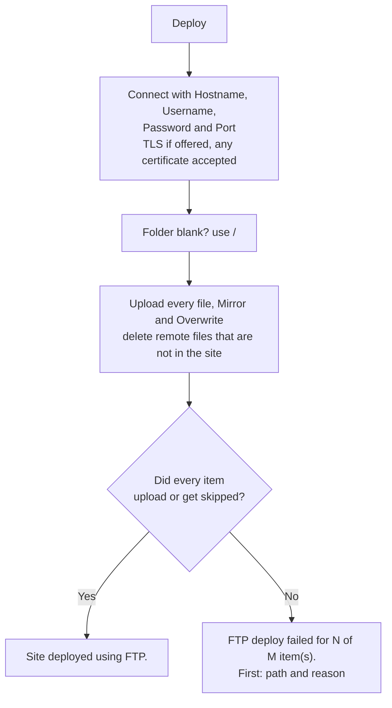

The FTP deployer uploads your generated site to an FTP server, which is how many traditional web hosts take files. It mirrors: the remote folder is made to match your generated site, **including deleting anything on the server that isn't in the site**. Read [Mirror mode](#mirror-mode-deletes-files) before you point it at a real server.

## At a glance

| | |
|---|---|
| NuGet package | `xStatic.Ftp` |
| Install | `dotnet add package xStatic.Ftp` |
| Discovered automatically | Yes |
| Deployer in the UI | **FTP** (id `ftp`) |
| Help text | "The remote FTP files will be mirrored to match the generated site." (shown above the fields in the backoffice) |
| Fields | **Hostname**, **Username**, **Password**, **Folder**, **Port** |
| Library used | FluentFTP 55.1.0 |
| Encryption | Explicit TLS if the server offers it, otherwise plain FTP. Any certificate is accepted |
| Fixed in 17.3.0 and 18.0.0 | Edited pages now update, blocked uploads are reported as failures, servers without TLS no longer hang. The betas and earlier releases don't have these fixes |

## Install

```powershell
dotnet add package xStatic.Ftp
```

Use the same version as your other xStatic packages (see [Installation](Installation.md)). Restart the site and **FTP** appears in the **Deployer \*** dropdown. Nothing goes in `Program.cs`. If you register xStatic manually, call `AddFtpDeployer()` on the deploy builder (`using XStatic.Ftp;`); see [Extending xStatic](Extending-xStatic.md).

## Set it up

1. Make sure you have an FTP account and a folder on the server that holds nothing but your static site (see the warning below).
2. In the backoffice, open **xStatic** then **Deployment Targets** and press **Manually Configure New Deployment Target**.
3. Fill in the form:

   | Field | What to put in it |
   |-------|-------------------|
   | **Name \*** | A label, for example `Shared hosting FTP` |
   | **Deployer \*** | **FTP** |
   | **Hostname** | The server name without a scheme, for example `ftp.mywebsite.com` (not `ftp://ftp.mywebsite.com`) |
   | **Username** | The FTP account name |
   | **Password** | The FTP password (masked, with a Show/Hide button) |
   | **Folder** | The remote folder to fill, for example `/public_html`. Leave it blank for `/`, the root of the account |
   | **Port** | Normally `21`. Leave it blank for the default, 21 |

4. Press **Submit**.
5. On the **xStatic Sites** dashboard press **Edit** on your site, choose the target in **Deployment Target** and submit. Fill in **Asset Paths** so your CSS, JavaScript and images are part of the output (see [Asset paths](Asset-Paths.md)).
6. Press **Generate**, then **Deploy**, then confirm. Open your site's address.

A blank or non-numeric **Port** uses the default, 21.

## Mirror mode deletes files

The deployer calls FluentFTP's `UploadDirectory` in `Mirror` mode with `Overwrite`. The effects are:

- Every file in your generated site is uploaded, replacing the copy on the server if there is one.
- **Files and folders in the remote Folder that aren't in your generated site are deleted.**

So if **Folder** is `/` and your account also holds email folders, a `.htaccess`, a `cgi-bin` or a blog, they will be deleted on the first deploy. Always point **Folder** at a folder that is only for the static site (for example a subdomain's document root), and take a backup before the first deploy. The deployer doesn't have an "ignore these files" option.

Mirroring is relative to the output folder that xStatic keeps on the Umbraco server, not to what Umbraco currently contains. A page you deleted in Umbraco stays on the remote until you press **Clean** and **Generate** again (see [Generating and deploying](Generating-and-Deploying.md)).

## What happens during a deploy

[FtpDeployer.cs](../Source/XStaticCore/XStatic.Ftp/FtpDeployer.cs):



1. The deployer connects using FluentFTP's automatic encryption mode and passive transfers (FluentFTP's default; there is no setting for active mode).
2. It uploads the whole output folder to **Folder**. All files are uploaded again each time. There is no check for unchanged files, so large sites take longer than they would on [Netlify](Deploying-to-Netlify.md).
3. It then checks the results. FluentFTP doesn't always flag a failed transfer: when the data connection is blocked, files come back with no result and no error. xStatic treats any item that wasn't confirmed as uploaded or deliberately skipped as a failure.
4. If any item failed, the result is `FTP deploy failed for N of M item(s). First: <path>: <reason>` where the reason is the exception message, or a hint to check the server's passive mode and firewall. A login or connection error becomes `Error deploying the site using FTP.` with the exception attached.
5. Otherwise the result is `Site deployed using FTP.`

## Passive mode

FTP uses one connection for commands and a second one for each file. In passive mode the server opens a port and tells the client to connect to it. Those ports must be reachable from the Umbraco server. The classic symptom of a blocked data connection is that **folders are created on the server but files aren't uploaded**.

Things to check on the server side:

- The passive port range is open in the server's firewall and in any NAT or cloud security group in front of it.
- The server announces an address the Umbraco server can reach. A server behind NAT that announces its internal address fails.
- The Umbraco server's own firewall allows outgoing connections to those ports.

## TLS

The deployer asks for explicit TLS when the server offers it, and uses plain FTP if the server doesn't. It is set to accept any certificate (`ValidateAnyCertificate`), so self-signed or expired certificates don't stop a deploy. The flip side is that the certificate isn't checked, so the connection is protected from eavesdropping but not from a server pretending to be yours. Because it can also fall back to plain FTP, check that your host offers TLS if the password matters. There is no setting for implicit FTPS (usually port 990); the encryption mode is fixed to automatic.

## Try it locally with Docker

The repository has a small FTP server for testing the deployer without a real host. You need Docker. From the repository root:

```powershell
docker compose -f Testing/Ftp/docker-compose.yml up -d
```

Then create a deployment target with these values:

| Field | Value |
|-------|-------|
| **Hostname** | `127.0.0.1` |
| **Port** | `2121` |
| **Username** | `xstest` |
| **Password** | `xstestpw` |
| **Folder** | `/home/xstest/site` |

Deploy a site to it. The files appear in `Testing/Ftp/data/site` in your checkout. Stop the server with:

```powershell
docker compose -f Testing/Ftp/docker-compose.yml down
```

The compose file ([docker-compose.yml](../Testing/Ftp/docker-compose.yml)) publishes the passive port range 21100 to 21110 as well as the control port, and sets the address the server announces. Without those, logging in and creating folders work but no file transfers, which is exactly the failure described under [passive mode](#passive-mode). It's also a handy way to see that error message for yourself. [Testing.md](../Testing.md) describes the matching Playwright test (spec 13) and the in-process FTP server the unit tests use.

## Limitations and gotchas

- **Mirror deletes remote files** that aren't in the site. See above.
- **A password typed into the field is stored in plain text** in the xStatic database and is visible to the `xStaticAdmin` group through the backoffice API. Type `${env:XSTATIC_FTP_PASSWORD}` instead and keep the password in an environment variable ([Secrets and environment variables](Secrets-and-Environment-Variables.md)). Use a dedicated FTP account that can only write to the site folder. See [User groups and security](User-Groups-and-Security.md).
- **No setting for active mode or implicit FTPS, and no SFTP.** SFTP (SSH) is a different protocol and isn't supported.
- **A failed deploy still updates "Last deployed",** and the Sites dashboard doesn't display the message the deployer returns. Check the Umbraco log for `FTP deploy failed` or `Error deploying the site using FTP.`
- **All files are re-uploaded every time.**
- **Fields are all required to exist.** If you build a target in code, supply all five keys (`FTP.Hostname`, `FTP.Uname`, `FTP.Pss`, `FTP.Folder`, `FTP.Port`), even when some are blank. The backoffice form always does.

## Troubleshooting

| Symptom | Likely cause and fix |
|---------|----------------------|
| `FTP deploy failed for N of M item(s)...` with the hint about passive mode | The data connection is blocked. Check the passive port range, firewall and the address the server announces. |
| `Error deploying the site using FTP.` and a login or authentication error in the log | Wrong **Username** or **Password**, or the account can't use FTP. |
| `Error deploying the site using FTP.` and a connection error | Wrong **Hostname** or **Port**, or the server is unreachable from the Umbraco server. Remember not to include `ftp://`. |
| Folders appear but they are empty | Passive mode, as above. |
| The remote site never changes | Files are uploaded each time, so check that you pressed **Generate** before **Deploy** and that **Folder** is the folder your host serves. |
| Things on the server vanished after the first deploy | Mirror mode deleted them. Restore from backup, and use a dedicated folder. |
| A page deleted in Umbraco is still online | Press **Clean**, **Generate**, then **Deploy** (Mirror then removes it). |
| Edited pages don't change, a failed upload reports success, or a deploy to a server without TLS hangs | You are on a version before 17.3.0 / 18.0.0 (this includes the betas), which don't have these fixes. Update to 17.3.0 or 18.0.0 or later. |

More fixes are on [Troubleshooting](Troubleshooting.md).

## See also

- [Deployment targets](Deployment-Targets.md)
- [Generating and deploying](Generating-and-Deploying.md)
- [Asset paths](Asset-Paths.md)
- [Deploying to Netlify](Deploying-to-Netlify.md) and [Deploying with Git](Deploying-with-Git.md) as alternatives.
- Video: [xStatic 14 - Get Started](https://www.youtube.com/watch?v=_BW8oV3LI1Q) for the target and site screens.
