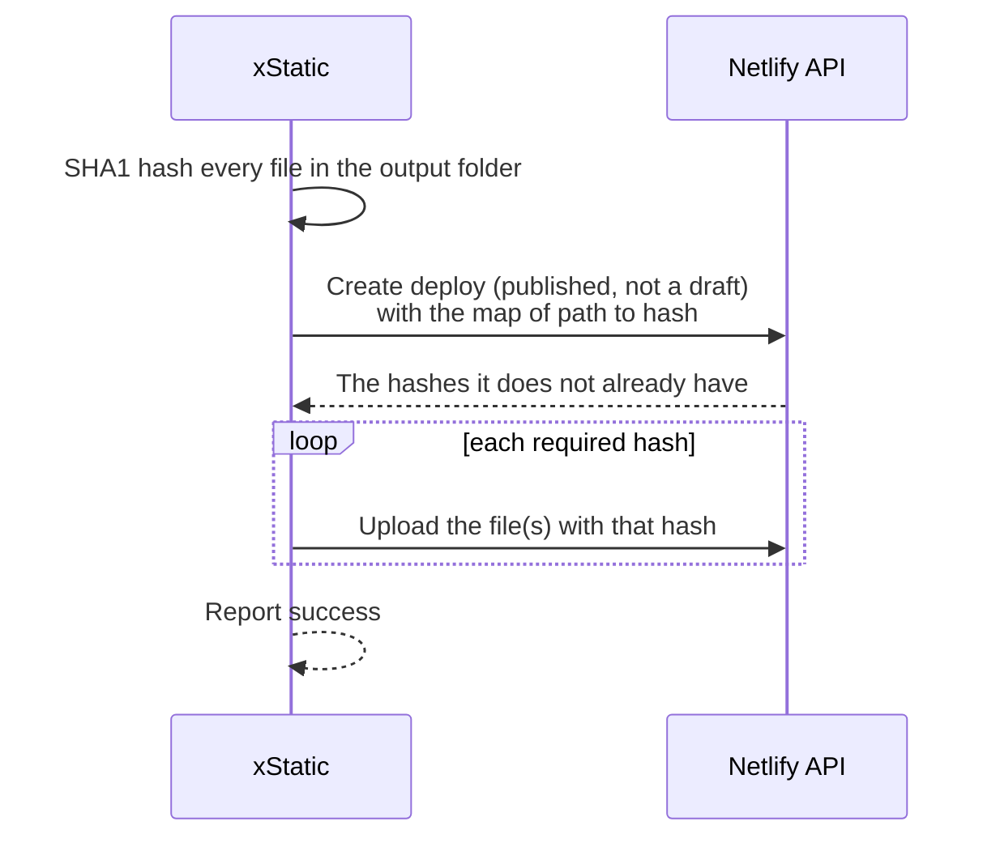

The Netlify deployer uploads your generated site to a site on [Netlify](https://www.netlify.com/) through the Netlify API. xStatic can also create the Netlify site for you, so you can go from nothing to a live static site without leaving the backoffice. This page is for site builders who want to host on Netlify.

## At a glance

| | |
|---|---|
| NuGet package | `xStatic.Netlify` |
| Install | `dotnet add package xStatic.Netlify --prerelease` (drop `--prerelease` once 18.0.0 is out) |
| Discovered automatically | Yes. No registration code is needed |
| Deployer in the UI | **Netlify** (id `netlify`). **Netlify (Legacy)** is also listed; see [the legacy deployer](#the-legacy-deployer) |
| Deployment target creator | **Netlify Site Creator** (id `netlify-site-creator`) |
| Extra post-generation action | `Netlify404Action` (needs one line of registration) |
| Fields | **Personal Access Token**, **Site ID** |
| Library used | NetlifySharp 1.1.1 |

## Install

1. Add the package to your Umbraco project and rebuild:

   ```powershell
   dotnet add package xStatic.Netlify --prerelease
   ```

   Use the same version as your other xStatic packages. The `--prerelease` flag is needed while xStatic 18 is in beta; without it you would get a 17.x package (see [Installation](Installation.md)).
2. Start the site. xStatic finds the deployer by scanning loaded assemblies, so **Netlify** now appears in the **Deployer \*** dropdown and **Netlify Site Creator** in the creator dropdown. Nothing goes in `Program.cs`.

If you registered xStatic yourself instead of letting it register automatically (see [Extending xStatic](Extending-xStatic.md)), add the deployer on the deploy builder:

```csharp
using XStatic.Core.App;
using XStatic.Netlify;

var xStatic = builder.Services.AddXStatic();
xStatic.DeployServiceBuilder.AddNetlifyDeployer();
// ...register the rest, then call xStatic.Build();
```

`AddNetlifyDeployer()` adds both the current and the legacy deployer. It does not add the Netlify Site Creator, which is only registered by automatic discovery. Don't combine `Automatic()` with `AddNetlifyDeployer()`: the same deployer would be registered twice and start-up fails.

## Option 1: let xStatic create the Netlify site

This is the quickest route (it is shown in the [xStatic 14.1 Speedrun video](https://www.youtube.com/watch?v=tYdYG3PgRcQ)).

1. In Netlify, create a personal access token at [app.netlify.com/user/applications](https://app.netlify.com/user/applications) and copy it. A Netlify token acts as you, so treat it like a password.
2. In the backoffice, open **xStatic** then **Deployment Targets**.
3. Press **Automatically Create New Deployment Target** (the yellow box).
4. In the **Automatically Create New Deployment Target** dialog:
   - **Name \***: required by the form. See the note below, the Netlify creator names the target after the site.
   - **Creator Template \***: choose **Netlify Site Creator**.
   - **Configuration**: the creator's help text appears above the fields. Fill in **Personal Access Token** and **Site Name**. The site name field has a fixed `.netlify.app` on the end and an arrow button that opens `https://<name>.netlify.app` so you can check whether the name is already taken.
5. Press **Create**.

xStatic calls Netlify to create the site, then saves a normal **Netlify** deployment target containing your token and the new site's ID. It is the same as a target you create by hand, so you can edit or delete it later.

> The target is named after the **Site Name**, not the **Name** you typed in the dialog (see
> [NetlifyDeploymentTargetCreator.cs](../Source/XStaticCore/XStatic.Netlify/NetlifyDeploymentTargetCreator.cs)).
> Use **Edit** on the target if you want a different name.

If Netlify refuses to create the site (usually because the name is taken), no target is created and the dialog stays open. The server's reply says `Error creating site on Netlify, please make sure that the site name is unique and try again.`, but the backoffice may only show a general "An error occurred" notification, so check the name first.

## Option 2: use a Netlify site you already have

1. Create the personal access token as above.
2. Find the site's ID. In Netlify, open your site, then **Site configuration** and **General**, and look under **Site details** (or **Site information**) for the **API ID** (some versions of the Netlify dashboard label it **Site ID** or **Project ID**). It looks like `5f1c2a3b-....`.
3. In xStatic, open **Deployment Targets** and press **Manually Configure New Deployment Target**.
4. Fill in the form:
   - **Name \***: for example `Netlify live`.
   - **Deployer \***: choose **Netlify**.
   - **Configuration**: put the token in **Personal Access Token** (the field is masked, with a Show/Hide button) and the ID in **Site ID**.
5. Press **Submit**.

The Netlify help text ("First create a personal access token at ... Then go to the site settings for your site, and in Site details/Site information you should see an API ID") is only shown in the creator dialog, not on the manual form.

## Deploy

1. Edit the site on the **xStatic Sites** dashboard and choose the target in **Deployment Target**.
2. Press **Generate**, then **Deploy**, then confirm.
3. Open the site's `.netlify.app` address. It can take a few seconds after xStatic reports success for Netlify to finish publishing.

For a site that needs its CSS, JavaScript and images, fill in **Asset Paths** first (see [Asset paths](Asset-Paths.md)).

## What happens during a deploy

[NetlifyDeployer.cs](../Source/XStaticCore/XStatic.Netlify/NetlifyDeployer.cs) uses Netlify's file digest method, so only files Netlify doesn't already have are uploaded.



1. Every file in the site's output folder is hashed (SHA1). Paths are relative to the output folder, with `/` separators.
2. xStatic creates a new deploy on your site named `xStatic deploy <date and time>`. It is a production deploy (`Draft = false`), not a preview.
3. Netlify replies with the hashes it still needs. xStatic uploads each of those files.
4. If everything uploaded, the result is `Site was successfully deployed to Netlify, congrats.`

Because the deploy describes the whole site, **files you removed from the output are removed from the live site** as well. xStatic doesn't wait for Netlify to report the deploy as ready.

Unchanged files aren't uploaded again, so later deploys are much quicker than the first.

## Serve your own 404 page

Netlify shows a file called `404.html` at the root of your site for unknown addresses. The `Netlify404Action` copies one of your generated pages to `/404.html`.

1. Create a page in Umbraco that looks like your 404 page, and make sure it is inside the site's root node so it is generated. Note its output path. With the default HTML export type a page at `/404/` is written to `/404/index.html`.
2. Register the action once. It has a constructor dependency, so it must be added to the service collection, for example in `Program.cs`:

   ```csharp
   using XStatic.Netlify;

   builder.Services.AddNetlifyActions();
   ```

   This is required. The action appears in the **Action Type \*** dropdown without it, but if you set it up and don't register it, generation throws when the action is created and the whole run is reported as failed.
3. Open **Actions**, create an action: **Action Name \*** `Netlify 404`, **Action Type \*** `Netlify404Action`, and in **Configuration** set `FilePath` to the generated page, for example `/404/index.html`.
4. Edit your site and select the action in **Post Generation Actions**.
5. **Generate**, then **Deploy**.

Post-generation actions run at the end of **Generate**, in the order they are listed on the site (see [Post-generation actions](Post-Generation-Actions.md)). If the file in `FilePath` doesn't exist, the action fails and the failure is shown as a warning after generation.

If you would rather skip the registration step, the built-in `FileCopyAction` with `FilePath` set to your 404 page and `NewFilePath` set to `404.html` does the same job.

## The legacy deployer

**Netlify (Legacy)** (id `netlify-legacy`) is the original implementation. It is kept so old targets keep working, but it uses obsolete .NET web APIs (the cause of two of the build warnings listed in the repo's `AGENTS.md`), and its file path handling is written for Windows. On Linux or macOS it can skip files without reporting an error. Use **Netlify** for anything new.

Its fields have the same labels but different aliases (`NetlifyLegacy.PAT`, `NetlifyLegacy.SiteId`), so a legacy target can't be switched to the current deployer by changing the dropdown. Create a new target instead. Sites upgraded from xStatic 13 get a current **Netlify** target (see [Upgrading](Upgrading.md)).

## Limitations and gotchas

- **A token typed into the field is stored in plain text** in the xStatic database table (`XStaticDeploymentTargets`) and is returned to anyone in the `xStaticAdmin` group through the backoffice API. Type `${env:XSTATIC_NETLIFY_TOKEN}` instead and keep the token in an environment variable ([Secrets and environment variables](Secrets-and-Environment-Variables.md)). Either way, use a token you can revoke, and keep access to the **Deployment Targets** dashboard limited. See [User groups and security](User-Groups-and-Security.md).
- **A deploy that fails can still look fine in the dashboard.** "Last deployed" is updated either way, and the Sites dashboard doesn't display the deployer's message. The error is written to the Umbraco log (`Error uploding file hashes to Netlify...`, spelled that way in the source).
- **xStatic creates a deploy, it doesn't manage your Netlify settings.** Custom domains, HTTPS, headers and redirects are set in Netlify. xStatic doesn't generate `_redirects`, `_headers` or `netlify.toml`; if you need one it must end up in the generated output (see [Asset paths](Asset-Paths.md)).
- **Root of the domain.** xStatic assumes the site is served from the root of its domain, which is how Netlify serves it.
- **Hashing happens before the error handling.** If a file in the output folder is locked or unreadable while hashing, the deploy throws instead of returning a tidy error message.

## Troubleshooting

| Symptom | Likely cause and fix |
|---------|----------------------|
| `Error parsing Netlify response. The deployment was not completed.` | The request to Netlify failed or was rejected. Most often an expired or wrong token, a **Site ID** that isn't yours, or no internet access from the server. The exception in the log says which. Create a fresh token and check the ID. |
| `Error uploding file hashes to Netlify. The deployment was not completed.` | A network-level error (a `WebException`) while asking Netlify what it needs. Check the server's internet access, then the token and **Site ID**. |
| `Error uploding file ... to Netlify.` | One file failed to upload. The exception in the log says why. Try again. |
| Creator: the dialog stays open and "An error occurred" appears (the server's reply is `Error creating site on Netlify, please make sure that the site name is unique...`) | The name is taken, or the token is invalid. Use the arrow button next to the name to see whether the address already exists, then try another name. |
| Creator: HTTP 500 and `Personal Access Token is required.` or `Site Name is required.` | A field was left blank. Fill in both. |
| `Failed to deploy. No generated output found at ...` | Press **Generate** first. |
| The 404 action makes generation fail | `AddNetlifyActions()` isn't called. Add it and restart. |
| Old pages are still live | They are still in the output folder. Press **Clean**, **Generate**, then **Deploy**. |

More general fixes are on [Troubleshooting](Troubleshooting.md).

## See also

- [Deployment targets](Deployment-Targets.md)
- [Deployment target creators](Deployment-Target-Creators.md) if you want to build a creator like the Netlify one.
- [Post-generation actions](Post-Generation-Actions.md)
- [Generating and deploying](Generating-and-Deploying.md)
- Videos: [xStatic 14.1 Speedrun](https://www.youtube.com/watch?v=tYdYG3PgRcQ) (the site creator end to end), [xStatic 14 - Get Started](https://www.youtube.com/watch?v=_BW8oV3LI1Q), and the original [Netlify in 5 minutes](https://www.youtube.com/watch?v=XOwgBITayyc) from 2020, which is obsolete (Umbraco 8).
