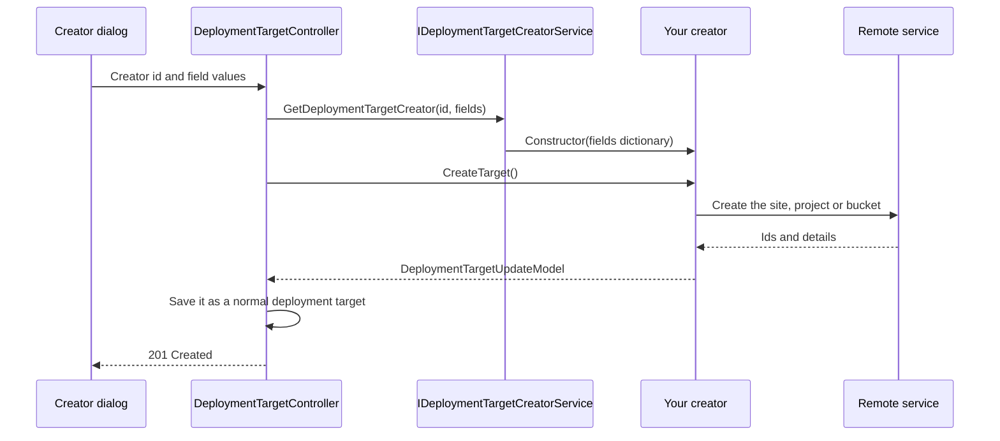

A deployment target creator sets up the remote service for you and then saves a ready-to-use deployment target. Three ship with xStatic: the **Netlify Site Creator** (in `xStatic.Netlify`), which creates a new Netlify site, and the **Cloudflare Workers Creator** and **Cloudflare Pages Project Creator** (both in `xStatic.Cloudflare`), which create a static-assets Worker or a Cloudflare Pages Direct Upload project. Each makes the remote service and a target for it in a single step. This page is for developers who want to build a creator for another host. If you just want to use one, see [Deploying to Netlify](Deploying-to-Netlify.md) or [Deploying to Cloudflare](Deploying-to-Cloudflare.md).

## At a glance

A creator is built from the same parts as a [deployer](Writing-a-Deployer.md), and it reuses the same field type:

| Class | Interface | Job |
|-------|-----------|-----|
| Creator | `IDeploymentTargetCreator` | Calls the remote service and returns the settings for a new deployment target |
| Definition | `IDeploymentTargetCreatorDefinition` | Id, name, help text and the fields the editor fills in |
| Auto installer | `IDeploymentTargetCreatorAutoInstaller` | Joins the two so xStatic discovers them with no registration code |

A creator doesn't deploy anything. It produces the settings that a normal deployer will use later, so you need a deployer for the target to be useful (the Netlify creator produces a target for the Netlify deployer).

## How it shows up in the backoffice

On the **Deployment Targets** dashboard, the **Create new Deployment Target** box has two buttons:

- **Manually Configure New Deployment Target** opens the normal dialog, where you pick a deployer and fill in its fields.
- **Automatically Create New Deployment Target** opens the creator dialog.

Both are only available to admin users (see [User groups and security](User-Groups-and-Security.md)).

The creator dialog is titled **Automatically Create New Deployment Target** and has three properties:

| Property | Where it comes from |
|----------|---------------------|
| **Name \*** | Required by the dialog |
| **Creator Template \*** | A dropdown of every discovered creator's `Name` |
| **Configuration** | The selected creator's `Fields`, with the definition's `Help` shown above them. `Help` is rendered as HTML, so you can include links |

The **Create** button posts the creator's id and the field values to the API. If it works, the new target appears in the list and the dialog closes. If the creator throws, the dialog stays open and no target is created. See [Management API](Management-API.md) for the endpoint (`POST api/v1/xstatic/deployment-targets/auto-create-deployment-target`).



## The interfaces

All three are in [Deploy/Targets/Creators](../Source/XStaticCore/XStatic.Core/Deploy/Targets/Creators).

```csharp
public interface IDeploymentTargetCreator
{
    Task<DeploymentTargetUpdateModel> CreateTarget();
}

public interface IDeploymentTargetCreatorDefinition
{
    string Id { get; }
    string Name { get; }
    string Help { get; }
    IEnumerable<DeployerField> Fields { get; }
}

public interface IDeploymentTargetCreatorAutoInstaller
{
    IDeploymentTargetCreatorDefinition Definition { get; }
    Func<Dictionary<string, string>, IDeploymentTargetCreator> Constructor { get; }
}
```

`DeployerField` is the same class deployers use, so everything on [Writing a deployer](Writing-a-Deployer.md#ideployerdefinition-and-deployerfield) applies: `Alias`, `Name`, `Value`, `EditorUiAlias` and the list of editors. Field aliases arrive as the dictionary keys in your creator's constructor, and the Netlify creator prefixes its aliases with `NetlifyCreator.` to keep them distinct.

`CreateTarget` returns a `DeploymentTargetUpdateModel` (in `XStatic.Core.Models`):

| Property | Set it to |
|----------|-----------|
| `Name` | The name the new target will have in the list. **This is the name used**, not the **Name \*** typed into the dialog (see the note below) |
| `DeployerDefinition` | The `Id` of the deployer this target is for, for example `"netlify"` |
| `Fields` | The deployer's field values, keyed by the **deployer's** field aliases (not the creator's) |
| `Id` | Leave as `0` |

xStatic then saves it exactly as if an admin had filled in the normal dialog, so the new target can be selected on a site straight away.

## What the Netlify creator does

The reference implementation is [NetlifyDeploymentTargetCreator.cs](../Source/XStaticCore/XStatic.Netlify/NetlifyDeploymentTargetCreator.cs), with its auto installer in [NetlifyAutoInstaller.cs](../Source/XStaticCore/XStatic.Netlify/NetlifyAutoInstaller.cs).

**Definition.** The Id is `netlify-site-creator` and the name is **Netlify Site Creator**. The help text explains how to get a personal access token and warns that the site name must be unique. It has two fields:

| Field | Alias | Editor |
|-------|-------|--------|
| **Personal Access Token** | `NetlifyCreator.PAT` | `UIEditors.Password` |
| **Site Name** | `NetlifyCreator.SiteName` | `xstatic.propertyEditorUi.netlifySubdomain`, a text box with a `.netlify.app` suffix and a button that opens the site in a new tab so you can check whether the name is taken |

**CreateTarget.** The creator:

1. Reads the token and site name, and throws if either is blank.
2. Creates the site on Netlify with the `NetlifySharp` client.
3. If Netlify refuses, throws an `XStaticException` with the message *Error creating site on Netlify, please make sure that the site name is unique and try again.* Any failure gets this message, not only a taken name, so a wrong token produces it too.
4. Returns a target named after the site, for the `netlify` deployer, with `Netlify.PAT` set to the token and `Netlify.SiteId` set to the id Netlify returned.

**Auto installer.** One class, `NetlifyAutoInstaller`, implements *both* `IDeployerAutoInstaller` and `IDeploymentTargetCreatorAutoInstaller`, using explicit interface implementations, so the deployer and its creator are registered together:

```csharp
public class NetlifyAutoInstaller : IDeployerAutoInstaller, IDeploymentTargetCreatorAutoInstaller
{
    IDeployerDefinition IDeployerAutoInstaller.Definition => new NetlifyDeployerDefinition();

    Func<Dictionary<string, string>, IDeployer> IDeployerAutoInstaller.Constructor => (x) => new NetlifyDeployer(x);

    IDeploymentTargetCreatorDefinition IDeploymentTargetCreatorAutoInstaller.Definition => new NetlifyDeploymentTargetCreatorDefinition();

    Func<Dictionary<string, string>, IDeploymentTargetCreator> IDeploymentTargetCreatorAutoInstaller.Constructor => (x) => new NetlifyDeploymentTargetCreator(x);
}
```

You can do the same, or use a separate class for each.

## Writing your own creator

This example pairs with the zip upload deployer from [Writing a deployer](Writing-a-Deployer.md#a-complete-example). It's deliberately simple: a real creator would call the remote service inside `CreateTarget` (the zip example just builds the settings, so it doesn't need to).

```csharp
using System;
using System.Collections.Generic;
using System.Threading.Tasks;
using XStatic;
using XStatic.Core;
using XStatic.Core.Deploy;
using XStatic.Core.Deploy.Targets.Creators;
using XStatic.Core.Models;

namespace MySite.Creators
{
    public class ZipUploadCreatorDefinition : IDeploymentTargetCreatorDefinition
    {
        public class FieldNames
        {
            public const string Endpoint = "ZipUploadCreator.Endpoint";
        }

        public string Id => "zip-upload-creator";

        public string Name => "Zip Upload Quick Setup";

        public string Help => "Creates a <strong>Zip Upload</strong> target pointing at the endpoint you enter.";

        public IEnumerable<DeployerField> Fields => new[]
        {
            new DeployerField { Alias = FieldNames.Endpoint, Name = "Endpoint URL", EditorUiAlias = UIEditors.Text }
        };
    }

    public class ZipUploadCreator : IDeploymentTargetCreator
    {
        private readonly Dictionary<string, string> _parameters;

        public ZipUploadCreator(Dictionary<string, string> parameters)
        {
            _parameters = parameters;
        }

        public Task<DeploymentTargetUpdateModel> CreateTarget()
        {
            if (!_parameters.TryGetValue(ZipUploadCreatorDefinition.FieldNames.Endpoint, out var endpoint) || string.IsNullOrWhiteSpace(endpoint))
            {
                throw new XStaticException("An endpoint URL is required.");
            }

            return Task.FromResult(new DeploymentTargetUpdateModel
            {
                Name = "Zip upload to " + endpoint,
                DeployerDefinition = "zip-upload",
                Fields = new Dictionary<string, string>
                {
                    { "ZipUpload.Endpoint", endpoint }
                }
            });
        }
    }

    public class ZipUploadCreatorAutoInstaller : IDeploymentTargetCreatorAutoInstaller
    {
        public IDeploymentTargetCreatorDefinition Definition => new ZipUploadCreatorDefinition();

        public Func<Dictionary<string, string>, IDeploymentTargetCreator> Constructor => x => new ZipUploadCreator(x);
    }
}
```

Because the auto installer is discovered automatically, **Zip Upload Quick Setup** appears in the **Creator Template \*** dropdown the next time the site starts.

### Report errors with XStaticException

The controller catches `XStaticException` and returns a `409 Conflict` carrying your message, so use it for problems the editor can act on (a taken name, a missing field). The message is in the response body, but the backoffice does not show it as text: it reports a general "An error occurred" notification, so keep your creator's help text clear about the likely causes. Any other exception type isn't caught by the controller and surfaces as a generic server error with no useful message. The Netlify creator's check for a blank token or site name throws a plain `Exception`, for example, so that message doesn't reach the editor.

## Registration

**Automatic.** `AddDeploymentTargetCreatorsAutomatically` in [DeployServiceBuilder.cs](../Source/XStaticCore/XStatic.Core/App/DeployServiceBuilder.cs) scans the loaded assemblies for `IDeploymentTargetCreatorAutoInstaller` implementations, creates each with its parameterless constructor and registers it. The default start-up and both `Automatic()` variants call it. As with deployers, make sure each Id is unique: a duplicate throws.

**Manual.** If you register xStatic yourself, call `AddDeploymentTargetCreator` on the `DeployServiceBuilder`:

```csharp
using Microsoft.Extensions.DependencyInjection;
using MySite.Creators;
using XStatic.Core.App;

var xstatic = services.AddXStatic();
xstatic.GeneratorServiceBuilder.AddDefaults();
xstatic.DeployServiceBuilder.AddDeploymentTargetCreator(
    new ZipUploadCreatorDefinition(),
    x => new ZipUploadCreator(x));
xstatic.Build();
```

`AddDeploymentTargetCreator` is on the `DeployServiceBuilder` class, not on the `IDeployServiceBuilder` interface that deployer extension methods use. That means the extension-method pattern from [Writing a deployer](Writing-a-Deployer.md#extension-method-manual-registration) needs `this DeployServiceBuilder builder` for a creator. Also note that `AddNetlifyDeployer()` registers the Netlify deployers but not the Netlify creator, so a manual set-up needs its own `AddDeploymentTargetCreator` call for it.

## Limitations

- **The dialog's Name isn't passed to your creator.** The creator is built from the field values only. The target is named by whatever `Name` your `CreateTarget` returns, so the **Name \*** typed into the dialog is required but doesn't name the target.
- A creator can't ask follow-up questions or show progress. It either returns a target or throws.
- Credentials you enter in the creator dialog (like the Netlify or Cloudflare token) are copied into the new target and stored in plain text, as for any deployment target. If you type a `${env:...}` or `${config:...}` reference instead, your creator receives the resolved value, and xStatic puts the reference back into the saved target wherever the creator returned that value unchanged, so the secret isn't stored. See [Secrets and environment variables](Secrets-and-Environment-Variables.md#when-references-are-read).
- If the remote service is created but saving the target fails, xStatic can't undo the remote creation.

## Next steps

- [Writing a deployer](Writing-a-Deployer.md): the deployer your creator will usually produce a target for.
- [Deployment targets](Deployment-Targets.md): how editors use creators and targets.
- [Deploying to Netlify](Deploying-to-Netlify.md): the Netlify creator from the user's side. The [14.1 speedrun video](https://www.youtube.com/watch?v=tYdYG3PgRcQ) shows it end to end.
- [Extending xStatic](Extending-xStatic.md): all the extension points.
