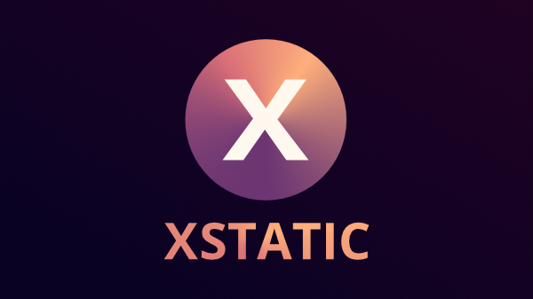

xStatic turns your Umbraco site into a static website. Editors keep using the Umbraco backoffice they already know.
When they're ready, xStatic renders every published page, copies the media and assets it needs, and deploys the
result to Netlify, a Git repository (GitHub Pages, for example), an FTP server or a folder. The static copy is
fast, cheap to host, and has no database or server code for anyone to attack.

This wiki covers everything from installing the package to writing your own deployers. It's written against
**xStatic 17 for Umbraco 17 (LTS)**. Most of it also applies to xStatic 14 to 18, and where something changed recently
the page says so.

## Where to start

| If you want to... | Read |
|-------------------|------|
| Find out whether xStatic suits your site | [What is xStatic?](What-is-xStatic.md) and the [FAQ](FAQ.md) |
| Install it and build your first static site | [Installation](Installation.md), then [Your first static site](Your-First-Static-Site.md) |
| Find your way around the backoffice | [Backoffice tour](Backoffice-Tour.md) |
| Put your site live | [Netlify](Deploying-to-Netlify.md), [Git](Deploying-with-Git.md), [FTP](Deploying-to-FTP.md) or [a folder](Deploying-to-a-Folder.md) |
| Rebuild on a schedule or from another system | [Remote operations](Remote-Operations.md) |
| Change what xStatic outputs | [Extending xStatic](Extending-xStatic.md) and [Architecture](Architecture.md) |
| Fix something that isn't working | [Troubleshooting](Troubleshooting.md) |
| Move from an older version | [Upgrading](Upgrading.md) |
| Look up a term | [Glossary](Glossary.md) |

If you prefer watching to reading, the [xStatic 14 Get Started video](https://www.youtube.com/watch?v=_BW8oV3LI1Q)
walks through the backoffice, and [Videos and talks](Videos-and-Talks.md) lists the rest.

## Versions

xStatic's major version matches the Umbraco major it supports. Each has its own branch in the repository.

| xStatic | Umbraco | .NET | Status |
|---------|---------|------|--------|
| 18.x | 18 | 10 | Latest, in beta |
| 17.x | 17 (LTS) | 10 | Long-term support |
| 15.x | 15 | 9 | No longer updated |
| 14.x | 14 | 8 | No longer updated |
| 13.x | 13 (LTS) | 8 | Long-term support |

There is no stable xStatic 16 release, so go from 15 to 17. Versions before 13 (for Umbraco 8 to 12) are no longer supported. [Version history](Version-History.md) has the full story.

## Getting help and contributing

- Found a bug or have an idea? Open an issue on [GitHub](https://github.com/Mulliman/xStatic-for-Umbraco/issues).
- Want to help? [Developing xStatic](Developing-xStatic.md) explains how to build and test the code.
- Spotted a mistake in this wiki? The pages live in the repository's `Wiki/` folder, so you can fix them in a pull request.
