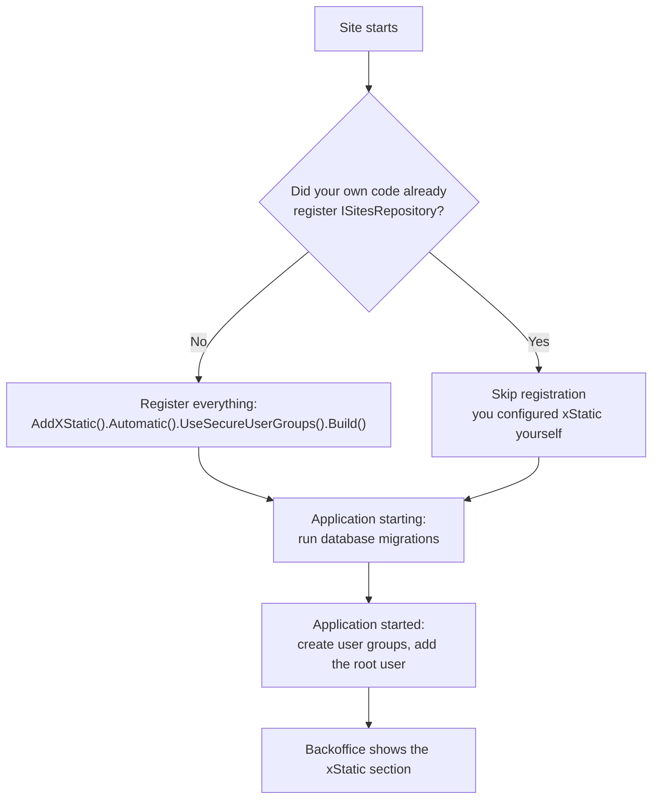

How to add xStatic to an Umbraco 17 site, what it sets up the first time the site starts, and how to find it in the
backoffice. For most sites this is one NuGet package and a restart.

## Requirements

| You need | Version |
|----------|---------|
| Umbraco | 17.8.2 or later (all of xStatic's Umbraco packages reference 17.8.2, which is the minimum) |
| .NET | 10 (`net10.0`) |
| Database | Anything Umbraco supports. xStatic creates its tables with Umbraco's migrations and is tested on SQLite and SQL Server |
| Site | A server-rendered (Razor) Umbraco site. xStatic downloads each published page over HTTP from the running site, so a headless-only site with no templates has nothing to render |
| Backoffice user | A user who can sign in to the backoffice. The first-start setup gives the **root user** access (see [below](#what-happens-on-first-start)) |

Earlier Umbraco versions have their own xStatic release. The [Home](Home.md) page lists which xStatic version matches
which Umbraco version, and [Upgrading](Upgrading.md) covers moving between them.

## Install the package

From your Umbraco project folder, run:

```powershell
dotnet add package xStatic
```

Or add the reference to your `.csproj` yourself:

```xml
<PackageReference Include="xStatic" Version="17.*" />
```

That is all the code you need. You don't have to edit `Program.cs`. Start the site (`dotnet run`, or press F5 in your
editor) and sign in to the backoffice.

> The [xStatic 14 - Get Started video](https://www.youtube.com/watch?v=_BW8oV3LI1Q) shows adding registration code to
> `Program.cs`. That step is no longer needed: `XStaticComposer` does it for you.

## Packages

xStatic is split into several NuGet packages. Most sites need `xStatic` plus one deployer.

| Package | What it is for | Install it when |
|---------|----------------|-----------------|
| `xStatic` | The Umbraco integration: composer, Management API controllers, database migrations and user group setup. It depends on `xStatic.Core` and `xStatic.Client`, so installing it brings both | Always |
| `xStatic.Core` | The engine and the public extension API (generators, transformers, deployers, actions, repositories) | Pulled in by `xStatic`. Reference it directly only in a separate class library, such as a plugin |
| `xStatic.Client` | The backoffice UI, shipped as a Razor class library. Its files are served from `/App_Plugins/xstatic14/` | Pulled in by `xStatic` |
| `xStatic.Netlify` | The [Netlify deployer](Deploying-to-Netlify.md), including the **Netlify Site Creator** | You host on Netlify |
| `xStatic.Git` | The [Git deployer](Deploying-with-Git.md), used for GitHub Pages and similar | You host from a Git repository |
| `xStatic.Ftp` | The [FTP deployer](Deploying-to-FTP.md) | You host on an FTP server |
| `xStatic.Cloudflare` | The [Cloudflare Pages and R2 deployers](Deploying-to-Cloudflare.md), project creator, and `_headers`/`_redirects` actions | You host on Cloudflare Pages or Cloudflare R2 |
| `xStatic.RemoteOperations` | A .NET client for [triggering xStatic remotely](Remote-Operations.md) with an Umbraco API user | You want builds from a scheduler or another application |
| `xStatic.AI` | Optional [AI pre-deploy GEO/SEO audit and agent tools](AI-Integration.md) built on `Microsoft.Extensions.AI` | You want automated pre-deploy audits or `Umbraco.AI.Agent` integration |

The **File System** deployer is built into `xStatic.Core`, so you don't need a package to
[deploy to a folder](Deploying-to-a-Folder.md).

To add a deployer:

```powershell
dotnet add package xStatic.Netlify
dotnet add package xStatic.Git
dotnet add package xStatic.Ftp
dotnet add package xStatic.Cloudflare
```

You don't register them. At startup xStatic scans the loaded assemblies for deployers and deployment target creators
and adds every one it finds, so the new deployer appears in the **Deployer** dropdown after a restart.

The official packages are listed under **Plugins** on the **Documentation** dashboard in the backoffice, which is built
into `xStatic.Client` (see [Backoffice tour](Backoffice-Tour.md#documentation)). Third-party plugins, such as the
community `xStatic.AWSS3` deployer, aren't listed there; see the [FAQ](FAQ.md#can-i-deploy-to-aws-s3-or-another-host-that-isnt-listed).

## What happens on first start

When the site starts, `XStaticComposer` ([source](../Source/XStaticCore/XStatic/XStaticComposer.cs)) does the
following.



1. **Registers its services**, unless you have already registered them. The composer checks whether an
   `ISitesRepository` is in the service collection. If not, it runs
   `AddXStatic().Automatic().UseSecureUserGroups().Build()`, which registers the default generators, transformers,
   storers, actions, every deployer it can find, and turns on the two xStatic user groups.
2. **Runs the database migrations** when Umbraco is starting (and only if Umbraco is fully installed, at the `Run`
   runtime level). The migration plan is called `xStatic` and creates four tables:

   | Table | Holds |
   |-------|-------|
   | `XStaticSiteConfigs14Plus` | Your [sites](Sites.md) |
   | `XStaticExportTypes` | [Export types](Export-Types.md). A first one, **HTML Website**, is added for you |
   | `XStaticActions` | [Post-generation actions](Post-Generation-Actions.md) |
   | `XStaticDeploymentTargets` | [Deployment targets](Deployment-Targets.md) |

   If you are upgrading from xStatic 13, the same step also copies your old sites across. See
   [Upgrading](Upgrading.md).
3. **Creates the user groups** `xStaticAdmin` and `xStaticNormalUser` when Umbraco has started, gives both of them
   access to the xStatic section, and adds the **root user** (the first user created when you installed Umbraco,
   internal id `-1`) to both. See [User groups and security](User-Groups-and-Security.md).
4. **Listens for published content**, which is what [Auto publish](Auto-Publish.md) uses.

If you add xStatic to a site that hasn't completed Umbraco's own installer yet, finish the installer first and then
restart the site, so the migrations and user groups are created.

The backoffice screens themselves come from the `xStatic.Client` package's static web assets, so there is nothing
to copy into `App_Plugins` yourself.

## Find xStatic in the backoffice

1. Sign in to the Umbraco backoffice as the root user.
2. Open the **xStatic** section in the section bar. Its address is `/umbraco/section/xstatic`.
3. You should see the **xStatic Sites** tab and the others described in the [Backoffice tour](Backoffice-Tour.md).

If the section is missing, the user isn't in a user group that allows it. Check **Users > User Groups** and make sure
the user's group has the **xStatic** section ticked, or add the user to the `xStaticAdmin` or `xStaticNormalUser`
group. Signing out and in again refreshes the user's permissions. To give other people access, see
[User groups and security](User-Groups-and-Security.md#giving-other-users-access).

## Optional: register xStatic yourself

You only need this to change what is registered: a different output folder, custom generators, a specific user to own
the user groups, or no automatic deployer discovery. Register xStatic in `Program.cs` using the builders in
`XStatic.Core.App`, and the composer notices and skips its own registration. [Extending xStatic](Extending-xStatic.md)
shows how, and [Configuration](Configuration.md) lists the settings.

Two settings are worth knowing about at install time:

- **Mac and Linux:** if generation fails with a certificate error because your local HTTPS certificate isn't trusted,
  set `XStatic:TrustSslWhenGenerating` to `true` in `appsettings.json`.
- **Who gets the user groups:** with the automatic registration, the root user always does. To name a different user,
  register xStatic yourself and call `UseSecureUserGroups("user@example.com")`.

## Uninstalling

1. Remove the xStatic packages with `dotnet remove package xStatic` (and any deployer packages).
2. Restart the site. The backoffice section disappears.

xStatic leaves its data behind: the four `XStatic*` database tables, the `xStaticAdmin` and `xStaticNormalUser` user
groups, and the generated files under `umbraco/Data/xStatic/output`. Delete these by hand if you don't want them. The
database tables hold your deployer credentials in plain text, so drop them rather than leaving them behind on a site
that no longer uses xStatic. Nothing in xStatic changes your Umbraco content or templates.

## Videos

- [xStatic 14 - Get Started](https://www.youtube.com/watch?v=_BW8oV3LI1Q): installing and a walkthrough of the
  backoffice.
- [xStatic 14.1 Speedrun](https://www.youtube.com/watch?v=tYdYG3PgRcQ): installing with Package Script Writer and creating
  a Netlify site from the backoffice.

## Next steps

- Build and deploy something with [Your first static site](Your-First-Static-Site.md).
- Take the [Backoffice tour](Backoffice-Tour.md).
- Set up [user groups and security](User-Groups-and-Security.md) before you give editors access.
