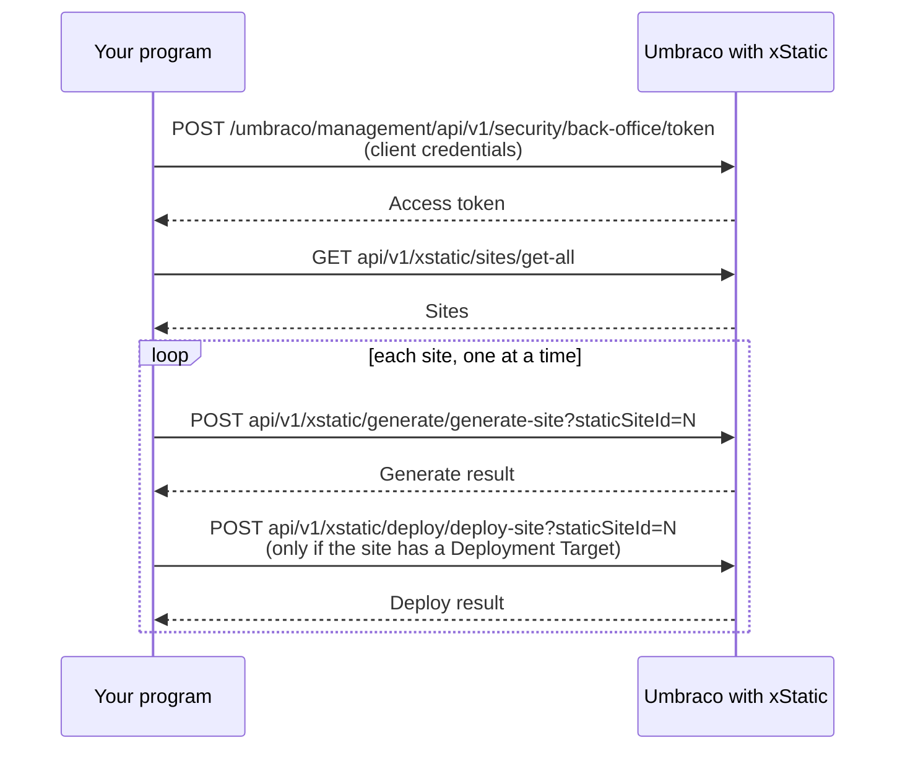

Remote operations let a program outside Umbraco tell xStatic to generate and deploy your sites: a scheduled job, an Azure Function, a CI pipeline or a small console app. The `xStatic.RemoteOperations` package is a .NET client that signs in with an Umbraco API user and calls the same backoffice API the dashboards use. This page is for developers and administrators who want scheduled or externally triggered builds.

The work still happens on the Umbraco server. The remote program is only a trigger that waits for the results.

## At a glance

| | |
|---|---|
| NuGet package | `xStatic.RemoteOperations` |
| Install | `dotnet add package xStatic.RemoteOperations --prerelease` (in the calling project, not the Umbraco site) |
| Needs | An Umbraco API user with a client credential (an id and a secret) in an xStatic user group, and a URL the caller can reach |
| Main class | `XStatic.RemoteOperations.XStaticRemoteOperationsClient` |
| Target framework | .NET 10 |
| Dependencies | Only `Microsoft.Extensions.Logging.Abstractions` |
| Needs `XStatic.Core`? | No, it is a stand-alone client |

## Step 1: create an API user in Umbraco

An API user is an Umbraco account for programs. It has a **client id** and a **client secret** instead of a password.

1. In the backoffice, open the **Users** section and create an **API user**. Umbraco explains the details in its [Management API documentation](https://docs.umbraco.com/umbraco-cms/reference/management-api).
2. Open the new user and create a client credential. Type an **Id** you will recognise, such as `xstatic-scheduler` (letters, digits and hyphens only), and choose a **Secret**. Umbraco can't show the secret again, so store it somewhere safe, such as Azure Key Vault or your CI secret store.
3. Note the full client id. Umbraco puts `umbraco-back-office-` in front of the **Id** you typed, so the client id you give the client is `umbraco-back-office-xstatic-scheduler`.
4. Add the user to the **`xStaticNormalUser`** user group. (The **`xStaticAdmin`** group also works, but the normal group is enough, and it is safer.)

xStatic creates those two groups when the site starts, with the root user in both (see [User groups and security](User-Groups-and-Security.md)). The generate and deploy endpoints that remote operations use accept either group. Without membership of one of them, every call fails with 403 Forbidden.

If you opted out of the automatic setup and didn't call `UseSecureUserGroups()`, the groups aren't checked and any authenticated API user works. The default setup does check them.

## Step 2: add the package and run a build

Create a small project and add the package:

```powershell
dotnet new console -n XStaticScheduler
cd XStaticScheduler
dotnet add package xStatic.RemoteOperations --prerelease
dotnet add package Microsoft.Extensions.Logging.Console
```

`--prerelease` is needed while the version for Umbraco 18 is `18.0.0-beta`; without it you get the latest stable release, which is the Umbraco 17 version.

Replace `Program.cs` with this. It reads its settings from environment variables, generates every site, deploys the ones that have a deployment target, and returns a non-zero exit code if anything went wrong:

```csharp
using Microsoft.Extensions.Logging;
using XStatic.RemoteOperations;

var baseUri = Environment.GetEnvironmentVariable("XSTATIC_BASE_URI")
    ?? throw new InvalidOperationException("Set XSTATIC_BASE_URI.");
var clientId = Environment.GetEnvironmentVariable("XSTATIC_CLIENT_ID")
    ?? throw new InvalidOperationException("Set XSTATIC_CLIENT_ID.");
var clientSecret = Environment.GetEnvironmentVariable("XSTATIC_CLIENT_SECRET")
    ?? throw new InvalidOperationException("Set XSTATIC_CLIENT_SECRET.");

using var loggerFactory = LoggerFactory.Create(builder => builder.AddConsole());
var logger = loggerFactory.CreateLogger("xStatic");

// No trailing slash on the base address.
var remote = new XStaticRemoteOperationsClient(baseUri.TrimEnd('/'), clientId, clientSecret, logger);

var problems = 0;

await foreach (BuildDeployResult result in remote.GenerateAndDeployAllSites())
{
    if (result.Exception != null)
    {
        logger.LogError(result.Exception, "A site failed to generate or deploy.");
        problems++;
        continue;
    }

    if (result.RebuildProcessResult is { WasSuccessful: false } build)
    {
        logger.LogWarning("Site {SiteId} generated with problems: {Exception}", build.SiteId, build.Exception);

        foreach (var warning in build.Warnings ?? [])
        {
            logger.LogWarning("  {Type} {Item}: {Message}", warning.Type, warning.Item, warning.Message);
        }

        problems++;
    }

    if (result.DeployProcessResult is { WasSuccessful: false } deploy)
    {
        logger.LogError("Deploy failed: {Message}", deploy.Message);
        problems++;
    }
}

return problems == 0 ? 0 : 1;
```

Run it:

```powershell
$env:XSTATIC_BASE_URI = "https://my-umbraco-site.example"
$env:XSTATIC_CLIENT_ID = "umbraco-back-office-xstatic-scheduler"
$env:XSTATIC_CLIENT_SECRET = "YOUR-CLIENT-SECRET"
dotnet run
```

To build one site, use `await remote.GenerateAndDeploySite(3)`, which returns a single `BuildDeployResult`. The number is the site's id, the `Id` property of the sites returned by the sites API (`GetAllAsync()` on the generated client).

## What it calls

For each run, in this order ([XStaticRemoteOperationsClient.cs](../Source/XStaticCore/XStatic.RemoteOperations/XStaticRemoteOperationsClient.cs)):



- **Sign-in** is an OAuth client-credentials request to Umbraco's token endpoint. The token is kept by the client object until about ten seconds before it expires, then renewed. Reuse one `XStaticRemoteOperationsClient` for several calls so it doesn't ask for a token every time.
- **Sites are handled sequentially.** The next site starts when the previous one has finished generating and deploying.
- **A site with no Deployment Target is generated only.** The client logs a warning, `DeployProcessResult` is `null`, and nothing is deployed.
- **The `BuildDeployResult`** has three properties: `RebuildProcessResult` (the generate result), `DeployProcessResult` (the deploy result) and `Exception` (set if the generate or deploy call failed, or the site id wasn't found; a sign-in or site-listing failure is thrown instead, see the caveats).
- All three calls need the normal-user policy, described in [User groups and security](User-Groups-and-Security.md).

The generate and deploy steps are exactly the ones in [Generating and deploying](Generating-and-Deploying.md), and the endpoints are listed in [Management API](Management-API.md).

## The package API

| Member | What it does |
|--------|--------------|
| `new XStaticRemoteOperationsClient(string baseUri, string clientId, string clientSecret, ILogger? logger = null)` | Creates the client. `baseUri` has **no trailing slash**, for example `https://www.example.com` |
| `IAsyncEnumerable<BuildDeployResult> GenerateAndDeployAllSites()` | Generates and deploys every site, yielding one result per site |
| `Task<BuildDeployResult> GenerateAndDeploySite(int siteId)` | Does the same for one site. If the id isn't found, the result's `Exception` says `No site with ID N found.` and nothing is thrown |
| `Task<Client> GetAutoGeneratedClient()` | Returns the generated API `Client` with a valid token attached, for calling any other xStatic endpoint |
| `protected virtual Client CreateAutoGeneratedClient(HttpClient)` and `protected virtual HttpClient CreateHttpClient(UmbracoAccessToken)` | Extension points, for example to change the timeout |
| `TokenRetriever` and `UmbracoAccessToken` | The sign-in helper and its result, if you want only a token |

`Client` ([Client.cs](../Source/XStaticCore/XStatic.RemoteOperations/Client.cs)) is generated by NSwag from the xStatic OpenAPI document and has a method for each endpoint, such as `GetAllAsync()`, `GenerateSiteAsync(int)`, `DeploySiteAsync(int)`, `ClearStoredSiteAsync(int)` and the deployment target and action methods. A non-success HTTP status throws an `ApiException`. The download endpoint isn't included, because it returns a file.

## Caveats

- **A site is deployed even if generating it failed.** `GenerateAndDeployAllSites` doesn't check the generate result before it deploys. If the generate call itself fails (an HTTP error), the exception is returned and nothing is deployed. But if generation finishes with failed pages or a failed action (`WasSuccessful` is `false`), the deploy still runs and publishes what was generated. For live sites you may prefer to deploy only after a clean generate; see [Deploy only when generation succeeded](#deploy-only-when-generation-succeeded).
- **Generating can take longer than 100 seconds.** The client uses a plain `HttpClient`, whose default timeout is 100 seconds. For a big site, subclass the client and raise it; see [Longer timeouts](#longer-timeouts).
- **Sign-in failures are thrown, not returned.** So is a failure to list the sites. A wrong secret or user makes the token call fail with an `HttpRequestException` (typically a 400 or 401 status) or `Token not successfully retrieved`. Wrap the call in `try`/`catch` if you want to handle it.
- **The secret isn't URL-encoded in the token request.** A client secret containing characters such as `&`, `+` or `%` will fail to sign in. Use a secret made of letters, digits, `-` and `_`.
- **A failed deploy isn't an exception.** The deployer's failure comes back as HTTP 200 with `WasSuccessful` set to `false` in `DeployProcessResult`, and "Last deployed" is updated anyway. Always check that value.
- **Don't run overlapping builds.** Two runs for the same site at once write to the same output folder. Schedule runs far enough apart for the longest build.
- **Keep the secret out of source control.** Anyone with the client id and secret can trigger builds, and (in the admin group) read deployment target secrets.

### Deploy only when generation succeeded

`GetAutoGeneratedClient()` gives you the generated client, so you can write the loop yourself:

```csharp
using XStatic.RemoteOperations;

public static class SaferRun
{
    public static async Task<bool> GenerateThenDeployOnlyIfGeneratedAsync(XStaticRemoteOperationsClient remote)
    {
        var api = await remote.GetAutoGeneratedClient();
        var sites = await api.GetAllAsync();
        var allGood = true;

        foreach (var site in sites ?? [])
        {
            var built = await api.GenerateSiteAsync(site.Id);

            if (!built.WasSuccessful)
            {
                allGood = false;
                continue;
            }

            if (site.DeploymentTarget == null)
            {
                continue;
            }

            var deployed = await api.DeploySiteAsync(site.Id);
            allGood &= deployed.WasSuccessful;
        }

        return allGood;
    }
}
```

### Longer timeouts

```csharp
using Microsoft.Extensions.Logging;
using XStatic.RemoteOperations;

public class PatientRemoteOperationsClient(string baseUri, string clientId, string clientSecret, ILogger? logger = null)
    : XStaticRemoteOperationsClient(baseUri, clientId, clientSecret, logger)
{
    protected override HttpClient CreateHttpClient(UmbracoAccessToken token)
    {
        var httpClient = base.CreateHttpClient(token);
        httpClient.Timeout = TimeSpan.FromMinutes(30);
        return httpClient;
    }
}
```

## Run it on a schedule with an Azure Function

A timer-triggered Azure Function is a good home for this. The function below runs every hour. It needs the packages `Microsoft.Azure.Functions.Worker`, `Microsoft.Azure.Functions.Worker.Sdk`, `Microsoft.Azure.Functions.Worker.Extensions.Timer` and `xStatic.RemoteOperations` in a .NET 10 isolated-worker project, with the three `XSTATIC_*` values set as application settings. The `Program.cs` is the standard isolated-worker one (`FunctionsApplication.CreateBuilder(args)` then `builder.Build().Run()`).

```csharp
using Microsoft.Azure.Functions.Worker;
using Microsoft.Extensions.Logging;
using XStatic.RemoteOperations;

namespace MyCompany.Failover;

public class RegenerateSites(ILogger<RegenerateSites> logger)
{
    // Every hour, on the hour. NCRONTAB format: {second} {minute} {hour} {day} {month} {day-of-week}.
    [Function("RegenerateSites")]
    public async Task Run([TimerTrigger("0 0 * * * *")] TimerInfo timer)
    {
        var remote = new XStaticRemoteOperationsClient(
            Environment.GetEnvironmentVariable("XSTATIC_BASE_URI")!,
            Environment.GetEnvironmentVariable("XSTATIC_CLIENT_ID")!,
            Environment.GetEnvironmentVariable("XSTATIC_CLIENT_SECRET")!,
            logger);

        await foreach (var result in remote.GenerateAndDeployAllSites())
        {
            if (result.Exception != null)
            {
                logger.LogError(result.Exception, "xStatic run failed");
            }
            else if (result.DeployProcessResult is { WasSuccessful: false } deploy)
            {
                logger.LogError("xStatic deploy failed: {Message}", deploy.Message);
            }
        }
    }
}
```

This function is a starting point, not a hosted sample from the repository. Check the current versions of the Azure Functions packages when you create the project, and note that an Azure Functions host must support .NET 10 for the isolated worker. The [Static failover site](Static-Failover-Site.md) recipe uses this pattern to keep a standby copy of a site fresh.

If you only need a rebuild whenever an editor publishes, you don't need remote operations at all. Turn on **Auto Publish** on the site (see [Auto publish](Auto-Publish.md)). Remote operations are for scheduled runs, for builds triggered by other systems, and for sites where publishing shouldn't start a build.

## Troubleshooting

| Symptom | Likely cause and fix |
|---------|----------------------|
| `HttpRequestException` with status 400 or 401 when signing in | Wrong client id or secret, a client id without its `umbraco-back-office-` prefix, or a secret with characters that break the form body. Check them, and the base address. |
| `HttpRequestException` with status 404 on sign-in | `baseUri` is wrong, has a trailing slash, or includes `/umbraco`. Use the site's root address only. |
| `ApiException` with status 401 or 403 | The API user isn't in `xStaticNormalUser` or `xStaticAdmin`, or the groups don't exist (the site's secure user groups weren't set up). See [User groups and security](User-Groups-and-Security.md). |
| `No site with ID N found.` | The id doesn't exist, or the API user can't see it. Use `GenerateAndDeployAllSites()` to see the available sites. |
| A warning that a site `has no deployment target` | Expected. The site is generated but not deployed. Add a **Deployment Target** to the site. |
| `TaskCanceledException` or a timeout on large sites | The 100 second `HttpClient` timeout. See [Longer timeouts](#longer-timeouts). |
| The build ran but the live site is unchanged | Check `DeployProcessResult.Message` and the Umbraco log. See the deployer's page. |
| Works locally, fails with a certificate error | The local HTTPS development certificate isn't trusted by the calling program. Trust it, or use a real certificate. |

## See also

- [Management API](Management-API.md): every endpoint, and the OpenAPI document.
- [User groups and security](User-Groups-and-Security.md)
- [Auto publish](Auto-Publish.md)
- [Static failover site](Static-Failover-Site.md)
- [Generating and deploying](Generating-and-Deploying.md)
- Video: [Umbraco 15 static failover site](https://www.youtube.com/watch?v=B2poMuqLeW8) shows an Azure Function using this package.
