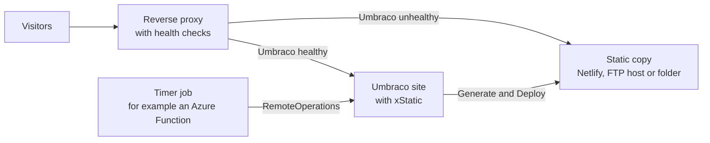

A static failover site is a read-only copy of your Umbraco website that takes over when Umbraco is down. Visitors keep seeing your pages during an upgrade, a database problem or a crash, instead of an error page. xStatic produces and refreshes the static copy. A reverse proxy that you run decides which version a visitor gets. This page is a recipe for developers and ops people, based on the [Umbraco 15 static failover video](https://www.youtube.com/watch?v=B2poMuqLeW8).

It is not a high-availability setup for the backoffice or for dynamic features. Be clear about what a static copy can't do (see [What a static copy can't do](#what-a-static-copy-cant-do)) before you rely on it.

## What is xStatic and what is yours

| Part | Who provides it |
|------|-----------------|
| Generating the site as static HTML, including media and assets | xStatic ([Generating and deploying](Generating-and-Deploying.md)) |
| Putting the copy on a host (Netlify, FTP, a folder or Git) | xStatic deployers ([Deploying to a folder](Deploying-to-a-Folder.md), [Netlify](Deploying-to-Netlify.md), [FTP](Deploying-to-FTP.md), [Git](Deploying-with-Git.md)) |
| Regenerating on a schedule from outside Umbraco | xStatic's [Remote operations](Remote-Operations.md) package, called from your own job (an Azure Function in the video) |
| Regenerating whenever content is published | xStatic [Auto publish](Auto-Publish.md) |
| Removing forms and other things that can't work offline | A transformer you write (an example is below). The video calls it `FormDisabledTransformer`; its code isn't in this repository |
| The reverse proxy, health checks and routing | **You.** The video uses YARP. xStatic has no proxy |
| Hosting the static copy, DNS, certificates | **You** |
| Running it all together locally or in the cloud | **You.** The video uses .NET Aspire. xStatic doesn't need it |

## How it fits together



1. Visitors always go to the proxy.
2. The proxy sends each request to Umbraco while Umbraco's health check passes. When it fails, requests go to the static copy.
3. xStatic on the Umbraco server generates the site and deploys it to the static host. A timer job (or Auto publish) triggers that regularly so the copy stays fresh.
4. A transformer removes the parts of the pages that need a live server.

## Step 1: choose where the static copy lives

Pick any deployer and set it up as described on its page. Whatever you choose, the proxy needs a URL for it.

- **Netlify** is the simplest: the site creator makes the site and you get an HTTPS address immediately (see [Deploying to Netlify](Deploying-to-Netlify.md)).
- A **folder** works when the proxy or a web server on the same network serves it (see [Deploying to a folder](Deploying-to-a-Folder.md)). Remember that the folder deployer never deletes old files.
- **FTP** and **Git** suit hosts that already work that way.

## Step 2: make a "failover" export type that strips forms

Pages that were generated while Umbraco was healthy contain forms: contact forms, search, newsletter sign-up. During an outage those would post to a server that isn't there. A transformer can replace them with a message. xStatic runs the transformers of a site's export type over every HTML page it generates (see [Export types](Export-Types.md)).

Add this to your Umbraco project. It needs no packages beyond what the site already has:

```csharp
using System.Collections.Generic;
using System.Text.RegularExpressions;
using Umbraco.Cms.Core.Web;
using XStatic.Core.Generator;
using XStatic.Core.Generator.Transformers;

namespace MySite.Failover;

public partial class FormDisabledTransformer : ITransformer
{
    private const string Notice =
        "<p class=\"failover-notice\">This form is unavailable while the site is in read-only mode. Please try again later.</p>";

    public string Transform(string input, IUmbracoContext context)
    {
        return string.IsNullOrEmpty(input) ? input : FormPattern().Replace(input, Notice);
    }

    [GeneratedRegex(@"<form\b.*?</form\s*>", RegexOptions.IgnoreCase | RegexOptions.Singleline)]
    private static partial Regex FormPattern();
}

public class FailoverHtmlTransformerListFactory : DefaultHtmlTransformerListFactory
{
    public override IEnumerable<ITransformer> BuildTransformers(ISiteConfig siteConfig)
    {
        foreach (var transformer in base.BuildTransformers(siteConfig))
        {
            yield return transformer;
        }

        yield return new FormDisabledTransformer();
    }
}
```

`FailoverHtmlTransformerListFactory` keeps everything the standard HTML export type does (the cache and crop transformers and the **Target Hostname** replacement) and adds the form remover at the end. xStatic finds the factory by scanning loaded assemblies, so there is no registration. The interfaces are explained in [Writing a transformer](Writing-a-Transformer.md).

A regular expression is a blunt tool. It handles ordinary forms, but not forms inside scripts, or controls that live outside a `<form>` and are driven by JavaScript. If your pages are more complex, parse the HTML with a library such as HtmlAgilityPack in your own project instead.

Now create the export type:

1. Open **xStatic** then **Export Types** and create a new one.
2. Set **Export Type Name \*** to `HTML Website (Failover)`.
3. Choose `FailoverHtmlTransformerListFactory` in **Transformer Factory \***, and the same **Generator \*** and **File Name Generator \*** as the built-in **HTML Website** type (`StaticHtmlSiteGenerator` and `EverythingIsIndexHtmlFileNameGenerator`).

## Step 3: create the failover site

On **xStatic Sites**, create a site, for example `Failover copy`:

- **Root Node \***: your home page.
- **Export Format \***: `HTML Website (Failover)`.
- **Media Root Nodes** and **Asset Paths**: include your media and your CSS, JavaScript and images. If the media files are only served by Umbraco, they disappear in an outage too (see [Asset paths](Asset-Paths.md) and [Sites](Sites.md)).
- **Cultures**: for a multi-language site, pick the cultures (see [Multi-language sites](Multi-Language-Sites.md)).
- **Target Hostname**: the public hostname of your site, if it differs from the address you generate from.
- **Deployment Target**: the target from step 1.

Press **Generate** and open the generated pages (or deploy and look at the static host). Check that there are no forms left and that the page looks right with no Umbraco behind it.

## Step 4: keep the copy fresh

A stale copy is worse than none, so automate regeneration. Use one or both:

- **Auto publish.** Turn it on for the site and every publish regenerates and deploys it (see [Auto publish](Auto-Publish.md)). This keeps the copy as current as the live site, but each publish triggers a full build, which is slow for large sites.
- **A timer job with Remote operations.** An Azure Function (or any scheduler) calls `XStaticRemoteOperationsClient.GenerateAndDeployAllSites()` every hour or night. The sample in [Remote operations](Remote-Operations.md#run-it-on-a-schedule-with-an-azure-function) is a function of the same shape as the one in the video. It also picks up changes that don't fire a publish, such as media and dictionary edits.

Check the results: a deploy can fail without the dashboard saying so (see the limitations on each deployer page).

## Step 5: add the proxy

This part isn't xStatic. The video uses [YARP](https://microsoft.github.io/reverse-proxy/) (Yet Another Reverse Proxy), Microsoft's reverse proxy library for ASP.NET Core. The code below is illustrative: change the addresses, and treat it as a starting point rather than a production setup. It was checked against YARP 2.3.

Create a new ASP.NET Core project, add the `Yarp.ReverseProxy` package, and use this `Program.cs`:

```csharp
var builder = WebApplication.CreateBuilder(args);

builder.Services
    .AddReverseProxy()
    .LoadFromConfig(builder.Configuration.GetSection("ReverseProxy"));

var app = builder.Build();

app.MapReverseProxy();

app.Run();
```

and this `appsettings.json`:

```json
{
  "ReverseProxy": {
    "Routes": {
      "everything": {
        "ClusterId": "website",
        "Match": { "Path": "{**catch-all}" }
      }
    },
    "Clusters": {
      "website": {
        "LoadBalancingPolicy": "FirstAlphabetical",
        "HealthCheck": {
          "Active": {
            "Enabled": true,
            "Interval": "00:00:10",
            "Timeout": "00:00:05",
            "Policy": "ConsecutiveFailures",
            "Path": "/"
          },
          "Passive": {
            "Enabled": true,
            "Policy": "TransportFailureRate",
            "ReactivationPeriod": "00:01:00"
          }
        },
        "Metadata": {
          "ConsecutiveFailuresHealthPolicy.Threshold": "3"
        },
        "Destinations": {
          "1-umbraco": { "Address": "https://cms.internal.example/" },
          "2-static": { "Address": "https://my-static-copy.example.net/" }
        }
      }
    }
  }
}
```

How it works:

- There is one cluster with two destinations. `FirstAlphabetical` always picks the first healthy destination by name, so the names `1-umbraco` and `2-static` make Umbraco the preferred one and the static copy the fallback. This is the YARP policy intended for dual-destination failover.
- **Active** health checks request `Path` on every destination every `Interval`. A destination is unhealthy after three failed checks in a row (the `Threshold`) and returns to service when a check passes. A response outside 200 to 299 counts as a failure. Choose a path that exercises the parts you care about; `/` on Umbraco touches the database, a plain endpoint would not.
- **Passive** checks watch real traffic and take a destination out after transport-level failures, then retry it after `ReactivationPeriod`.
- The static destination is checked too, using the same path, which exists there as well.

Things to sort out yourself:

- **Host headers.** By default YARP sends the destination's own host name. Umbraco uses the host to pick the right [culture and hostname](Multi-Language-Sites.md) and your static host may need its own host name as well. Many setups give both the same public name internally, or pass the original host in `X-Forwarded-Host` and configure Umbraco to trust it.
- **HTTPS, certificates and DNS** for the proxy's public address.
- **Running the proxy itself reliably.** If the proxy goes down, so does the site. It has to be at least as available as the failover you are building.
- **The backoffice** (`/umbraco`) goes to the static copy during an outage and returns 404 there. That is expected.

The video runs the Umbraco site, the proxy and the function together under .NET Aspire so the whole arrangement starts with one command on a development machine. Aspire is a convenience for local development and deployment, not something xStatic or YARP needs, and its API changes quickly, so check its current documentation rather than copying code from older sources.

## Step 6: test it

1. Browse your site through the proxy. You should see the Umbraco version.
2. Stop the Umbraco site. After the health check interval (about 30 seconds with the settings above) the same address serves the static copy. Pages work, forms show the notice.
3. Start Umbraco again. After a successful check, traffic returns to it.

Do this test before you need it, and again after any proxy or hosting change.

## What a static copy can't do

- **Anything that needs a server.** Sign-in, member areas, shopping baskets, comments, search, personalised content and anything that posts data.
- **Fresh content.** It is only as new as the last Generate and Deploy.
- **API calls to Umbraco from JavaScript.** If your pages call Umbraco endpoints, those fail in an outage. Disable or hide those parts as well.

## Troubleshooting

| Symptom | Likely cause and fix |
|---------|----------------------|
| Visitors still see an error page during an outage | The proxy didn't switch. Check the active health check settings, that the health `Path` fails when Umbraco is down, and the proxy logs (YARP logs each failed probe). |
| The proxy switched, but the static copy is a 404 | The deploy never ran, or went to a different place. Generate and deploy, then open the static host directly. |
| Pages on the static copy have no styles or images | **Asset Paths** and **Media Root Nodes** on the failover site are incomplete. |
| Forms are still there | The site isn't using the failover export type, or the form isn't matched by the pattern (for example it is built by JavaScript). |
| Links in the static copy point at the wrong host | Set **Target Hostname** on the site (see [Sites](Sites.md)). |
| The copy is out of date | The timer job isn't running, or a deploy failed silently. Check the job's logs and the Umbraco log. See [Remote operations](Remote-Operations.md). |
| Traffic flaps between the two | The health check is too sensitive. Increase the `Threshold`, `Interval` and `Timeout`, and use a cheaper health path. |

## See also

- [Remote operations](Remote-Operations.md)
- [Auto publish](Auto-Publish.md)
- [Writing a transformer](Writing-a-Transformer.md)
- [Export types](Export-Types.md)
- [Deployment targets](Deployment-Targets.md)
- Video: [Umbraco 15 static failover site](https://www.youtube.com/watch?v=B2poMuqLeW8) (Aspire, YARP, an Azure Function and a form-disabling transformer). The concept still applies; the code in it lives outside this repository and targets Umbraco 15.
