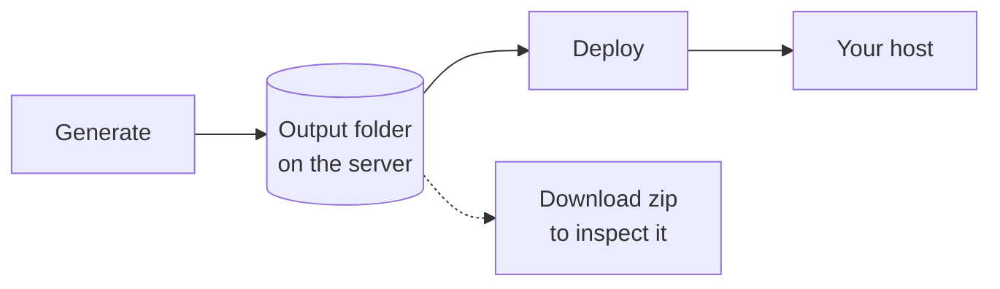

Fixes for the problems people hit most often with xStatic, organised by what you see. Find the heading that matches your symptom, check the cause and work through the numbered fix. If nothing here helps, [report a bug](#how-to-report-a-bug) and include the details listed there.

## Start here

Most problems show up in one of three places. Look at them in this order:

1. **The toast after Generate.** If it says **Site generated with N problem(s)**, it lists the first five failures. Fix those first ([Generating and deploying](Generating-and-Deploying.md#results-and-warnings)).
2. **The generated files.** Select **Download** on the site card and look inside the zip. If the page or file is missing or wrong there, the problem is in generating. If it's right there but wrong on your live site, the problem is in deploying or hosting.
3. **The Umbraco log.** Errors from generating and deploying are written there ([Where to find the logs](#where-to-find-the-logs)).

The most important thing to remember is that **Generate** and **Deploy** are separate steps. Generate builds the output folder on the Umbraco server. Deploy only sends whatever is in that folder right now.

## The backoffice

### I can't see the xStatic section

**Cause.** The signed-in user isn't in a user group that has the **xStatic** section. xStatic only adds the built-in **root user** (the first user created when Umbraco was installed) to its groups. Being an Umbraco administrator isn't enough.

**Fix.**

1. Sign in as the root user and open **xStatic**. If you can see it, the problem is the other user's permissions.
2. Open **Users > User Groups** and check that `xStaticNormalUser` and `xStaticAdmin` exist and have the **xStatic** section ticked. If they don't exist, see the next heading.
3. Add the user to `xStaticNormalUser` (editors) or `xStaticAdmin` (people who manage hosting). See [Giving other users access](User-Groups-and-Security.md#giving-other-users-access).
4. Ask the user to sign out and back in. Permissions are read at sign-in.

The **Deployment Targets** and **Actions** tabs are shown only to `xStaticAdmin` ([Backoffice tour](Backoffice-Tour.md)).

### The user groups don't exist, or the section is missing for everyone

**Cause.** The groups are created once Umbraco has finished starting. That doesn't happen if the site hasn't completed Umbraco's installer, if you registered xStatic yourself without `UseSecureUserGroups()`, or if the user who should create them can't be found. With the automatic registration that is the built-in root user. A name in `XStatic:RoleCreationUser` only counts when you register with `UseSecureUserGroups("name")` yourself.

**Fix.**

1. Finish Umbraco's own installer and restart the site.
2. Look in the Umbraco log for lines that start `xStatic -`, such as `Role creation user not found` or `xStatic user roles are not enabled or role creation user is not set`.
3. If you registered xStatic yourself, add `.UseSecureUserGroups()` ([Configuration](Configuration.md#setting-them-in-code)).

How it works is described on [Installation](Installation.md#what-happens-on-first-start).

### The backoffice looks broken or a tab is blank

**Cause.** The browser has cached the previous version's JavaScript.

**Fix.** Hard-refresh the browser (Ctrl+F5). If you've just upgraded, also check that every xStatic package is the same version ([Upgrading](Upgrading.md#general-upgrade-steps)). Mixed versions of `xStatic`, `xStatic.Core` and `xStatic.Client` cause odd errors.

### The Sites dashboard shows an error after upgrading from xStatic 13

**Cause.** On versions before 17.3.0 and 18.0.0, a database upgraded from xStatic 13 never got the table that holds sites (`XStaticSiteConfigs14Plus`), so the Sites dashboard failed with an HTTP 500.

**Fix.**

1. Update every xStatic package to 17.3.0 or later (18.0.0 or later on Umbraco 18) and restart the site. xStatic then creates the missing tables and copies your old sites across ([What the automatic upgrade does](Upgrading.md#what-the-automatic-upgrade-does)).
2. Look in the Umbraco log for lines that start `xStatic: upgraded`, which says how many sites were copied. A site that was skipped gets its own `xStatic: could not upgrade v13 site` line, because its root content node no longer exists. If the new sites table already had sites in it, nothing is copied at all.
3. Open each site and check its **Deployment Target**. The old inline deployer settings become a target named `<site name> (<deployer name>)`.
4. If the dashboard still returns 500, [report a bug](#how-to-report-a-bug) and include the error from the log.

Once everything works, drop the old `XStaticSiteConfigs` table. It holds your credentials in plain text ([Dropping the old table](Upgrading.md#dropping-the-old-table)).

## Generating

### Generate finishes but the output is empty, or has no pages

**Cause.** There are several, and xStatic doesn't always warn you:

- The site's **Root Node** isn't published. xStatic reads the published content cache, so an unpublished root means zero pages and no warning. The site card shows **Item Not Found** next to the root node.
- Every page failed to download. You'd see the problems toast.
- The pages have no template. They're skipped without a message in an HTML export.
- The page isn't published in the selected **Cultures**.

**Fix.**

1. Publish the root node (with descendants if you want the whole tree), then generate again.
2. If the toast shows `Could not download the page from ...`, follow the next heading.
3. Open the page in Umbraco and check it has a template. A page with no template can't be rendered as HTML. Use a [JSON export](JSON-Export.md) if you want content without templates.
4. If you ticked languages under **Cultures**, check each page is published in them ([Multi-language sites](Multi-Language-Sites.md)).

### "Could not download the page from ..." for some or all pages

**Cause.** xStatic fetches each published page by making an HTTP request, from the Umbraco server, to the page's URL as Umbraco reports it. The request failed.

**Fix.** Work down this list:

1. **Open that URL in a browser on the server** (or run `curl -I` against it from there). If it fails, xStatic will fail too. A page returning a 404 or 500 needs fixing in your template, not in xStatic.
2. **Check the host name.** The URL comes from your **Culture and Hostnames** settings. If a domain there points at a different server, or isn't reachable from the Umbraco server itself (behind a load balancer, in a container, or only resolvable from outside), downloads fail. Fix the domain, or add a hosts-file entry on the server so it can reach itself.
3. **Check the certificate.** If the site uses HTTPS and the server doesn't trust its own certificate (a self-signed or development certificate, most often on Linux and macOS), set `XStatic:TrustSslWhenGenerating` to `true` in `appsettings.json` and restart ([TrustSslWhenGenerating](Configuration.md#trustsslwhengenerating)). Before 17.1.0 it can only be set in code. It switches off certificate checking for xStatic's own downloads only. Don't leave it on in production unless you need to.
4. **Check the page has a URL in that language.** A page that isn't published in a ticked culture has no URL for it, and is reported as failed.
5. Look in the Umbraco log for `Error while downloading file from <url>`. It has the exception, such as `The SSL connection could not be established` or `Connection refused`.

Pages that fail aren't saved. Before 18.0.0 (and 17.3.0) they were saved as empty files with no warning, so an old build may contain empty pages ([Upgrading](Upgrading.md#behaviour-changes-in-1800)).

### Generation failed

**Cause.** The danger toast **Generation failed** means the build itself threw an exception, for example because the site's export type points at a generator that can't be created.

**Fix.**

1. Read the message in the toast.
2. Open the site's **Export Format** on the **Export Types** tab and check each of its three parts still exists, for example after removing a plugin ([Export types](Export-Types.md)).
3. Check the Umbraco log for `xStatic failed to generate site`, which has the full exception.

### Old or deleted pages are still on the live site

**Cause.** **Generate never empties the output folder.** It writes new and changed files and leaves everything else. A page you unpublished, deleted or renamed stays in the output and is deployed again. Unpublishing doesn't remove it either.

**Fix.**

1. On the site card, select **Clean** and confirm. This empties the output folder, keeping `.git` and `CNAME` by default ([Clean](Generating-and-Deploying.md#clean)).
2. Select **Generate**, and wait for it to finish.
3. Select **Deploy**.

> **Never Clean and then Deploy.** After **Clean** the output folder still exists but is empty, so **Deploy** runs and sends nothing. With a deployer that sends the whole folder as the site, that **removes the live site's files**: [FTP](Deploying-to-FTP.md#mirror-mode-deletes-files) deletes them from the server, Git commits their deletion, and Netlify publishes an empty site. Always **Generate** straight after **Clean**.

What a deploy does with files that are no longer in the output depends on the deployer:

| Deployer | Removed pages |
|----------|---------------|
| **Netlify** | Removed from the live site, because each deploy describes the whole site |
| **Git** | Removed from the repository, because deletions are staged |
| **FTP** | Deleted from the server (mirror mode) |
| **File System** | Never deleted. Remove them from the destination by hand |

### The page works but CSS, JavaScript or fonts are missing

**Cause.** Stylesheets, scripts and fonts live on disk, not in Umbraco, so xStatic doesn't know about them until you list them under **Asset Paths**.

**Fix.**

1. View the source of the generated page and note every `href` and `src` that isn't under `/media`, or open the browser's network tab and look for 404s.
2. Edit the site and add each path to **Asset Paths**, for example `/css/*`, `/scripts/*` and `/fonts/*`. A folder on its own (`/css`) doesn't include its subfolders. A trailing `/*` does ([Asset paths](Asset-Paths.md#folders-files-and-wildcards)).
3. Generate again.
4. If the toast says `Asset path '...' not found`, the path doesn't exist in `wwwroot` or the content root. Check the spelling and case. On Linux, paths are case sensitive.

Assets are copied as they are, so a stylesheet that mentions your local host name isn't rewritten ([Tips](Asset-Paths.md#tips)).

### Images are missing, resized images are broken or the crops weren't created

**Cause.** Resized images are made in advance and listed under **Image Crops**. Several things can go wrong:

- The crop entry isn't written correctly. Bad entries are skipped without a warning.
- The size in your template doesn't match a crop, so the link points at a file that doesn't exist.
- Umbraco's image signing (`HMACSecretKey`) rejected the request.
- The server couldn't download its own images (see the certificate and host name points above).

**Fix.**

1. Check the crop syntax: `800x450`, `320x0` or `1600x900@80`, with a lower case `x` ([Crop syntax](Image-Crops.md#crop-syntax)).
2. Check that the template asks for exactly the same `width` and `height`. Open the generated HTML and look at the image URLs. A rewritten one ends in `--800x450.jpg`.
3. If the toast says `Saved the original, but could not download these crops`, you're probably on a version before 17.3.0 / 18.0.0 with an `HMACSecretKey` set, or the server can't reach itself. Update, and then see [When a crop fails](Image-Crops.md#when-a-crop-fails).
4. Check the file extension's case. xStatic names the crop file with a lower case extension, but the link rewriting keeps the original case. For a source file called `photo.JPG` the page links to `photo--800x450.JPG` while the file on disk is `photo--800x450.jpg`. This works on Windows hosts and fails on case-sensitive ones (Linux, Netlify, GitHub Pages). Rename the media item's file to a lower case extension in Umbraco and generate again.
5. Make sure the images are in a folder chosen under **Media Root Nodes**. Media outside them aren't copied.
6. Two crops with the same size but different quality (`800x450@80` and `800x450@50`) write the same file name, and the second wins. Use one quality per size ([What gets made](Image-Crops.md#what-gets-made)).
7. Avoid sizes where one number starts with another (`width=300` also matches `width=3000`).

### Links in the static site point at localhost or my staging domain

**Cause.** The generated pages contain the host name Umbraco used when it rendered them. **Target Hostname** replaces your Umbraco domains with the live one, but only in HTML export types that use the default transformer list, and only for domains that are set up in **Culture and Hostnames**. It's a plain text replacement.

**Fix.**

1. Edit the site and set **Target Hostname** to the live host name without a protocol, for example `www.example.com` ([Target Hostname](Sites.md#target-hostname)).
2. On the site's root content item, open **Culture and Hostnames** and check that a domain is set for the host name you see in the output. If Umbraco has no domain for it, there is nothing for xStatic to replace.
3. Check that the domain is written exactly as it appears in the links, including any port (`localhost:44300`). The swap matches the whole string.
4. If your domains include a path (`example.com/en`), the whole string is replaced, path included. Check the absolute links in the output ([Hostnames](Multi-Language-Sites.md#hostnames)).
5. If you built a [custom export type](Export-Types.md), make sure its transformer factory is the default HTML one. JSON export doesn't change host names.
6. Look for the host name in CSS or JavaScript files you listed under **Asset Paths**. Those aren't transformed. Use relative URLs in them.

Better still, write relative links (`/about/`) in your templates, which need no replacement.

### My multi-language site shows an error at the root address

**Cause.** With one folder per language, nothing exists at `/`.

**Fix.** Add a post-generation action that copies the default language's home page to the root: **Action Type** `FileCopyAction`, **FilePath** `/en/index.html`, **NewFilePath** `index.html` (use the path your build produces). Add it to the site under **Post Generation Actions** ([Send the root to a language](Multi-Language-Sites.md#send-the-root-to-a-language)).

### A post-generation action fails

**Cause.** The action reports its error under the name you gave it, for example `Copy 404 page: Error running file copy action Could not find file ...`. The usual reasons are a source file that doesn't exist, an empty field, or a path written for the wrong layout.

**Fix.**

1. Select **Generate**, then **Download** and look in the zip for the real path of the file. With the default HTML export a page at `/error/` is `error/index.html`.
2. Edit the action on the **Actions** tab and correct **FilePath** and **NewFilePath**. Paths are relative to the output folder. A leading `/` is optional.
3. If the action is `Netlify404Action` and generation fails altogether, `AddNetlifyActions()` hasn't been called ([Serve your own 404 page](Deploying-to-Netlify.md#serve-your-own-404-page)).
4. An action whose type has been removed (a plugin you uninstalled) is skipped silently. Check **Config** to see what is installed.

Every action runs even if an earlier one fails, so the toast shows all the problems at once ([Failures](Post-Generation-Actions.md#failures)).

### JSON output is wrong or can't be read

**Cause and fix**, by symptom:

| Symptom | Cause and fix |
|---------|---------------|
| I get HTML, not JSON | The site's export type isn't a JSON one. xStatic only creates **HTML Website** for you. Create a JSON export type and choose it on the site ([Set up a JSON export type](JSON-Export.md#set-up-a-json-export-type)) |
| Nothing is generated, or the files are named `index.html` | The export type mixes parts. It needs `BasicJsonApiGenerator`, `DefaultJsonTransformerListFactory` and `JsonFileNameGenerator` together |
| My JSON parser fails on the first character | A byte order mark in files from before 17.3.0 / 18.0.0. Update and **Clean**, then generate again |
| Links look like `about.json` and don't resolve | They have no leading slash, by design. Resolve them against the place the JSON is hosted ([Links between pages](JSON-Export.md#links-between-pages)) |
| Content links are still `umb://document/...` | The target page wasn't found (unpublished or outside the site). Media links aren't rewritten |
| Every language has the same values | The language isn't passed when properties are read. The language only changes the file path ([Limitations](JSON-Export.md#file-contents)) |
| The browser blocks the request from my front end | Your host needs to send CORS headers. xStatic doesn't add any |
| Git shows every file as changed | `_GENERATED_ON_` changes on every build |

## Deploying

### Deploy says "generate first" or "Deployment target null"

**Cause.** The backoffice may show only a generic error for these, so check the Umbraco log for the message. `Failed to deploy. No generated output found at '...'. Generate the site before deploying.` means the output folder doesn't exist yet. `Deployment target null` means the site has no target, and `Deployment target not found with id ...` means the target was deleted.

**Fix.**

1. Select **Generate** and wait for it to finish, then **Deploy**.
2. If the message is about the target, edit the site and choose a **Deployment Target**. Create one on the **Deployment Targets** tab first if necessary (admins only).

Without a deployment target the card has no **Deploy** button ([Deployment targets](Deployment-Targets.md)).

### Deploy says it worked but nothing changed on the live site

**Cause.** There are two kinds of problem here. First, a failed deploy can look like a success: the dashboard doesn't show the deployer's error message, and **Last deployed** is updated whether the deploy worked or not. Second, the deploy may have worked but sent old content.

**Fix.**

1. Check the Umbraco log for the deployer's message. xStatic logs a failed deploy as an error, with text such as `FTP deploy failed for N of M item(s)`, `Error deploying site using Git.`, `Error uploding file hashes to Netlify` (spelled that way) or `Error deploying site to file system.`
2. Check that you pressed **Generate** before **Deploy**. Deploy doesn't generate.
3. Use **Download** to confirm the new content is in the output.
4. **FTP: folders appear on the server but they are empty.** The data connection is blocked. Open the server's passive port range in its firewall, and make sure the server announces an address your Umbraco server can reach ([Passive mode](Deploying-to-FTP.md#passive-mode)). Before 17.3.0 / 18.0.0 this was reported as a success, and edited pages weren't updated.
5. **FTP: the site is deployed to the wrong place.** Check **Folder**. It must be the folder your host serves.
6. **Anything cached in front of the host** (a CDN, the browser) may still serve the old page. Check with a private window or add a cache-busting query to the address.
7. **Netlify:** the deploy can take a few seconds to publish after xStatic says it's done. Check **Deploys** in Netlify.

Per-deployer tables are on [Deploying to FTP](Deploying-to-FTP.md#troubleshooting), [Deploying with Git](Deploying-with-Git.md#troubleshooting), [Deploying to Netlify](Deploying-to-Netlify.md#troubleshooting) and [Deploying to a folder](Deploying-to-a-Folder.md#troubleshooting).

### Files on my server disappeared after the first FTP deploy

**Cause.** The FTP deployer mirrors. Anything in the remote **Folder** that isn't in your generated site is deleted.

**Fix.** Restore from your backup, then point **Folder** at a folder used only for the static site. Never use the account's root if it holds anything else ([Mirror mode deletes files](Deploying-to-FTP.md#mirror-mode-deletes-files)).

### The first Git deploy fails, or Git deploys fail with authentication errors

**Cause.** The first deploy clones your repository into the output folder. It fails when the remote URL is mistyped, the token can't see the repository or lacks **Contents** read and write permission, or the server can't reach the remote. Only HTTPS with a username and token is supported. SSH isn't.

**Fix.**

1. Edit the target. Check **Remote URL** (the HTTPS address ending in `.git`), **Username** and **Password / Personal Access Token**. Use a token, not your account password.
2. For GitHub, create a fine-grained token for that one repository with **Contents** set to **Read and write** ([Walkthrough: GitHub Pages](Deploying-with-Git.md#walkthrough-github-pages)).
3. Deploy again. If the clone failed, xStatic put your generated site back, so you don't need to generate again. On versions before 17.3.0 / 18.0.0 the site was left in a `_temp` folder next to the output folder and the next deploy deleted it, so generate again.
4. If the error is `cannot push non-fastforwardable reference`, the remote has commits xStatic doesn't have (for example GitHub added a `CNAME` after the first clone), or **Branch** names an existing branch that isn't the default. xStatic never pulls. Either run `git pull` in the output folder, or delete the `.git` folder inside it so the next deploy clones again ([Limitations](Deploying-with-Git.md#limitations-and-gotchas)).

### The Netlify Site Creator shows an error

**Cause and fix**, by message. The backoffice may show only a generic error, so if you don't see these words, open the browser's network tab and read the response to the `auto-create-deployment-target` request.

| Message | Fix |
|---------|-----|
| `Error creating site on Netlify, please make sure that the site name is unique and try again.` | The name is taken, or the token is invalid. Use the arrow button beside the name to see whether the address exists, then try another name or check the token |
| HTTP 500 with `Personal Access Token is required.` or `Site Name is required.` | A field was left blank. Fill in both |
| The new target isn't named what you typed | The creator names the target after the **Site Name** and ignores the dialog's **Name**. Rename it with **Edit** |

If the creator isn't in the **Creator Template** list, `xStatic.Netlify` isn't installed. You can always create the site in Netlify and add a **Netlify** target by hand with its **Site ID** ([Option 2](Deploying-to-Netlify.md#option-2-use-a-netlify-site-you-already-have)).

### Deploying to GitHub Pages, or any sub-path, breaks every link

**Cause.** xStatic assumes the site is served from the root of a domain. A GitHub Pages project site (`you.github.io/my-repo/`) isn't.

**Fix.** Use a custom domain or a `<your-name>.github.io` repository. Otherwise write a transformer that adds the prefix ([Hosting under a sub-path](Deploying-with-Git.md#hosting-under-a-sub-path)).

## Automatic builds

### Auto Publish is slow, or it doesn't deploy

**Cause.** Auto publish runs a full rebuild and deploy inside Umbraco's publish notification, so the editor waits for it. It only runs under certain conditions.

**Fix.** Check each in turn:

1. The site has a **Deployment Target**. Auto publish does nothing without one.
2. **Auto Publish** is on. The card says **Auto Publish On**.
3. The published page is the site's **Root Node** or below it.
4. You published. Unpublishing, deleting, media changes and changes to languages or domains don't trigger a build.
5. Check the Umbraco log for errors from the build or the deploy.

If publishing feels slow, that's expected on a big site: there is no incremental build, so every publish regenerates everything. Switch **Auto Publish** off and use a scheduled build instead ([Remote operations](Remote-Operations.md)). Also note that it deploys even when the build reported problems, so a bad page can go live. Run a manual **Generate** if you suspect something ([Auto publish](Auto-Publish.md#what-to-know-before-you-switch-it-on)).

### A scheduled or remote build ran but the site didn't update

**Cause.** The remote client deploys even when generation reported failures, and a failed deploy comes back as HTTP 200 with `WasSuccessful` set to `false`. A timeout on a large site is also common (the default is 100 seconds).

**Fix.** Check `DeployProcessResult.Message` and the Umbraco log, and see the table on [Remote operations](Remote-Operations.md#troubleshooting). For 401 or 403 errors, check the API user is in `xStaticNormalUser` ([User groups and security](User-Groups-and-Security.md#api-users-for-remote-operations)).

## Where to find the logs

xStatic writes to Umbraco's normal log, so there's nothing extra to switch on.

1. In the backoffice, open **Settings** and then **Log Viewer**. Search for `xStatic`, or filter to **Error** and **Warning**.
2. The raw files are in `umbraco/Logs` on the server, one file per day.

What xStatic writes there:

| Message | Meaning |
|---------|---------|
| `Error while downloading file from <url>` | A page, media file or crop couldn't be fetched |
| `Error generating file ...`, `Error generating media ...`, `Error generating page ...` | A page or media item failed |
| `xStatic failed to generate site <name> (<id>)` | The whole build threw an exception |
| `xStatic excluding document types: ...` | The `ExcludeGeneratingDocTypes` setting is in use. Logged at information level when a build starts |
| `xStatic asset path ... was not found ... and has been skipped` | A path under **Asset Paths** doesn't exist |
| `FTP deploy failed ...`, `Error deploying site using Git.` and so on | A deploy result that wasn't successful. The deploy endpoint logs the deployer's message as an error |
| `xStatic: upgraded N of M v13 sites ...` | The version 13 data upgrade ran ([Upgrading](Upgrading.md)) |
| `xStatic - ...` | User group set-up at start-up |

Umbraco's default log level is `Information`. The per-page `Generating static HTML for page at ...` lines are written at `Debug` level. To see them, set the minimum level to `Debug` in `appsettings.json` (the `Serilog` section) while you investigate, and put it back afterwards.

The deployers themselves (FTP, Git, Netlify) don't write their own log lines. What you see is the message the deploy endpoint logged when the result was unsuccessful. If a deployer threw an exception, the exception is attached to that entry.

## How to report a bug

Open an issue at [github.com/Mulliman/xStatic-for-Umbraco/issues](https://github.com/Mulliman/xStatic-for-Umbraco/issues). Search the existing issues first. It helps a great deal if you include:

- **Versions:** xStatic (all packages), Umbraco, .NET, and the operating system or hosting (IIS, Linux, Docker, Azure).
- **Database:** SQLite or SQL Server.
- **What you did and what you expected**, step by step, and what happened instead.
- **The deployer** you use (Netlify, Git, FTP, File System, a third-party one).
- **The export type** (HTML or JSON, built-in or custom) and whether the site has several languages.
- **The warnings from the Generate toast**, exactly as shown.
- **The relevant Umbraco log lines**, including the stack trace. Remove tokens, passwords and host names you don't want public. Check for secrets before you paste.
- **A minimal example**, such as the page that fails, if you can find one.

Never paste a deployment target's token, password or the contents of the `XStaticDeploymentTargets` table into an issue. Those values are stored in plain text ([Deployment targets](Deployment-Targets.md#secrets-where-they-live-and-who-sees-them)).

If you have a fix, pull requests are welcome. See [Developing xStatic](Developing-xStatic.md).

## Next steps

- [Generating and deploying](Generating-and-Deploying.md)
- [FAQ](FAQ.md)
- [Upgrading](Upgrading.md)
- [Configuration](Configuration.md)
