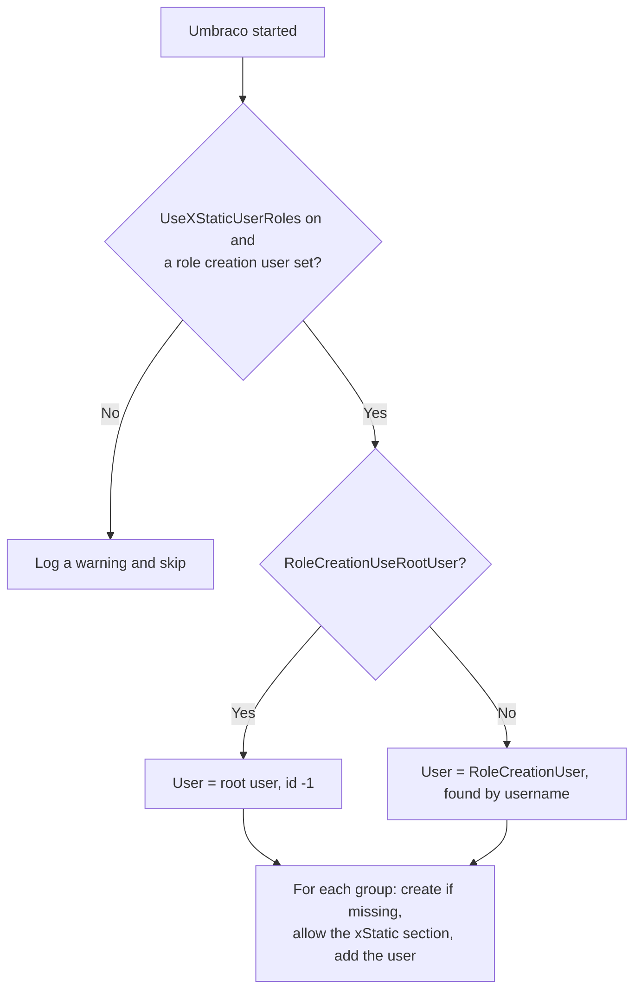

Who can do what in xStatic. This page covers the two user groups xStatic creates, what each can see and call, how and
when the groups are made, what changes if you turn them off, and how to keep credentials away from editors. It is
for whoever sets up the site's backoffice users.

## At a glance

- xStatic creates two Umbraco user groups: **`xStaticAdmin`** and **`xStaticNormalUser`**.
- **Normal users** work with sites: create, edit, generate, deploy, clean and download. They can also manage export types.
- **Admins** can do all that and also manage **deployment targets** (which hold passwords and tokens) and **actions**.
- The groups are created automatically the first time the site starts, and the **root user** is added to both.
  You add everyone else by hand.
- The rules are enforced twice: by the backoffice UI (tabs are hidden) and by the Management API (requests are refused).

## What each group can do

| | `xStaticNormalUser` | `xStaticAdmin` |
|---|:---:|:---:|
| See the **xStatic** section | Yes | Yes |
| **xStatic Sites**: create, edit, delete | Yes | Yes |
| Generate, deploy, clean, download a site | Yes | Yes |
| **Export Types**: create, edit, delete | Yes | Yes |
| **Config** and **Documentation** tabs | Yes | Yes |
| Pick a deployment target or action by name in the site dialog | Yes | Yes |
| **Deployment Targets**: see, create, edit, delete | No | Yes |
| **Actions**: see, create, edit, delete | No | Yes |
| Read deployer passwords and tokens | No | Yes |

Normal users can deploy a site, because that's part of an editor's job, but they never see where it deploys or the
credentials it uses. The site dialog gives them only the id and name of each target and action (and the deployer type of each target).

Export types are open to normal users on purpose. They only choose between installed components. They hold no secrets.

### How it is enforced

On the **API**, each endpoint carries one of two policies:

| Policy | Role required | Used by |
|--------|---------------|---------|
| `xStaticNormalUser` | `xStaticNormalUser` **or** `xStaticAdmin` | Sites, generate, deploy, download and the config and export type endpoints |
| `xStaticAdmin` | `xStaticAdmin` | Deployment targets and actions |

Both also require a signed-in backoffice user (or API user) with a valid token. The role is the **alias of the user
group**, which is why the groups' aliases must be exactly `xStaticAdmin` and `xStaticNormalUser`. The full endpoint
list is in the [Management API](Management-API.md).

In the **backoffice UI**, the **Deployment Targets** and **Actions** tabs are shown only to admins. The rest are shown
to either group. The UI reads the current user's group permissions to decide, so it also hides things for users in neither
group.

Hiding a tab is a convenience. The API check is the one that protects the data.

## How the groups are created

On every start, once Umbraco is fully running, xStatic's
[`AddXStaticRolesNotificationHandler`](../Source/XStaticCore/XStatic/Security/AddXStaticRolesNotificationHandler.cs)
does this for each of the two groups:

1. If the group doesn't exist, create it. It gets the alias and name `xStaticAdmin` or `xStaticNormalUser`, the
   `icon-os-x` icon, and a permission string equal to its alias, which the backoffice UI checks.
2. Make sure the group is allowed into the **xStatic** section, adding it if not.
3. Add the configured user to the group (and keep them in it).

The handler is safe to run on every start. If SQLite reports a locked table it retries up to three times, a second apart. Any other failure is logged and rethrown.

### Who gets added

Only one user is added: the **role creation user**. Which user that is depends on two settings.

| Setting (in `appsettings.json` under `XStatic`) | Code equivalent | Meaning |
|---|---|---|
| `RoleCreationUseRootUser` = `true` | `UseSecureUserGroups()` | Use the root user, the first user created in the Umbraco installer (internal id `-1`) |
| `RoleCreationUser` = `"admin@example.com"` | `UseSecureUserGroups("admin@example.com")` | Use the user with this username. Umbraco usernames are usually the email address |
| `UseXStaticUserRoles` = `true` | Either of the above | Turns the groups and the API checks on |

The automatic setup (just installing the package) is `UseSecureUserGroups()`, so the **root user** gets both groups.
If `RoleCreationUseRootUser` is `true`, it wins over `RoleCreationUser`. That means setting `XStatic:RoleCreationUser`
in `appsettings.json` does nothing under automatic registration. To name a different user, register xStatic yourself
and call `UseSecureUserGroups("admin@example.com")` ([Configuration](Configuration.md#user-group-settings)).
If the named user can't be found, xStatic logs a warning and creates nothing.

### Giving other users access

Add other people yourself, in the backoffice:

1. Open **Users > User Groups** and open `xStaticNormalUser` (for editors) or `xStaticAdmin` (for the few who manage
   deployment).
2. Add the users, or open each user in **Users** and tick the group.
3. Ask them to sign out and in again so their permissions refresh.

Use the groups xStatic created. If you make your own group with the same alias by hand, it won't have the permission
string the backoffice UI looks for, so tabs may stay hidden for its members even though the API accepts them.

An administrator who isn't in either group can't use xStatic. Being a Umbraco administrator doesn't count.

## Without secure user groups

If you register xStatic yourself (see [Extending xStatic](Extending-xStatic.md)) and don't call `UseSecureUserGroups`,
the xStatic groups are not used:

- No groups are created. xStatic logs a warning at every start to say so.
- The API checks only that the caller is signed in. Anyone with a backoffice token passes, whether or not they can
  open the xStatic section.
- The UI shows every tab to everyone who can see the section.
- Access is controlled only by ticking the **xStatic** section in a user group.

That's fine for a one-person site, but it means **every backoffice user who can reach the API can read your deployment
credentials**. Turn the groups on for any site with more than one backoffice user.

## Recommendations

- **Keep credentials away from editors.** Put editors in `xStaticNormalUser`. Keep `xStaticAdmin` to the people who
  genuinely set up hosting.
- **Use least-privilege tokens.** Give deployers a token that can do only the one job: a Netlify token you can revoke,
  a GitHub token limited to **Contents** on one repository, an FTP account restricted to one folder.
- **Remember what's stored.** Deployer secrets sit in the database in plain text. Protect database backups
  and access accordingly. See [Deployment targets](Deployment-Targets.md#secrets-where-they-live-and-who-sees-them).
- **Don't share the root user.** Create a named user for each admin and add them to `xStaticAdmin`.
- **Use a dedicated API user for automation** rather than a person's account (see below).
- **Review after upgrading from 13.** The old `XStaticSiteConfigs` table keeps credentials in plain text. Drop it when
  you are done. See [Upgrading](Upgrading.md).

## API users for remote operations

To build and deploy from outside Umbraco, such as a scheduler or an Azure Function, call the Management API with an
Umbraco **API user**. API users sign in with a client ID and secret rather than a password. The
[Remote operations](Remote-Operations.md) page covers the whole flow, and the [Management API](Management-API.md)
page has working requests.

To set one up:

1. In the backoffice, open **Users** and create an **API user**, then create a client credential on it: choose an **Id** and a **Secret** (Umbraco can't show the secret again). The client id you send when signing in is `umbraco-back-office-` followed by that Id.
2. Add the API user to the `xStaticNormalUser` group. That is enough to generate and deploy sites.
   Add it to `xStaticAdmin` only if the caller must also manage targets or actions.
3. Store the secret in a secrets manager, not in source control.

The same group rules apply to API users as to people. With secure user groups on, an API user in neither group gets a
403 from xStatic's endpoints.

## Next steps

- [Security policy](../SECURITY.md): which versions get security fixes, and how to report a vulnerability privately.
- [Backoffice tour](Backoffice-Tour.md): which tabs each group sees.
- [Management API](Management-API.md): every endpoint and its policy.
- [Configuration](Configuration.md): the `XStatic` settings in `appsettings.json`.
