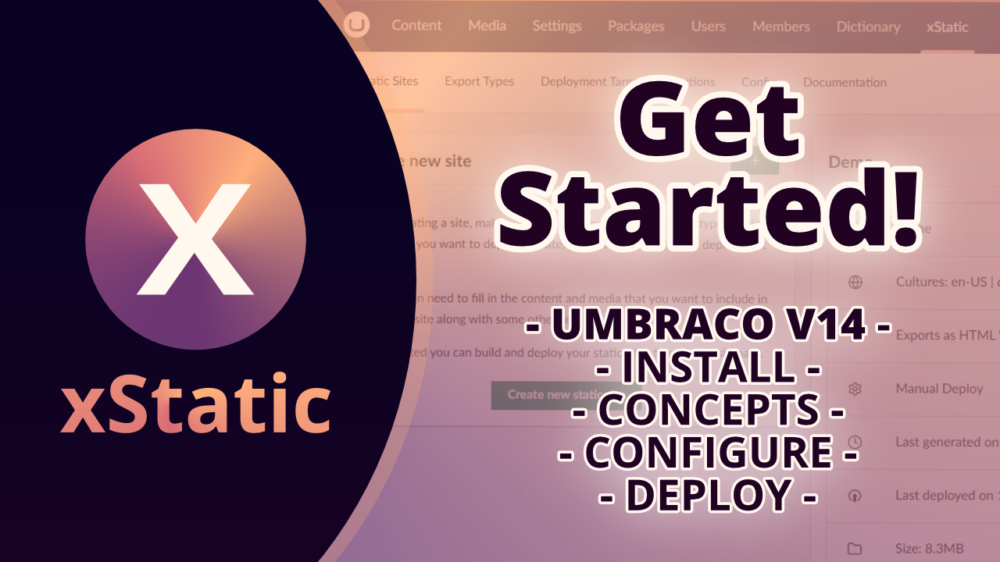
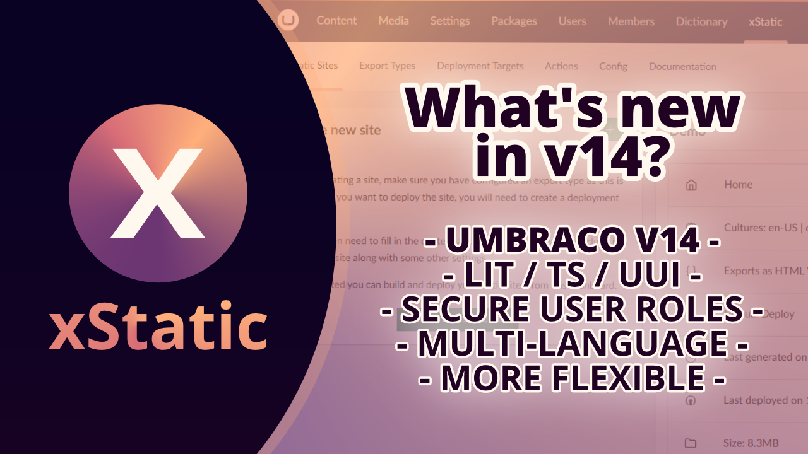
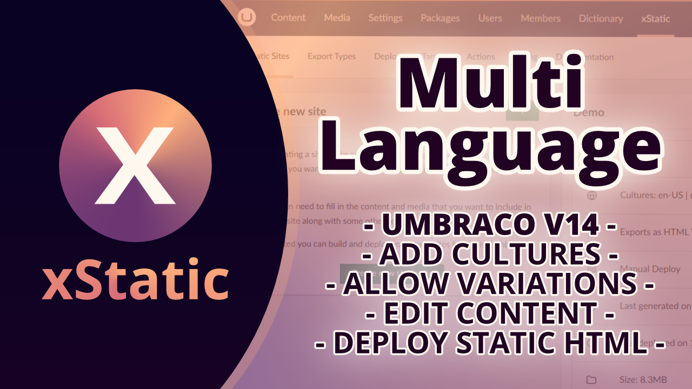
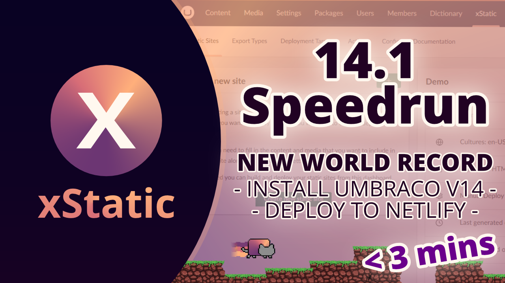
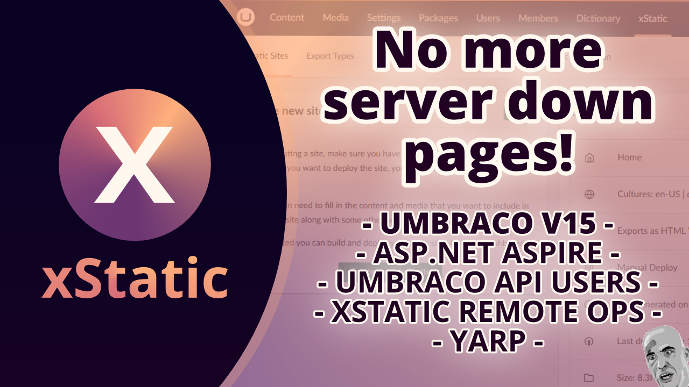

Every public xStatic video and talk, what each covers, and whether it still matches the current version. Videos are a
good way to see the backoffice in action, but the wiki pages are the source of truth where the two differ.

## At a glance

| Video | Year | Length | Still current? |
|-------|------|--------|----------------|
| [xStatic 14: Get Started](#xstatic-14-get-started) | 24 Aug 2024 | 15:58 | Mostly. Skip the `Program.cs` step |
| [xStatic 14: What's new?](#xstatic-14-whats-new) | 24 Aug 2024 | 0:58 | Yes, as a trailer |
| [Create and host multi-language sites](#create-and-host-multi-language-sites) | 26 Aug 2024 | 11:06 | Yes |
| [xStatic 14.1 Speedrun](#xstatic-141-speedrun) | 6 Sep 2024 | 6:00 | Yes |
| [Umbraco 15 static failover site](#umbraco-15-static-failover-site) | 24 Nov 2024 | 32:05 | The idea yes, the code lives outside this repo |
| [Netlify in 5 minutes (2020)](#netlify-in-5-minutes-2020) | 11 Dec 2020 | 4:43 | No. Umbraco 8 only |
| [umbraCoffee #160](#umbracoffee-160-the-origin-story) | 29 Jan 2021 | 54:11 | Historical |

## xStatic 14: Get Started

**15:58, 24 August 2024.** The best walkthrough of the Umbraco 14 backoffice: installing the package, creating a deployment
target and a site, generating, deploying, and setting up the user groups.

**Is it still current?** Mostly. The sections and screens still match.

- Registering xStatic in `Program.cs` is **no longer needed**. Since 14.1.0 `XStaticComposer` does it. See
  [Installation](Installation.md).
- Some labels and layout have been polished since. If a button isn't where the video shows it, use the
  [Backoffice tour](Backoffice-Tour.md).

**Read instead:** [Your first static site](Your-First-Static-Site.md), [Sites](Sites.md),
[Deployment targets](Deployment-Targets.md), [User groups and security](User-Groups-and-Security.md).

## xStatic 14: What's new?

**0:58, 24 August 2024.** A one-minute trailer for the version 14 rebuild.

**Is it still current?** Yes, as an overview. The full story of what changed is on
[Version history](Version-History.md) and [Upgrading](Upgrading.md).

## Create and host multi-language sites

**11:06, 26 August 2024.** Builds a multi-language site end to end: the Umbraco side (adding languages, varying content by
culture, cultures and hostnames) and the xStatic side (picking cultures on the site, the per-culture folders in the
output). It also shows the trick of putting a root `index.html` in place so the bare domain forwards to a language.

**Is it still current?** Yes. The Umbraco steps follow Umbraco's own behaviour, so check Umbraco's documentation for
your version.

**Read instead:** [Multi-language sites](Multi-Language-Sites.md).

## xStatic 14.1 Speedrun

**6:00, 6 September 2024.** From an empty Umbraco site to a live static site on Netlify as fast as possible. It uses Package Script
Writer to install Umbraco with xStatic, and the **Netlify site creator** (added in 14.1.0), which creates the Netlify
site and a deployment target for you.

**Is it still current?** Yes. The creator is covered, with its limits, on
[Deploying to Netlify](Deploying-to-Netlify.md). See also [Deployment target creators](Deployment-Target-Creators.md)
if you want to write one.

## Umbraco 15 static failover site

**32:05, 24 November 2024.** A recipe for a static copy of your site that takes over if Umbraco goes down. It uses .NET Aspire and
YARP as a reverse proxy, an Azure Function that calls xStatic through
[Remote operations](Remote-Operations.md) to rebuild on a schedule, and a transformer that disables forms in the
static copy, since forms can't post to a static site.

**Is it still current?** The concept is. The example code for the proxy and the function lives outside this
repository. The xStatic parts (remote operations and a custom transformer) are covered on
[Static failover site](Static-Failover-Site.md) and [Writing a transformer](Writing-a-Transformer.md).

## Netlify in 5 minutes (2020)

[Watch on YouTube](https://www.youtube.com/watch?v=XOwgBITayyc)

**4:43, 11 December 2020.** The original demo of xStatic version 1 deploying to Netlify, in an Umbraco 8 beta.

**Is it still current?** No. It is for Umbraco 8 and the 2020 interface, which has been rewritten twice. It is kept as
history. For the current way to do this, see [Deploying to Netlify](Deploying-to-Netlify.md).

## umbraCoffee #160: the origin story

[Watch on YouTube](https://www.youtube.com/watch?v=aqz-u8PL6tg)

**54:11, 29 January 2021.** An interview about where xStatic came from: a 2013 proof of concept for a high-traffic, high-security
site for a UK public inquiry, and how it was revived to host a photography site cheaply on Netlify.

**Is it still current?** As history, yes. The product has since moved from Umbraco 8 to 18, so don't follow any
steps from it. For the current picture, see
[What is xStatic?](What-is-xStatic.md) and [Version history](Version-History.md).

## Next steps

- [Your first static site](Your-First-Static-Site.md) to follow a current walkthrough in writing
- [FAQ](FAQ.md) for short answers
- [Version history](Version-History.md) for what has changed since each video
