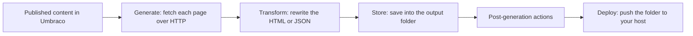

xStatic is a static site generator for Umbraco. You keep building and editing your site in Umbraco as normal, and xStatic turns the published site into plain files (HTML, or JSON) that you can put on any static host. This page explains what it does, who it suits, how it works and what it can't do.

## What it does

1. You build your site in Umbraco with Razor templates, and editors publish content in the backoffice as usual.
2. In the xStatic section of the backoffice you define a **site**: which content to include, which media, extra files such as CSS, and where the result should go.
3. When you press **Generate**, xStatic requests every published page from your running Umbraco site, tidies the HTML up, and saves it as files in a folder on the server.
4. When you press **Deploy**, xStatic copies that folder to your host: a Netlify site, a Git repository, an FTP server or a plain folder.

Umbraco stays private (or hidden behind a login or firewall) and your visitors only ever see the generated files.

## Is xStatic for you?

xStatic is a good fit when:

- **Your site is mostly content.** Brochure sites, marketing sites, documentation, blogs and campaign microsites all work well, because every visitor sees the same page.
- **You want to start small and grow later.** You can build the site in Umbraco, generate it, and host the result somewhere cheap. Many static hosts have free plans. If you later need a dynamic site again, your content is still in Umbraco.
- **You want fewer things to secure.** A static site has no database, no login page and no server-side code for a visitor to attack. Your Umbraco backoffice doesn't need to be on the public internet.
- **You want speed.** Static files can be served straight from a CDN with no rendering time.
- **You want to share starter kits.** The generated site is a folder of files, so an Umbraco starter kit can be turned into a static site by anyone with xStatic installed.

xStatic is probably not for you when your site needs server-side behaviour on every visit. See [What it can't do](#what-it-cant-do).

## How it works

Pressing **Generate** and **Deploy** runs these steps. Each is an extension point if you need to change it (see [Architecture](Architecture.md)).

- **Generate** asks Umbraco for the URL of every published page under your site's root node and downloads it. Media files under the chosen media folders and any extra asset files are copied across too.
- **Transform** runs a list of small changes over each page. For HTML, the default list adds an `<!-- Cached by xStatic -->` comment before `</body>`. If the site has image crops, it renames image URLs to point at the generated crop files ([Image crops](Image-Crops.md)). If the site has a **Target Hostname**, it swaps the hostnames set in Umbraco's **Culture and Hostnames** for that one.
- **Store** writes the files into a folder in `umbraco/Data/xStatic/output`, one folder per site.
- **Post-generation actions** are optional extra steps, such as copying a page to `404.html` ([Post-generation actions](Post-Generation-Actions.md)).
- **Deploy** sends the folder to a deployment target. Generating and deploying are separate buttons, so you can check the output first.

The details of each button are on [Generating and deploying](Generating-and-Deploying.md). If you'd rather have it happen on its own, see [Auto publish](Auto-Publish.md).

## What it can't do

A static site is a set of files, so anything that needs to run on the server when a visitor arrives won't work from the files alone. That includes:

- Forms that save or email data, unless you hand them to a separate service.
- Site search that queries Umbraco or Examine.
- Member logins, personalisation and anything that depends on who is visiting.
- Pages that change on every request, such as basket contents or live prices.

You can often replace these with JavaScript talking to a third-party service, but that's your own build work, not something xStatic does for you.

There is one more requirement. xStatic gets each page by making a real HTTP request to your running Umbraco site, so it needs **server-rendered pages**: Razor templates that produce the HTML. A site that is only a JavaScript app calling an API has nothing for xStatic to download. For that style of site, use [JSON export](JSON-Export.md) instead, which writes the content itself and doesn't need templates. The Umbraco server must also be able to reach its own page URLs.

HTML export only generates pages that have a template. Unpublished pages aren't generated, because xStatic reads from the published content cache.

## Packages

xStatic is split into packages so you install only what you use. All of them are free and MIT licensed. Versions should be updated together.

| Package | What it is |
|---------|------------|
| `xStatic` | The main package. Install this one into your Umbraco site. It brings in the other two below. |
| `xStatic.Core` | The engine and the public API for people writing their own generators, transformers, deployers and actions. |
| `xStatic.Client` | The backoffice screens. |
| `xStatic.Netlify` | Deployer, site creator and 404 action for [Netlify](Deploying-to-Netlify.md). |
| `xStatic.Git` | Deployer for [Git repositories](Deploying-with-Git.md), including GitHub Pages. |
| `xStatic.Ftp` | Deployer for [FTP servers](Deploying-to-FTP.md). |
| `xStatic.RemoteOperations` | A small client for triggering builds from outside Umbraco ([Remote operations](Remote-Operations.md)). |

A deployer that copies to a folder on the server is built into the core, so you don't need an extra package for [that](Deploying-to-a-Folder.md). Version 18 of xStatic needs Umbraco 18.3.2 or later. See [Installation](Installation.md) for the full steps.

## Videos

- [xStatic 14 - Get Started](https://www.youtube.com/watch?v=_BW8oV3LI1Q): a walkthrough of the backoffice. The `Program.cs` registration it shows is no longer needed.
- [xStatic 14 - What's new?](https://www.youtube.com/watch?v=BhKlHbvK2yY): a short trailer for the Umbraco 14 version.
- [xStatic 14.1 Speedrun](https://www.youtube.com/watch?v=tYdYG3PgRcQ): setting up a Netlify site from scratch.
- [umbraCoffee #160](https://www.youtube.com/watch?v=aqz-u8PL6tg): an interview about why xStatic exists.

There are more on [Videos and talks](Videos-and-Talks.md).

## Next steps

- [Installation](Installation.md)
- [Your first static site](Your-First-Static-Site.md)
- [Backoffice tour](Backoffice-Tour.md)
- [FAQ](FAQ.md)
