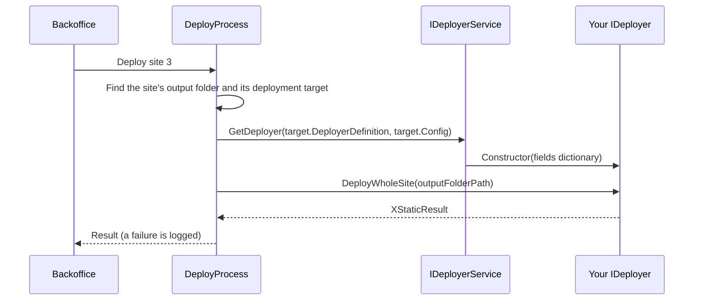

A deployer is the component that takes the folder of generated files and pushes it somewhere: a host, a repository, a server. xStatic ships deployers for a folder, Netlify, Git and FTP, and you can add your own. This page is for developers and covers the interfaces, the fields that appear in the backoffice, registration, and packaging a deployer as its own NuGet plugin.

## At a glance

A deployer is made of up to four small classes:

| Class | Interface | Required? | Job |
|-------|-----------|-----------|-----|
| Deployer | `IDeployer` | Yes | Does the work in `DeployWholeSite(folderPath)` |
| Definition | `IDeployerDefinition` | Yes | Id, display name, help text and the fields editors fill in |
| Auto installer | `IDeployerAutoInstaller` | Recommended | Ties the definition and the deployer together so xStatic finds them without any registration code |
| Extension method | none | Optional | A one-line `AddMyDeployer()` for people who register xStatic by hand |

If you just want to *use* a deployer, see [Deployment targets](Deployment-Targets.md). The built-in ones have their own pages: [folder](Deploying-to-a-Folder.md), [Netlify](Deploying-to-Netlify.md), [Git](Deploying-with-Git.md) and [FTP](Deploying-to-FTP.md).

## How a deploy runs

An editor creates a **Deployment Target** in the backoffice: a name, a deployer type and values for that deployer's fields. Each site then points at one target. When the editor presses deploy, [DeployProcess.cs](../Source/XStaticCore/XStatic.Core/Deploy/Processes/DeployProcess.cs) does this:



Your deployer is created fresh for every deploy, so keep no state between runs.

## IDeployer

[IDeployer.cs](../Source/XStaticCore/XStatic.Core/Deploy/IDeployer.cs):

```csharp
public interface IDeployer
{
    Task<XStaticResult> DeployWholeSite(string folderPath);
}
```

`folderPath` is the absolute path of the site's generated output. Treat it as read-only.

### How field values arrive

The constructor receives a `Dictionary<string, string>`. The **keys are the field aliases** you declared in the definition, and the values are whatever the editor typed. Everything is a string, including numbers.

```csharp
public MyDeployer(Dictionary<string, string> parameters)
{
    var endpoint = parameters[MyDefinition.FieldNames.Endpoint];
}
```

Be defensive:

- The built-in deployers read with `parameters[key]`, which throws `KeyNotFoundException` if the key is missing. A target saved *before* you added a new field won't have that key, so prefer `TryGetValue` and apply a default.
- A field the editor left empty can arrive as `null` rather than an empty string.
- Stick to text-style editors for your fields (see below) and parse the value yourself. Every value is stored as a string, and only the text and password editors are used by the built-in deployers.

### Returning XStaticResult

[XStaticResult.cs](../Source/XStaticCore/XStatic.Core/XStaticResult.cs) is the return type:

| Member | Use |
|--------|-----|
| `XStaticResult.Success()` / `Success(message)` | The deploy worked |
| `XStaticResult.Error(message)` | It failed and you know why |
| `XStaticResult.Error(message, exception)` | It failed with an exception. The exception is logged |
| `WasSuccessful`, `Message`, `Exception` | The properties behind those |

**Catch your own exceptions and return an error result.** `DeployProcess` doesn't wrap the call in a `try`, so an exception thrown from `DeployWholeSite` or from your constructor escapes as an unhandled server error (HTTP 500). A returned error result is logged with your message and exception by the deploy endpoint instead (auto publish doesn't log it). The backoffice doesn't show the result message, so the log is where you and your users will look. Also don't report success unless the files really arrived: the FTP deployer got caught out by that and now checks every uploaded item ([FtpDeployer.cs](../Source/XStaticCore/XStatic.Ftp/FtpDeployer.cs)).

`DeployWholeSite` returns a `Task`. If your work is synchronous, wrap it with `TaskHelper.FromResultOf` from `XStatic.Core.Helpers`, as the folder and FTP deployers do.

## IDeployerDefinition and DeployerField

[IDeployerDefinition.cs](../Source/XStaticCore/XStatic.Core/Deploy/IDeployerDefinition.cs) describes the deployer to the backoffice:

```csharp
public interface IDeployerDefinition
{
    string Id { get; }
    string Name { get; }
    string Help { get; }
    IEnumerable<DeployerField> Fields { get; }
}
```

| Member | What it is |
|--------|------------|
| `Id` | A unique, stable key such as `"ftp"`. It is saved with every deployment target made from this deployer. **Never change it once people use the deployer**, or their targets stop appearing in the list. Adding two definitions with the same Id throws an error at start-up |
| `Name` | What the **Deployer \*** dropdown shows, for example `FTP` |
| `Help` | A sentence or two about the deployer. It can contain HTML. At the time of writing the Deployment Target dialog doesn't display it (the target creator dialog does, see [Deployment target creators](Deployment-Target-Creators.md)), but the API returns it |
| `Fields` | The settings an editor fills in, in the order given |

Each field is a `DeployerField`:

| Property | Default | What it does |
|----------|---------|--------------|
| `Alias` | none | The dictionary key your deployer reads. Make it unique across *all* deployers by using a prefix: the built-ins use names like `FTP.Hostname` and `Netlify.PAT` |
| `Name` | none | The label shown to the editor. Always set it |
| `Value` | `null` | A default value, shown pre-filled when a new target is created |
| `Help` | `null` | Intended as help text. The current dialog doesn't render it, so put anything important in the label or the definition's `Help` |
| `EditorUiAlias` | `Umb.PropertyEditorUi.TextBox` | Which Umbraco property editor UI draws the field |

### Editors you can use

[UIEditors.cs](../Source/XStaticCore/XStatic.Core/UIEditors.cs) lists the aliases as constants in the `XStatic` namespace:

| Constant | Alias | Use for |
|----------|-------|---------|
| `UIEditors.Text` | `Umb.PropertyEditorUi.TextBox` | Single-line text: hostnames, paths, URLs |
| `UIEditors.TextArea` | `Umb.PropertyEditorUi.TextArea` | Multi-line text |
| `UIEditors.Password` | `xstatic.propertyEditorUi.password` | Secrets such as passwords and tokens. A masked box with a **Show** button |
| `UIEditors.Integer` | `Umb.PropertyEditorUi.Integer` | Whole numbers |
| `UIEditors.Decimal` | `Umb.PropertyEditorUi.Decimal` | Decimal numbers |
| `UIEditors.Toggle` | `Umb.PropertyEditorUi.Toggle` | On/off |
| `UIEditors.Email` | `Umb.PropertyEditorUi.Email` | Email addresses |
| `UIEditors.Tags` | `Umb.PropertyEditorUi.Tags` | A list of tags |
| `UIEditors.StaticFilePicker` | `Umb.PropertyEditorUi.StaticFilePicker` | Picking a file from the site |

The `Umb.PropertyEditorUi.*` editors are Umbraco's own. The password editor is registered by xStatic's backoffice client, which also registers a Netlify subdomain editor (`xstatic.propertyEditorUi.netlifySubdomain`) used by the [Netlify site creator](Deployment-Target-Creators.md). The built-in deployers only use `UIEditors.Text` and `UIEditors.Password`. Try any other editor in a scratch target before relying on it, because the saved values are strings.

Fields are saved in the database as part of the deployment target, **in plain text**. Passwords and tokens are stored exactly as typed. The deployment target endpoints are admin-only: when secure user groups are on, only users in the xStatic admin group can see and edit targets (see [User groups and security](User-Groups-and-Security.md)).

## A complete example

This deployer zips the generated site and POSTs it to an HTTPS endpoint, optionally with a bearer token. It is deliberately small, but it covers the definition, fields, defaults, validation, error handling and registration.

```csharp
using System;
using System.Collections.Generic;
using System.IO;
using System.IO.Compression;
using System.Net.Http;
using System.Net.Http.Headers;
using System.Threading.Tasks;
using XStatic;
using XStatic.Core;
using XStatic.Core.Deploy;

namespace MySite.Deployers
{
    public class ZipUploadDeployerDefinition : IDeployerDefinition
    {
        public class FieldNames
        {
            public const string Endpoint = "ZipUpload.Endpoint";
            public const string Token = "ZipUpload.Token";
            public const string TimeoutSeconds = "ZipUpload.TimeoutSeconds";
        }

        public string Id => ZipUploadDeployer.DeployerKey;

        public string Name => "Zip Upload";

        public string Help => "Zips the generated site and POSTs it to an HTTPS endpoint.";

        public IEnumerable<DeployerField> Fields => new[]
        {
            new DeployerField { Alias = FieldNames.Endpoint, Name = "Endpoint URL", EditorUiAlias = UIEditors.Text },
            new DeployerField { Alias = FieldNames.Token, Name = "Bearer token", EditorUiAlias = UIEditors.Password },
            new DeployerField { Alias = FieldNames.TimeoutSeconds, Name = "Timeout (seconds)", EditorUiAlias = UIEditors.Text, Value = "100" },
        };
    }

    public class ZipUploadDeployer : IDeployer
    {
        public const string DeployerKey = "zip-upload";

        private readonly string _endpoint;
        private readonly string _token;
        private readonly int _timeoutSeconds;

        public ZipUploadDeployer(Dictionary<string, string> parameters)
        {
            _endpoint = Get(parameters, ZipUploadDeployerDefinition.FieldNames.Endpoint);
            _token = Get(parameters, ZipUploadDeployerDefinition.FieldNames.Token);

            if (!int.TryParse(Get(parameters, ZipUploadDeployerDefinition.FieldNames.TimeoutSeconds), out _timeoutSeconds) || _timeoutSeconds <= 0)
            {
                _timeoutSeconds = 100;
            }
        }

        public async Task<XStaticResult> DeployWholeSite(string folderPath)
        {
            if (!Uri.TryCreate(_endpoint, UriKind.Absolute, out var uri) || uri.Scheme != Uri.UriSchemeHttps)
            {
                return XStaticResult.Error("The endpoint URL must be a full https:// address.");
            }

            try
            {
                using var zip = new MemoryStream();
                ZipFile.CreateFromDirectory(folderPath, zip, CompressionLevel.Optimal, includeBaseDirectory: false);
                zip.Position = 0;

                using var client = new HttpClient { Timeout = TimeSpan.FromSeconds(_timeoutSeconds) };
                using var request = new HttpRequestMessage(HttpMethod.Post, uri) { Content = new StreamContent(zip) };
                request.Content.Headers.ContentType = new MediaTypeHeaderValue("application/zip");

                if (!string.IsNullOrWhiteSpace(_token))
                {
                    request.Headers.Authorization = new AuthenticationHeaderValue("Bearer", _token);
                }

                using var response = await client.SendAsync(request);

                if (!response.IsSuccessStatusCode)
                {
                    return XStaticResult.Error($"The server replied {(int)response.StatusCode} {response.ReasonPhrase}.");
                }

                return XStaticResult.Success($"Site uploaded to {uri.Host}.");
            }
            catch (Exception e)
            {
                return XStaticResult.Error("Error uploading the site.", e);
            }
        }

        private static string Get(Dictionary<string, string> parameters, string key)
        {
            return parameters.TryGetValue(key, out var value) ? value : null;
        }
    }
}
```

The deployer creates its own `HttpClient` because xStatic only passes the field dictionary to the constructor: dependency injection isn't available inside a deployer. For a one-off upload per deploy that is fine.

## Registration

There are two ways to get a deployer into xStatic. Use the first unless you have opted out of automatic registration.

### Auto installer (recommended)

`IDeployerAutoInstaller` ([IDeployerAutoInstaller.cs](../Source/XStaticCore/XStatic.Core/Deploy/IDeployerAutoInstaller.cs)) joins the definition to a factory function for the deployer:

```csharp
using System;
using System.Collections.Generic;
using XStatic.Core.Deploy;

namespace MySite.Deployers
{
    public class ZipUploadAutoInstaller : IDeployerAutoInstaller
    {
        public IDeployerDefinition Definition => new ZipUploadDeployerDefinition();

        public Func<Dictionary<string, string>, IDeployer> Constructor => x => new ZipUploadDeployer(x);
    }
}
```

When xStatic starts, `AddDeployersAutomatically` in [DeployServiceBuilder.cs](../Source/XStaticCore/XStatic.Core/App/DeployServiceBuilder.cs) scans the loaded assemblies for non-abstract classes that implement `IDeployerAutoInstaller`, creates each with its parameterless constructor and registers it. The default start-up (`XStaticComposer`) does this for you, so once the class is in an assembly the site references, **ZipUpload** appears in the **Deployer \*** dropdown of the **Deployment Targets** dashboard. No `Program.cs` change is needed.

Auto installers are created with `Activator.CreateInstance`, so they need a public parameterless constructor.

### Extension method (manual registration)

If your site opts out of automatic registration, add the deployer with the builder. Wrap it in an extension method so it reads well:

```csharp
using XStatic.Core.App;

namespace MySite.Deployers
{
    public static class ZipUploadExtensions
    {
        public static IDeployServiceBuilder AddZipUploadDeployer(this IDeployServiceBuilder builder)
        {
            builder.AddDeployer(new ZipUploadDeployerDefinition(), x => new ZipUploadDeployer(x));

            return builder;
        }
    }
}
```

Then register it with the rest of your manual set-up:

```csharp
using Microsoft.Extensions.DependencyInjection;
using MySite.Deployers;
using XStatic.Core.App;
using XStatic.Core.Deploy;

var xstatic = services.AddXStatic();
xstatic.GeneratorServiceBuilder.AddDefaults();
xstatic.DeployServiceBuilder.AddDeployer(new FileSystemDeployerDefinition(), x => new FileSystemDeployer(x));
xstatic.DeployServiceBuilder.AddZipUploadDeployer();
xstatic.Build();
```

See [Extending xStatic](Extending-xStatic.md) for what else a manual set-up needs. Two cautions:

- **Don't do both.** `AddDeployer` adds the Id to a dictionary, so registering the same deployer by auto installer *and* by extension method throws an `ArgumentException` for the duplicate key.
- `XStaticComposer` only runs the automatic set-up when `ISitesRepository` hasn't been registered yet. Your manual set-up registers it (through `AddDefaults`), which is how the composer knows to step aside.

## Packaging a deployer as a NuGet plugin

The FTP deployer is the smallest real example to copy: the folder is [XStatic.Ftp](../Source/XStaticCore/XStatic.Ftp). It contains:

| File | Role |
|------|------|
| [FtpDeployer.cs](../Source/XStaticCore/XStatic.Ftp/FtpDeployer.cs) | The `IDeployer` |
| [FtpDeployerDefinition.cs](../Source/XStaticCore/XStatic.Ftp/FtpDeployerDefinition.cs) | The definition, with a nested `FieldNames` class of alias constants |
| [FtpAutoInstaller.cs](../Source/XStaticCore/XStatic.Ftp/FtpAutoInstaller.cs) | The auto installer |
| [FtpExtensions.cs](../Source/XStaticCore/XStatic.Ftp/FtpExtensions.cs) | `AddFtpDeployer()` for manual registration |
| [XStatic.Ftp.csproj](../Source/XStaticCore/XStatic.Ftp/XStatic.Ftp.csproj) | Package metadata and references |
| `App_Plugins/XStatic.Ftp/package.manifest` | An empty `{}` placeholder that ships in the package |

A minimal project file for your own plugin looks like this (the FTP one also sets package metadata such as the licence and icon):

```xml
<Project Sdk="Microsoft.NET.Sdk">
  <PropertyGroup>
    <TargetFramework>net10.0</TargetFramework>
    <PackageId>MyCompany.XStatic.ZipUpload</PackageId>
    <Version>18.0.0</Version>
    <Description>Zip upload deployer for xStatic for Umbraco.</Description>
  </PropertyGroup>

  <ItemGroup>
    <PackageReference Include="XStatic.Core" Version="18.*-*" />
    <PackageReference Include="Umbraco.Cms.Core" Version="18.3.2" />
  </ItemGroup>
</Project>
```

Points to get right:

- **Reference `XStatic.Core`, not `XStatic`.** The core package holds the interfaces and has no backoffice code. Use the same major version as the xStatic your users have installed.
- **Match the Umbraco major.** An xStatic 18 plugin targets Umbraco 18 and `net10.0`.
- **Include the auto installer.** With it, users add your package and the deployer appears with no code.
- **Keep your field aliases unique** with a prefix, since all deployers' values are stored in the same table.
- **Choose a stable `Id`** and never change it.

The repository's own packages are listed in `.github/workflows/pack.yml` and released by the maintainer. That only matters if you are contributing a new deployer to this repository: then add its project file to the Pack step as described in [Developing xStatic](Developing-xStatic.md).

## Limitations

- A deployer only gets the field dictionary and the folder path. It can't read the site's settings, other services or the Umbraco context.
- `DeployWholeSite` is all-or-nothing from xStatic's point of view: there is no per-file progress or partial-success result.
- Field `Help` and the definition's `Help` are not displayed in the Deployment Target dialog yet.
- The result message isn't shown in the backoffice, and a failed result still updates the site's last-deployed time. Report details through the log.

## Next steps

- [Deployment target creators](Deployment-Target-Creators.md): let editors create a target (and the remote service) in one step.
- [Deployment targets](Deployment-Targets.md): how editors use targets.
- [Extending xStatic](Extending-xStatic.md): all the extension points and manual registration.
- [Architecture](Architecture.md): where deployment sits in the pipeline.
- [Deploying to FTP](Deploying-to-FTP.md): the reference deployer from a user's side.
