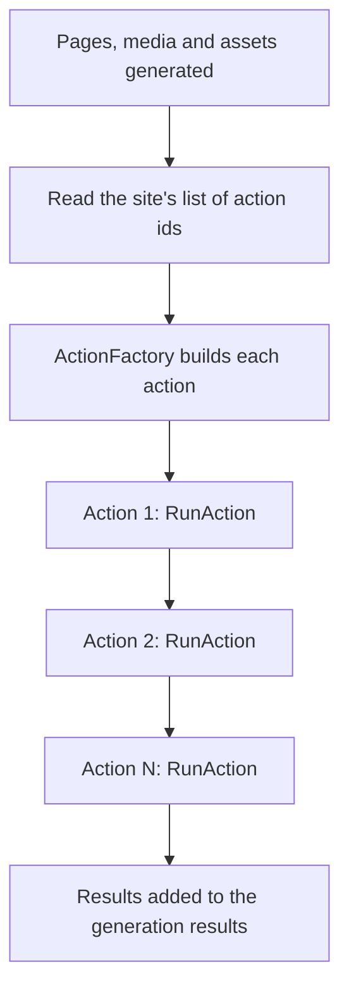

A post-generation action is a small piece of code that runs once all the pages, media and assets have been generated, for example to copy a 404 page, write a `robots.txt` or call a webhook. This page is for developers: it covers the interface, how editors' settings reach your code, how xStatic finds and creates your action, and how its results and errors are reported.

If you want to *use* the built-in actions rather than write one, see [Post-generation actions](Post-Generation-Actions.md).

## At a glance

| Piece | What it is |
|-------|------------|
| `IPostGenerationAction` | The interface: a `Name` and a `RunAction` method |
| `PostGenerationActionBase` | An optional base class with a `GetParameter` helper |
| `[XStaticEditableField]` | An attribute that adds a setting to the action's form in the backoffice. Use it once per setting |
| Registration | None if the action has a parameterless constructor. Register it in dependency injection if it takes constructor parameters |

## How an action runs

An editor creates an **Action** in the backoffice (a name, a type and values for the type's settings) and ticks it on a site under **Post Generation Actions**. When the site is generated, this happens at the end of [RebuildProcess.cs](../Source/XStaticCore/XStatic.Core/Generator/Processes/RebuildProcess.cs):



Auto publish uses the same process, so your action runs on automatic rebuilds too. Deploying is a separate step that happens afterwards, so an action that writes files into the site's output folder (as the example below does) has its files included in the deploy.

## The interface

[IPostGenerationAction.cs](../Source/XStaticCore/XStatic.Core/Actions/IPostGenerationAction.cs):

```csharp
public interface IPostGenerationAction
{
    string Name { get; }

    Task<XStaticResult> RunAction(int staticSiteId, Dictionary<string, string> parameters);
}
```

| Member | Meaning |
|--------|---------|
| `Name` | A fallback label for the action in results. The editor's own **Action Name \*** is used when there is one, which is nearly always. Return something sensible such as `nameof(MyAction)` |
| `staticSiteId` | The id of the site being generated |
| `parameters` | The values the editor entered, keyed by the field name (see below) |
| Return value | An `XStaticResult`. `XStaticResult.Success()` or `XStaticResult.Error(message)` / `XStaticResult.Error(message, exception)` |

You can derive from `PostGenerationActionBase` ([PostGenerationActionBase.cs](../Source/XStaticCore/XStatic.Core/Actions/FileActions/PostGenerationActionBase.cs)) in the `XStatic.Core.Actions.FileActions` namespace. It makes `Name` and `RunAction` abstract and gives you `GetParameter(parameters, key)`, which returns the value or `null` if the key isn't there. It saves a `TryGetValue` and is what all the built-in actions use.

## Settings: XStaticEditableField

Each setting an editor can fill in is declared with an attribute on the class ([XStaticEditableFieldAttribute.cs](../Source/XStaticCore/XStatic.Core/XStaticEditableFieldAttribute.cs)):

```csharp
[XStaticEditableField("Webhook URL")]
[XStaticEditableField("Secret", UIEditors.Password)]
public class MyAction : PostGenerationActionBase { /* ... */ }
```

| Part | What it does |
|------|--------------|
| `fieldName` (first argument) | Is **both the label** the editor sees and the **key** in the `parameters` dictionary. Use the same constant in the attribute and in `GetParameter` |
| `editorUiAlias` (optional second argument) | Which editor draws the field. It defaults to a text box. `UIEditors.Password` (from the `XStatic` namespace) gives a masked box. The [list of editors](Writing-a-Deployer.md#editors-you-can-use) is the same as for deployers |

Things to know:

- The attribute can be repeated, and the fields appear in the order they are declared. The reflection order isn't formally guaranteed, but in practice it matches the source.
- **Attributes are not inherited.** If you derive from another action, repeat the attributes on your class. `Netlify404Action` does this: it extends `FileCopyAction` but declares its own single `FilePath` field.
- A field the editor never touched arrives as an empty string or `null`. A saved action doesn't get new keys automatically if you add a field later, so use `GetParameter` (which returns `null`) and handle both.
- Values are strings. Parse numbers and booleans yourself and decide what a bad value does (return an error, not an exception).
- Values are saved in the database in plain text, like deployer fields.

## Discovery, registration and construction

**Discovery.** [PostGenerationActionsList.cs](../Source/XStaticCore/XStatic.Core/Actions/PostGenerationActionsList.cs) scans every loaded assembly for non-abstract classes that implement `IPostGenerationAction`. These fill the **Action Type \*** dropdown in the **Actions** dashboard, which shows each class's **class name** (not the `Name` property). They also appear under **Post Generation Actions** on the **Config** dashboard. Because of the dropdown, choose class names that make sense on their own.

**Construction.** When a site is generated, [ActionFactory.cs](../Source/XStaticCore/XStatic.Core/Actions/ActionFactory.cs) builds each configured action:

1. It looks the type up from the assembly-qualified name saved with the action.
2. It asks the dependency injection container for that exact type.
3. If the container returns nothing, it calls `Activator.CreateInstance`, which needs a **public parameterless constructor**.

So:

| Your action has... | Do this |
|--------------------|---------|
| A parameterless constructor | Nothing. No registration needed |
| Constructor parameters (`IStaticSiteStorer`, a logger, your own service) | Register the **action class itself** in the container, usually as transient |

Registering the action type is easy to forget: the container can supply the *dependencies*, but it only constructs the action if the action has been registered. The built-in actions are registered like this in [GeneratorServiceBuilder.cs](../Source/XStaticCore/XStatic.Core/App/GeneratorServiceBuilder.cs):

```csharp
_services.AddTransient<FileCopyAction>();
```

If the type can't be found at all (for example, you removed the class but an action using it still exists), the action is skipped silently. It doesn't fail the run, and it doesn't appear in the results.

If the action has constructor parameters but isn't registered, `Activator.CreateInstance` throws. That isn't caught per action, so the whole generation reports a failure with that exception's message.

## Results, errors and order

How a result is reported:

| Your action... | Shown in the generation results as |
|----------------|------------------------------------|
| Returns `XStaticResult.Success()` | A successful `PostAction` item with the message `Completed`. Any success message you return isn't shown |
| Returns `XStaticResult.Error("...")` | A failed item whose message is your text, followed by the exception's message if you passed one |
| Returns an error with no message | A failed item reading `Action failed.` |
| Returns `null` | A failed item reading `Action returned no result.` |
| Throws | A failed item with the exception's message. It is caught, so it doesn't stop the run |

The item is listed under the **configured name**: what the editor typed in **Action Name \***, such as `Copy 404 page`, not the class name. That makes it possible to tell several actions of the same type apart. The `Name` property is only a fallback for a blank name.

**Order.** Actions run one after another, in the order of the ids stored on the site. There is no priority setting and the site editor offers a checkbox list, so don't build an action that depends on another having run first. If two steps must happen in order, do both in one action. A failing action doesn't stop the later ones, so all problems appear together at the end. Because the actions run after generation, they never see a half-built site, but they do see the whole output folder, including media and assets.

Report failures by returning an error result rather than throwing: it gives you control over the message.

## A complete example

This action writes a `robots.txt` into the site's output folder. The editor chooses whether to block all crawlers and may add a sitemap URL. It takes a logger, so it needs a one-line registration.

```csharp
using System;
using System.Collections.Generic;
using System.Text;
using System.Threading.Tasks;
using Microsoft.Extensions.DependencyInjection;
using Microsoft.Extensions.Logging;
using Umbraco.Cms.Core.Composing;
using Umbraco.Cms.Core.DependencyInjection;
using XStatic.Core;
using XStatic.Core.Actions;
using XStatic.Core.Actions.FileActions;
using XStatic.Core.Generator.Storage;

namespace MySite.Actions
{
    public static class RobotsTxtFields
    {
        public const string SitemapUrl = "Sitemap URL";
        public const string BlockAll = "Block all crawlers (true or false)";
    }

    [XStaticEditableField(RobotsTxtFields.SitemapUrl)]
    [XStaticEditableField(RobotsTxtFields.BlockAll)]
    public class WriteRobotsTxtAction : PostGenerationActionBase
    {
        private readonly IStaticSiteStorer _storer;
        private readonly ILogger<WriteRobotsTxtAction> _logger;

        public WriteRobotsTxtAction(IStaticSiteStorer storer, ILogger<WriteRobotsTxtAction> logger)
        {
            _storer = storer;
            _logger = logger;
        }

        public override string Name => nameof(WriteRobotsTxtAction);

        public override async Task<XStaticResult> RunAction(int staticSiteId, Dictionary<string, string> parameters)
        {
            var sitemapUrl = GetParameter(parameters, RobotsTxtFields.SitemapUrl);
            var blockAll = string.Equals(GetParameter(parameters, RobotsTxtFields.BlockAll)?.Trim(), "true", StringComparison.OrdinalIgnoreCase);

            var sb = new StringBuilder();
            sb.AppendLine("User-agent: *");
            sb.AppendLine(blockAll ? "Disallow: /" : "Disallow:");

            if (!blockAll && !string.IsNullOrWhiteSpace(sitemapUrl))
            {
                sb.AppendLine($"Sitemap: {sitemapUrl.Trim()}");
            }

            try
            {
                await _storer.StoreSiteItem(staticSiteId.ToString(), "robots.txt", sb.ToString(), new UTF8Encoding(false));
            }
            catch (Exception e)
            {
                _logger.LogError(e, "Could not write robots.txt for site {SiteId}", staticSiteId);
                return XStaticResult.Error("Could not write robots.txt.", e);
            }

            return XStaticResult.Success();
        }
    }

    // Needed because the action has constructor parameters. Umbraco runs every IComposer it finds.
    public class RobotsComposer : IComposer
    {
        public void Compose(IUmbracoBuilder builder)
        {
            builder.Services.AddTransient<WriteRobotsTxtAction>();
        }
    }
}
```

`IStaticSiteStorer` ([Site storers](Site-Storers.md)) is how the built-in actions write into the output folder. `StoreSiteItem` takes the site id as a string, a path inside the site and the file contents. `GetStorageLocationOfSite(int)` gives the folder path if you need to read files instead.

### Use it

1. Build and start the site. **WriteRobotsTxtAction** now appears as an **Action Type \*** option.
2. Open the **Actions** dashboard and create a new action. Enter an **Action Name \*** such as `Write robots.txt`, choose the type, and fill in the **Sitemap URL** and **Block all crawlers (true or false)** fields.
3. Edit your site, tick the action under **Post Generation Actions** and save.
4. Generate the site and look for `robots.txt` in the output folder. The result list shows a `PostAction` item called `Write robots.txt`.

## Limitations

- The action can't change how pages are generated. It runs after everything else. To change page content use a [transformer](Writing-a-Transformer.md).
- Actions run for every generation of the site, including automatic ones. There is no "only on manual runs" option.
- There's no per-action ordering control and no way to mark one action as a dependency of another.
- Settings are plain strings and are stored in plain text. All of an action's settings, serialised, must fit in a 2,500-character database column on SQL Server, and the action's name in 100.

## Next steps

- [Post-generation actions](Post-Generation-Actions.md): the built-in actions and how editors configure them.
- [Site storers](Site-Storers.md): where the output folder is and how files are written.
- [Architecture](Architecture.md): where actions sit in the pipeline.
- [Extending xStatic](Extending-xStatic.md): the other extension points.
