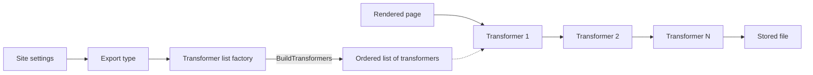

A transformer changes the text of a generated page before xStatic saves it, for example to rewrite URLs or strip out a form. This page is for developers: it covers the `ITransformer` interface, the transformers that ship with xStatic, the transformer list factories that decide which ones run, and a worked example you can drop into your own Umbraco project.

## At a glance

| You want to... | You write... |
|----------------|--------------|
| Change the HTML or JSON of every generated page | A class that implements `ITransformer` |
| Choose which transformers run, and in what order | A class that implements `ITransformerListFactory` (or derives from `DefaultHtmlTransformerListFactory`) |
| Use your transformers on a site | Nothing to register, unless your factory has constructor parameters. Pick your factory in an [export type](Export-Types.md) |

## How transformers fit in

When a site is generated, [RebuildProcess.cs](../Source/XStaticCore/XStatic.Core/Generator/Processes/RebuildProcess.cs) asks the site's export type for its transformer list factory, calls `BuildTransformers` once and hands the resulting list to every page job. For each page, the generator downloads the rendered page, runs the transformers in order (each one receives the output of the one before) and then stores the result.



Things worth knowing before you write one:

- Transformers run on **pages only**. Media files, asset paths and the output of [post-generation actions](Post-Generation-Actions.md) don't pass through them.
- The transformer gets the page text and an `IUmbracoContext`. It is **not** told which page or URL it is working on, and it has no culture parameter.
- `ITransformer.Transform` is synchronous. There is no async version, so don't call `.Result` on slow work. Do any lookups once in your factory or constructor and keep `Transform` fast.
- If a transformer throws, that page is reported as an error in the generation results and the other pages carry on.
- The same instances are reused for every page in a run, so don't keep per-page state in fields.
- xStatic enumerates what `BuildTransformers` returns more than once (it checks for any item, then copies them all). Keep it cheap and free of side effects.
- The text can be empty. Return it unchanged in that case, as the built-in transformers do. (`null` text never reaches a transformer.)

## The ITransformer interface

[ITransformer.cs](../Source/XStaticCore/XStatic.Core/Generator/Transformers/ITransformer.cs):

```csharp
namespace XStatic.Core.Generator.Transformers
{
    public interface ITransformer
    {
        string Transform(string input, IUmbracoContext context);
    }
}
```

`IUmbracoContext` comes from `Umbraco.Cms.Core.Web`. The built-in `HostnameTransformer` uses it to read the hostnames configured in Umbraco (`context.Domains`), and `UmbracoContentUdiToJsonUrlTransformer` uses it to look up content (`context.Content`).

## Built-in transformers

All of these are in [Generator/Transformers](../Source/XStaticCore/XStatic.Core/Generator/Transformers).

| Transformer | What it does | In which default list |
|-------------|--------------|-----------------------|
| `CachedByTransformer` | Adds the comment `<!-- Cached by xStatic -->` just before `</body>` | `DefaultHtmlTransformerListFactory` (always) |
| `CroppedImageUrlTransformer` | Changes `/media/...` URLs that carry `width=` and `height=` for a configured crop so they point at the generated crop file. See [Image crops](Image-Crops.md) | `DefaultHtmlTransformerListFactory`, only when the site's **Image Crops** field isn't empty |
| `HostnameTransformer` | Replaces every hostname configured in Umbraco's **Cultures and Hostnames** with the site's **Target Hostname** (plain string replace) | `DefaultHtmlTransformerListFactory`, only when **Target Hostname** isn't empty |
| `UmbracoContentUdiToJsonUrlTransformer` | Replaces `umb://document/<guid>` references (the guid is 32 hex characters, no dashes) with the content's URL plus `.json` | `DefaultJsonTransformerListFactory` (always) |
| `CachedTimeTransformer` | Like `CachedByTransformer`, but the comment includes the date and time | Neither. It is available to use in your own list |

The HTML list runs them in the order shown: cached-by comment, then crops, then hostname.

`HostnameTransformer` only changes anything if the site has hostnames set up in Umbraco. See [Sites](Sites.md) for the **Target Hostname** field.

## Transformer list factories

A transformer list factory is the class that builds the list for a site. The interface is in [ITransformerListFactory.cs](../Source/XStaticCore/XStatic.Core/Generator/Transformers/ITransformerListFactory.cs):

```csharp
public interface ITransformerListFactory
{
    IEnumerable<ITransformer> BuildTransformers(ISiteConfig siteConfig);
}
```

`ISiteConfig` is the site being generated, so the factory can add transformers based on its settings (`TargetHostname`, `ImageCrops`, `Cultures`, `AutoPublish` and so on). The order you return is the order they run.

xStatic ships two factories:

- [DefaultHtmlTransformerListFactory.cs](../Source/XStaticCore/XStatic.Core/Generator/Transformers/DefaultHtmlTransformerListFactory.cs) is used by the built-in **HTML Website** export type. `BuildTransformers` is `virtual`, so you can derive from it and add to its list.
- [DefaultJsonTransformerListFactory.cs](../Source/XStaticCore/XStatic.Core/Generator/Transformers/DefaultJsonTransformerListFactory.cs) is for JSON export types. See [JSON export](JSON-Export.md).

If an export type has no factory set, xStatic falls back to `DefaultHtmlTransformerListFactory`.

## Example: switch off forms on a read-only copy

This is the idea behind the `FormDisabledTransformer` in the [Umbraco 15 static failover video](https://www.youtube.com/watch?v=B2poMuqLeW8): a static copy of the site can't process form posts, so replace each form with a notice. See [Static failover site](Static-Failover-Site.md) for the full recipe.

The transformer replaces every `<form>...</form>` block with a short paragraph. The factory keeps everything the default HTML list does and adds the new transformer on the end.

```csharp
using System.Collections.Generic;
using System.Linq;
using System.Text.RegularExpressions;
using Umbraco.Cms.Core.Web;
using XStatic.Core.Generator;
using XStatic.Core.Generator.Transformers;

namespace MySite.XStaticExtensions
{
    public class FormDisabledTransformer : ITransformer
    {
        private static readonly Regex FormRegex =
            new(@"<form\b[^>]*>.*?</form>", RegexOptions.Singleline | RegexOptions.IgnoreCase);

        private readonly string _notice;

        public FormDisabledTransformer(string notice)
        {
            _notice = notice;
        }

        public string Transform(string input, IUmbracoContext context)
        {
            if (string.IsNullOrEmpty(input))
            {
                return input;
            }

            var notice = $"<p class=\"form-disabled-notice\">{_notice}</p>";

            return FormRegex.Replace(input, notice);
        }
    }

    public class FailoverHtmlTransformerListFactory : DefaultHtmlTransformerListFactory
    {
        public override IEnumerable<ITransformer> BuildTransformers(ISiteConfig siteConfig)
        {
            return base.BuildTransformers(siteConfig)
                .Append(new FormDisabledTransformer("Forms are switched off while the site is in read-only mode."));
        }
    }
}
```

That's all the code. Build the project, start the site and the factory is ready to choose. The regular expression is deliberately simple: it doesn't cope with a `<form>` nested inside another `<form>` (which isn't valid HTML anyway).

### Use it in an export type

1. Open the **xStatic** section and go to **Export Types**.
2. Create a new export type, or edit an existing one.
3. Set **Transformer Factory \*** to `FailoverHtmlTransformerListFactory`. The dropdown shows the class name, so give your factory a name that is easy to tell apart.
4. Leave **Generator \*** as `StaticHtmlSiteGenerator` and **File Name Generator \*** as `EverythingIsIndexHtmlFileNameGenerator`, then save.
5. Select the export type in the site's settings and generate the site again.

The **Config** dashboard in the xStatic section lists every discovered factory under **Transformer List Factories**, which is a quick way to check that yours was found. [Export types](Export-Types.md) explains the rest of the export type fields.

## Registration: discovery and constructor dependencies

You normally don't register anything. Understanding how xStatic finds and creates your factory tells you when you do.

**Discovery.** [TransformerList.cs](../Source/XStaticCore/XStatic.Core/Generator/Transformers/TransformerList.cs) scans every assembly loaded in the app for non-abstract classes that implement `ITransformerListFactory`, and the **Transformer Factory** dropdown is built from that. Your class only needs to be in an assembly the site references. Individual `ITransformer` classes aren't discovered or listed: they only run if a factory returns them.

**Creation.** The export type stores the factory's assembly-qualified type name. When a site is generated, [DatabaseExportTypeService.cs](../Source/XStaticCore/XStatic.Core/Generator/ExportTypes/DatabaseExportTypeService.cs) resolves it in two steps:

1. It asks the dependency injection container for that exact type.
2. If the container doesn't have it, it calls `Activator.CreateInstance`, which needs a **public parameterless constructor**.

So:

| Your factory has... | Do this |
|---------------------|---------|
| No constructor parameters | Nothing. It is created for you |
| Constructor parameters (a service, `IConfiguration`, `IOptions<T>`) | Register the factory class in the container, as in the next example |

Dependencies are injected into the *factory*. The transformers it returns are plain objects you create with `new`, so pass them what they need from the factory.

### Example: a factory with a constructor dependency

This second example rewrites root-relative links so the static site works when it is served from a subpath such as `https://example.com/docs/`. The subpath comes from `appsettings.json`, so the factory needs `IConfiguration` and has to be registered.

```csharp
using System.Collections.Generic;
using System.Text.RegularExpressions;
using Microsoft.Extensions.Configuration;
using Microsoft.Extensions.DependencyInjection;
using Umbraco.Cms.Core.Composing;
using Umbraco.Cms.Core.DependencyInjection;
using Umbraco.Cms.Core.Web;
using XStatic.Core.Generator;
using XStatic.Core.Generator.Transformers;

namespace MySite.XStaticExtensions
{
    public class SubpathTransformer : ITransformer
    {
        // Matches href="/", src="/" and action="/" but not protocol-relative URLs ("//cdn...").
        private static readonly Regex RootRelative =
            new("""(?<attr>\b(?:href|src|action)=")/(?!/)""", RegexOptions.IgnoreCase);

        private readonly string _subpath;

        public SubpathTransformer(string subpath)
        {
            _subpath = "/" + subpath.Trim('/') + "/";
        }

        public string Transform(string input, IUmbracoContext context)
        {
            if (string.IsNullOrEmpty(input))
            {
                return input;
            }

            return RootRelative.Replace(input, m => m.Groups["attr"].Value + _subpath);
        }
    }

    public class SubpathHtmlTransformerListFactory : ITransformerListFactory
    {
        private readonly IConfiguration _configuration;

        public SubpathHtmlTransformerListFactory(IConfiguration configuration)
        {
            _configuration = configuration;
        }

        public IEnumerable<ITransformer> BuildTransformers(ISiteConfig siteConfig)
        {
            yield return new CachedByTransformer();

            var subpath = _configuration["MySite:StaticSubpath"];

            if (!string.IsNullOrWhiteSpace(subpath))
            {
                yield return new SubpathTransformer(subpath);
            }
        }
    }

    public class MySiteComposer : IComposer
    {
        public void Compose(IUmbracoBuilder builder)
        {
            builder.Services.AddTransient<SubpathHtmlTransformerListFactory>();
        }
    }
}
```

With this in `appsettings.json`:

```json
{
  "MySite": {
    "StaticSubpath": "docs"
  }
}
```

`href="/about/"` becomes `href="/docs/about/"`. The sample only matches double-quoted attributes. Extend the pattern if your templates use single quotes, `srcset` or CSS `url(...)`.

Umbraco runs every `IComposer` it finds at start-up, so the `MySiteComposer` needs no further wiring. If you already register services in `Program.cs`, put the `AddTransient` line there instead.

## Troubleshooting

- **The factory isn't in the dropdown.** Restart the site after adding it, and check it is a public, non-abstract class that implements `ITransformerListFactory`. It must be in an assembly the site loads. The **Config** dashboard shows what was found.
- **Generation fails with an error about a missing constructor.** Your factory has constructor parameters but isn't registered. Add `builder.Services.AddTransient<YourFactory>()`.
- **Generation fails after you renamed or deleted a factory.** The export type still stores the old type name. Edit the export type and choose the new factory before generating.
- **Nothing changed in the output.** Check your site uses the export type you edited, and that the transformer's match really appears in the downloaded page. Look at the page source as xStatic sees it, not as your browser shows it after JavaScript runs.

## Next steps

- [Export types](Export-Types.md): where a transformer factory is chosen.
- [Writing a generator](Writing-a-Generator.md): the component that downloads the page and calls the transformers.
- [Architecture](Architecture.md): the whole pipeline, and how components are discovered.
- [Extending xStatic](Extending-xStatic.md): overview of every extension point, and manual registration.
- [Image crops](Image-Crops.md) and [Sites](Sites.md): the settings the default HTML list reads.
